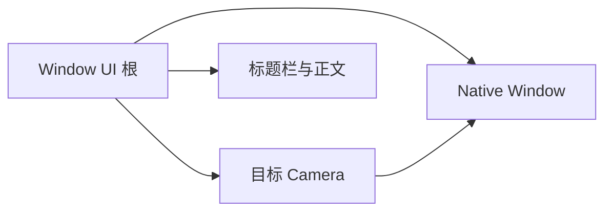
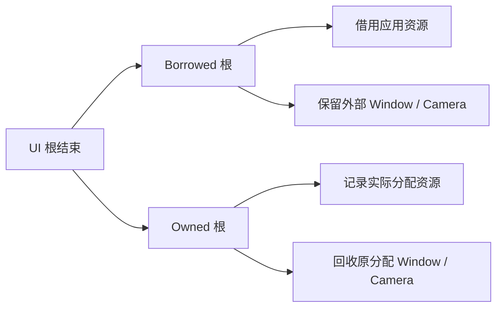
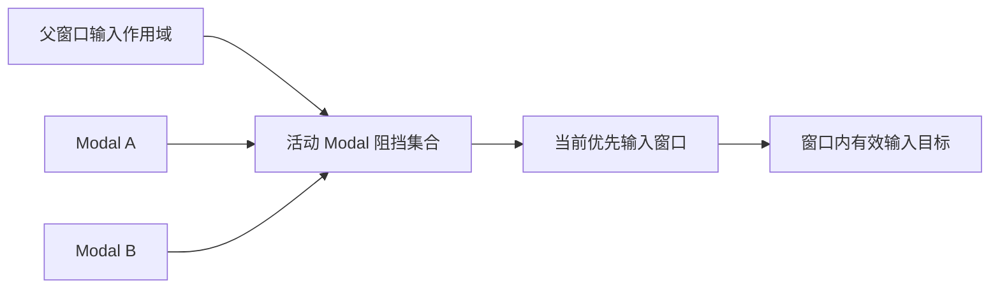

# Window 核心设计

Window 把原生窗口、渲染目标和 UI 外壳建立为明确绑定，而不是把它们当作可以互相推断的同一个实体。资源是否由控件创建、输入属于哪个窗口、关闭后谁负责回收，都由这条绑定关系决定。

## 先绑定原生资源，再提供窗口外壳

原生 Window 负责操作系统窗口，相机负责对应渲染目标，Window UI 根承载标题栏和正文。三者角色不同，一组有效绑定只对应一个界面。

自绘外壳需要原生透明配置和匹配的呈现初始化。透明不只是给 UI 背景设置 Alpha；如果底层交换链的合成方式不同，UI 结构正确也无法得到正确窗口画面。

## 在绑定之上区分资源所有权

Borrowed 绑定已有 Window / Camera，Owned 创建专属资源。两者展示能力相同，回收责任不同。

回收依据原分配身份，而不是根据后来可能损坏的绑定猜测所有权。一个失效根不能因此删除另一个窗口的相机。

## 让跨窗口输入仍有明确作用域

指针、Keyboard 和 IME 首先属于原生窗口，再解析到该窗口的有效 UI 输入目标。Window 不把全部键盘消息作为一个全局流消费，以免一个窗口处理另一个窗口的编辑输入。

初始焦点通过显式候选和输入目标映射确定。TextField 的行为根和真正 Editor 可以不同，焦点因此不能只停留在外壳 Entity。显式清空焦点也是应用意图，不应被自动恢复逻辑覆盖。

## 用模态关系临时收窄输入范围

Modal Child 不通过普通 UI 父子层级跨原生窗口继承 Disabled，而是由窗口机制维护父子作用域和阻挡关系。多个子窗口共同阻挡同一父窗口时，单个关闭只释放自己的贡献。

同层最新与嵌套最内层规则决定当前作用域。关闭后恢复仍有效的原焦点，但不清除应用自己的禁用请求。

标题和颜色则始终是绑定状态的投影：标题来自 Native Window，外壳样式只管理自己的部件。正文业务内容不因为窗口获得焦点、换主题或关闭一个 Modal 而重新建立。
