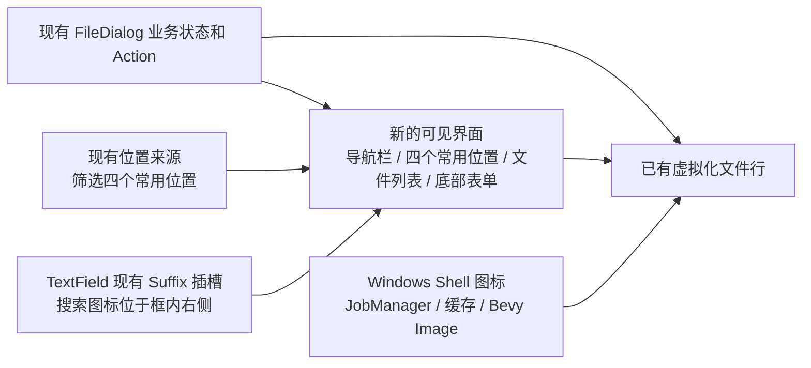

# FileDialog UI 收官改造：整体设计

本次改造保留 FileDialog 现有的文件选择业务能力和 Windows 原生窗口承载方式，只改变使用者看到的操作界面与文件图标表现。设计由两个可以分别交付的增量组成：一是收敛可见布局与导航信息，二是让文件列表的图标来自当前 Windows 的文件关联，而不再由两枚通用图标代替所有文件。

上图区分的是职责，不是重新设计业务流程。文件导航、选择、过滤、排序、隐藏文件配置、固定目录、新建目录等原有业务能力仍由现有状态与 Action 承担。界面上暂时没有入口的功能不被删除，也不额外增加右键菜单或新操作入口。文件列表继续保持详细信息视图、虚拟化滚动与选择逻辑；只替换其图标来源。四个常用位置由现有来源提供，仅改变侧栏投影，不新增文件选择业务；搜索图标直接复用 TextField 的 Suffix 插槽，Windows 文件图标则使用现有 Job 管理边界与 Bevy 图像资源。

两个增量的唯一实施顺序是先完成可见布局与导航，再接入 Windows Shell 文件图标。它们没有新的业务层依赖；这样安排只是先确定文件行与侧边栏的最终视觉容器，再接入图标呈现，并能分别验收外观与异步图标正确性。

## 实施方案

1. [收敛 FileDialog 布局与 Windows 11 风格导航](01-file-dialog-layout.md)
2. [为文件列表接入 Windows Shell 原生图标](02-windows-shell-icons.md)
