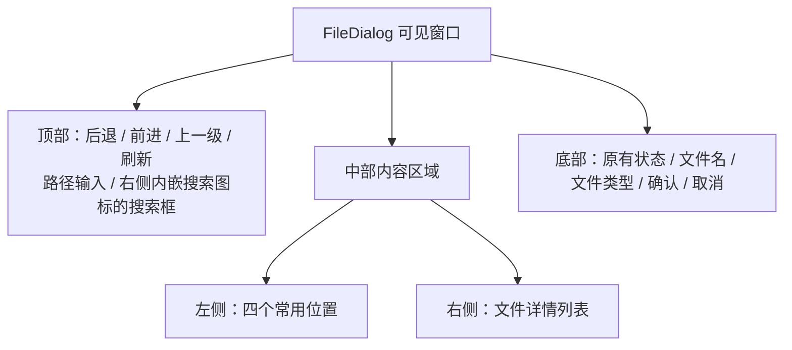

# 收敛 FileDialog 布局与 Windows 11 风格导航

FileDialog 保留现有的 Windows 文件选择对话框式骨架：顶部路径导航、左侧常用位置、右侧文件详情列表以及底部文件名、类型和确认操作。此次调整不是重做视觉主题或业务模型，而是把过于分散的操作集中到已有必要区域，减少工具栏占用，并让常用导航更接近 Windows 11 原生文件选择器的习惯。

## 可见导航与工具栏

顶部保留四个现有导航动作：后退、前进、上一级目录、刷新。替换它们的图形资源，让轮廓、尺寸与 Windows 11 的 Fluent 风格统一；可使用微软 Fluent UI System Icons 的 Regular 资源作为视觉来源，保留现有 Widgetry 按钮交互、启用状态、提示与动作映射。不把原生系统工具栏引入 Widgetry，也不借换图标修改导航行为。

路径输入框保留原有显示和编辑方式。搜索框继续放在同一排，不改变搜索输入的业务过程；在**输入框内部右侧**增加一个搜索图标作为视觉提示，不在输入框外新增搜索按钮，也不让图标成为新的操作触发点。图标应与输入文字保持间距，避免长搜索词遮盖图标。焦点、键盘输入、Tab 次序和输入事件仍由现有 TextField 负责。

**直接复用 TextField 已提供的组合插槽。** 现在 `WidgetryTextField` 的 `children` 会放入输入框 Frame，`WidgetryTextFieldSuffix` 会排在编辑区域右侧；利用这一能力放置不参与 Picking、不拥有 Tab stop 的搜索装饰图标，无需在 TextField 外覆盖一层图片、手动计算输入区右内边距，也无需为这次改造修改 TextField 的基础结构。`crates/file_dialog/src/style.rs::editor_scene` 当前同时用于 Path、Search、Filename 和 Folder；应仅为 Search 实例提供后缀，避免所有编辑框都出现搜索图标。需要新增静态搜索图标资源时继续遵循现有 `BuiltinIcon` / `WidgetryIcon` 的内置 SVG 路径。TextField 的 root 上原有 `PartKind::Search`、`TabIndex`、样式 Owner 与文本读写接口维持不变，槽位子实体不接管输入。

移除原界面第二排的常驻操作区，具体包括 `Pin folder`、`New folder`、排序下拉框、`Hidden` 和 `System` 复选框。原有的 Pin / Unpin、NewFolder、Sort、ShowHidden、ShowSystem 业务 Action、保存的数据与必要的内部支持代码保留，但暂时不为它们增加右键菜单、替代按钮或别的入口。此决定意味着从当前可见界面无法直接发起这些动作，是有意接受的界面取舍，不应误写成这些业务能力已删除。

从 `shell_scene` 移除常驻控件时，要检查 `controls.rs` 中与其关联的控件同步、部件登记、颜色归属和事件绑定。控制模型可继续供业务侧使用，但不能留下依赖已不存在实体的必需路径，也不能误删新建文件夹的内部动作和控制逻辑。即使外部代码或现有状态已设置排序、显示隐藏项、固定目录等信息，重建 UI 也不能擅自重置这些状态。

## 左侧常用位置和分隔关系

左侧导航仅展示四个常用位置，顺序为：

- Home
- Desktop
- Documents
- Downloads

不再显示 `Quick access`、`This PC`、`Pinned` 等分组标题，不在侧栏枚举 `C:`、`D:` 等磁盘，也不展示固定目录列表或图钉标记。侧栏可以借鉴 Windows 11 的行高、缩进、悬停与选中反馈，但无需复制资源管理器完整导航树。四项继续使用现有位置来源与 `Navigate(Path)`，从有效的系统位置提供路径，不凭显示标签推导或拼接磁盘路径；若某位置不可用，应保留现有错误处理边界而不是伪造可导航项。保留现有侧栏的可滚动容器和键盘、辅助功能语义。

当前 `crates/file_dialog/src/filesystem.rs::WidgetryFileDialogNativeFileSystem::locations()` 已提供这四种常用位置（在对应目录可用时），不必修改系统目录发现逻辑。默认后端仍可返回磁盘及其他位置，原有 `WidgetryFileDialogLocation` / Locations Job 以及这些数据的业务消费者保持不变；只是侧栏按固定顺序筛选、投影四项。自定义后端未提供某项时，不凭标签伪造路径，也不绕过后端自行解析本机目录。此处只更改可见信息组织，不重写位置来源。

在侧栏与右侧文件列表之间添加一条窄而低对比度的视觉分隔线，目标粗细约 1 逻辑像素。该分隔线仅用于区分区域，不参与 Picking，不获取焦点，也不响应鼠标拖动；**不使用仓库已有的 Splitter 控件**。固定侧栏宽度仍使用 `WidgetryFileDialogStyle::sidebar_width`，不新增可调宽度状态。注意分隔线不得挤压文件列表到不合理的宽度，也不得覆盖文件行图标。

## 文件详情表头和底部区域

继续使用现有 Name、Type、Modified、Size 详情列以及列表的选择、滚动和虚拟行复用方式。去掉可见的排序箭头，包括初始表头及后续状态同步阶段可能写回的 `↑` 或 `↓`。底层排序状态与实际条目顺序不受影响。当前 `view.rs` 的 `column_header` 和 `sync_header` 都可能生成表头文本，必须统一调整，防止同步时箭头重新出现。

修改时间列标题由 `Modified (UTC)` 改为 `Modified`，仅移除可见的 `(UTC)` 提示；**不改变现有时间数据的计算、时区转换或排序语义**。`sync_header` 的所有排序分支也不能重新写回 `(UTC)`。时间显示仍按当前行为输出；本项不额外改为本地时间。

底部原有的状态行、文件名输入或选择摘要、文件类型过滤及确认／取消按钮保持现状。窗口标题栏、主题字体、整体色彩主题、文件详情列的其他布局和已完成业务功能不纳入本次改造。底部表单看起来仍然比较宽，但这次不附加新的压缩布局方案。

## 与当前代码的关系

重点修改 FileDialog 自己的可见结构和表现，不向基础控件库引入仅为这次使用的通用需求：

- `crates/file_dialog/src/style.rs`：`shell_scene` 导航、工具区、两栏容器和可见结构；保留 `WidgetryFileDialogStyle` 现有公开设置与必要校验。
- `crates/file_dialog/src/controls.rs`：侧栏位置投影、原工具栏控件的可见性/构造关系以及依赖它们的状态协调；保持 Action 和导航机制。当前 `controls::sync` 仍遍历 `UiControl`、`PartKind::Sort/Hidden/System`；移除可见实体后按“部件可能不存在”处理，不能要求已删除的实体一定存在。`FolderPanel`、`OverwritePanel` 等内部面板及相关 Action 仍需保留。
- `crates/text_field/src/text_field.rs` / `composition.rs`：使用已存在的 `WidgetryTextFieldSuffix` 布局和焦点契约；原则上不需要改基础控件的实现。
- `crates/file_dialog/src/view.rs`：表头初始与同步文本。
- FileDialog 使用的图标资源：导航按钮、搜索装饰及侧栏所需的视觉资源，避免无意改变其他控件的图标。

这些路径是当前职责的定位，具体代码调整应遵循既有 BSN、样式归属、构建和输入生命周期。独立窗口与嵌入场景均沿用原构造与结果路由，不新建另一套 FileDialog。

## 验收重点

在实际 Windows 图形环境的 Gallery 中检查打开文件、打开多文件、选目录、选多个目录、保存文件等既有模式；同时检查模态与非模态窗口。视觉验收应确认工具栏常驻控件确实消失、顶部四枚导航图标统一、搜索图标位于**框内右侧**、左侧仅四种常用位置、没有图钉和磁盘分组、分隔线不可拖动、表头没有排序箭头及 `(UTC)`。四个入口需使用后端提供的真实位置路径，点击后能够正确导航；对于后端未提供的目录，不显示伪造的可点击位置。

通过 BRP/ECS 查询与真实交互确认，顶部导航、路径编辑、搜索输入、侧栏导航、文件类型过滤、文件选择、确认取消、键盘焦点、Tab 顺序和滚动未被破坏。专门验证搜索框 Suffix 图标不会遮挡文字、接受点击、进入 Tab 顺序或改变输入焦点；检查 TextField 组合构造及样式颜色同步后仍正确显示。原有排序等后台状态即使没有可见入口，也不能被 UI 重建或刷新意外复位。对初始渲染和状态同步后再次取图，检查被删除的箭头与 `(UTC)` 不会回来。窗口/主题、可见行复用、空列表和错误显示沿用已有契约；与改动直接相关的测试和 Gallery 断言同步更新，不因删除控件而保留错误的存在性断言。

## 范围保护

这项改造不改文件扫描、目录权限、筛选结果、异步 Session、存储偏好或用户选中结果的语义；不添加新右键菜单、替代固定按钮、树状侧栏或可拖动分割线。不借此重设整个 Widgetry 主题、字体、标题栏或底部表单布局。文件列表中根据 Windows 文件关联提供原生图标的工作归入后一份独立方案。
