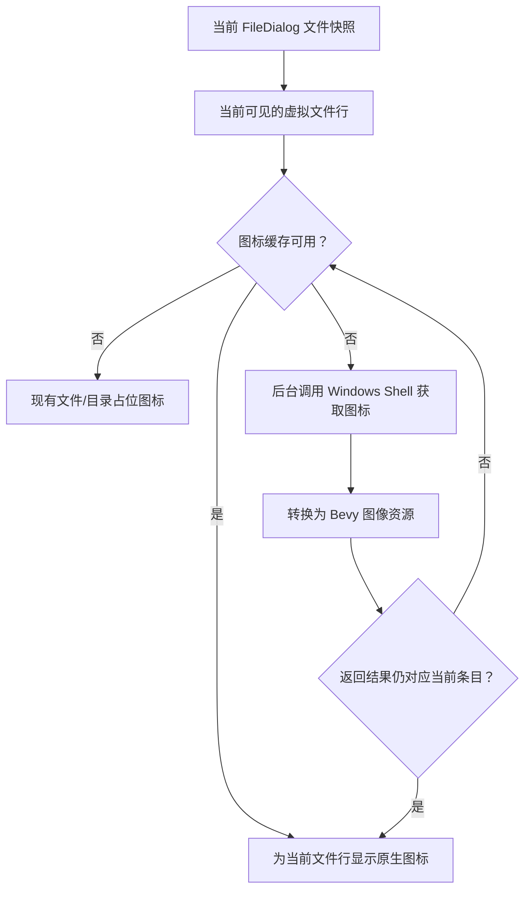

# 为文件列表接入 Windows Shell 原生图标

目前 FileDialog 的 `view.rs::row_content` 将所有目录映射到 `BuiltinIcon::FileDialogFolder`、所有其他条目映射到 `BuiltinIcon::FileDialogFile`。这样虽然轻量，但文件列表里的 `.txt`、`.pdf`、`.exe` 等文件都缺乏 Windows 文件资源管理器中由文件关联决定的视觉区别。新的图标呈现应使用运行这台电脑的 Windows Shell 所提供的系统图标，而不是把一套近似 Windows 11 的图片静态打包进去。

这次只改文件列表的图标来源。导航栏、搜索框等固定界面图标由前一份布局方案负责；文件路径、文件类型、选择、排序、过滤和后台读取的业务数据不因图标来源改变。

## 图标语义与来源

普通文件使用当前 Windows 文件关联中实际对应的系统图标，不按扩展名预先固定为一张 Widgetry 图片；例如 `.pdf` 的图标会受关联的 PDF 应用影响。目录使用 Windows 系统文件夹图标。对于 `.exe`、`.ico`、`.lnk` 等可能有文件级专属图标的类型，允许按文件本身获取，而不强制只采用该扩展名的公共图标。

图标获取使用 Windows Shell 提供的接口，例如 `SHGetFileInfoW` 或适用的 Shell Item 接口。具体选择应服从所需的系统关联行为、图标精度、权限和线程模型，不能假定所有路径都能只按扩展名获得完整图标；也不能因引入原生接口而侵入文件选择业务层。接口选择和提取结果向 Bevy `Image`/UI 纹理的转换属于实现内部细节，最终呈现的仍是文件列表当前行的图标。当前 `bevy_widgetry_core::icon::WidgetryIcon` 以 SVG `AssetPath` 为输入，内置图标也走 SVG 栅格化路径，**不能直接拿来装载 Windows Shell 返回的位图**。原生图标应转换为 `Assets<Image>` 中的资源，由适当的 `ImageNode` 呈现；静态 `WidgetryIcon` 仍可承担等待时的占位图标。不要为了原生位图向 WidgetryIcon 塞入不属于它的 SVG 语义。

**不包含**图像、视频等文件内容的缩略图，不包含 OneDrive 等云同步状态覆盖标识，不提供资源管理器完整 Shell 扩展能力。特殊文件若无法获得原生图标，退回原有通用文件或文件夹图标，不因此让文件行或整个会话失败。

## 异步提取与缓存

图标提取不能在每个可见行构造、每次滚动或每一帧的 UI 更新中直接同步访问 Shell。应在文件列表可见项请求图标时先查缓存；缓存缺失时显示原有 `FileDialogFile` / `FileDialogFolder` 作为占位，并排入后台请求。图标就绪后，再通过适当的 ECS/资源更新机制让当前行显示结果；后台线程不直接修改 Bevy `World` 或 UI 实体。

缓存要区分可按文件类型共享的图标与依赖具体路径/文件的特殊图标，避免对每个同类文件重复执行相同的 Shell 查询，也避免将某个可执行文件的专属图标错误用于其他同扩展名文件。缓存和请求去重应与当前会话和可见行的实际需求相称；具体键设计、失效范围和资源容量应以图标来源和资源生命周期为准，不擅自扩大成通用文件预览缓存。

**后台工作纳入现有 Job 管理边界。** FileDialog 目前的目录查询、位置查询、投影、选择等后台任务已由 `bevy_widgetry_job::JobManager` 管理，并在 `crates/file_dialog/src/runtime.rs` 中按会话协调。新增的 Shell 图标查询不应另起一套不受管理的线程生命周期；使用 JobManager 的提交、结果接收、取消、失败记录和关闭协调能力，并结合 Shell API 的实际线程要求决定如何组织任务。图标请求应合并或复用工作单元，避免对每个可见行都调用一次 `spawn_thread`、创建独立 OS 线程，也不能把这些同步系统调用放回主线程。该图标工作是展示所需的非关键结果，不进入目录、选择、校验或持久化 Job 的业务返回类型。

Windows 原生图标句柄与图像资源的生命周期需要明确收束：成功、失败、取消和窗口关闭都不应泄漏 Shell 图标句柄。调用线程所需的 COM/Windows 初始化规则必须与所选接口匹配；若选择需要线程关联初始化的 Shell 接口，初始化、取图、释放必须遵守同一线程的约束，不能把图标句柄跨线程直接交给 ECS。资源转换应保持图像像素、尺寸与透明度正确。受限路径、关联缺失、网络盘和系统 API 失败时，UI 应可继续浏览。

取图失败与 FileDialog 业务失败是不同层级：已知的无关联、不可提取等结果使用占位图标并按现有诊断规则记录必要信息；真实的提交失败、Job 失败、资源更新异常不能悄悄吞掉，应沿用当前 `JobFailure` / Widgetry 诊断与 BevyError 的错误归属规则，同时保证图标错误不使文件选择结果失效。缓存项要能表达“加载中／成功／不可用”差异，避免失败项在每一帧或每次滚动中无限重试。

## 虚拟化文件行的正确归属

当前列表通过 `FileDialogEntryViewport` 复用可见行实体；`EntryRow` 已带有文件条目 `id`、会话 `token`、索引及快照身份。原生图标的异步结果必须依据所请求的文件身份重新确认是否适用于当前行，不能只凭“当初持有的 UI Entity”回写。尤其在目录切换、搜索过滤、排序切换、取消、Session 更新和快速滚动之后，旧请求可能晚于新行内容完成。

正确的渲染规则是：每次行被绑定到新的文件条目，旧文件的图标不得短暂保留；需要的新图标尚未准备好时立即显示对应占位图标。异步结果到达时，若该物理行已被复用，旧结果至多进入正确的图标缓存，不应覆盖新文件行；缓存命中也必须遵守当前文件身份。不能为了等图标而阻塞目录快照、行创建、滚动或确认操作。

显示尺寸与现有 `row_content` 的约 16px 图标位一致，除为了正确绘制图像资源所需的最小布局变化外，不修改文件行高度、列宽、选中反馈、双击、输入或虚拟化窗口大小。图标应遵从资源透明度，不额外绘制第二套背景。

## 直接影响的实现位置

- `crates/file_dialog/src/view.rs` 的 `row_content`、可见行协调与实体复用处：按当前文件身份请求图标、显示占位与接收缓存结果。
- FileDialog 自身必要的 Windows Shell 图标服务/缓存模块：隔离 OS 查询、去重与资源转换；服务不应把文件图标提取变成通用文件选择业务 API。
- `crates/file_dialog/src/runtime.rs` 与现有 `bevy_widgetry_job`：按当前 Session/Job 生命周期接入图标请求、完成、失败和清理；避免建立额外的无主后台 Worker。
- `crates/file_dialog/Cargo.toml` 及相关 Windows API 绑定：如需新依赖，按 Workspace 已有的 Windows 64 位目标和依赖约定接入，保持 FileDialog 的实现边界。
- 现有 Bevy 图像/资产呈现能力：通过 `Assets<Image>` 和 `ImageNode` 将原生图标像素显示在 UI 中，并随行复用、会话结束清理不再需要的关联；旧的 `WidgetryIcon` 仍用于默认占位。
- FileDialog 的 Gallery 场景和已有相关测试：验证真实 Windows 图标呈现、异常回退与虚拟行更新。

上述位置仅确定职责边界；确切模块组织和 Shell API 选型以符合现有 Bevy 0.20 / Windows 64 位 MSVC / DX12 技术环境为准，不额外扩大跨平台适配范围。

## 验收重点

在实际 Windows 桌面环境中准备包含目录、普通文本文件、已关联的 PDF 或其他应用文档、可执行文件、`.ico` 和可用快捷方式的测试目录。确认显示效果随当前系统文件关联，与该机器 Windows 文件资源管理器在相同类型下的图标表现相符；不要求内容缩略图或云同步覆盖标记。缺失关联或取图失败时仍显示合理的默认占位，不妨碍文件选择。

通过快速滚动、反复换目录、搜索过滤、排序状态切换、会话结束/重开、窗口取消以及文件行实体复用，观察不会出现旧文件图标贴到新文件上的情况。还需模拟图片完成后物理行已被复用的情况，确认只有缓存接收结果，旧 Entity 不被回写；图标 Job 在会话/窗口结束时能正确停用或回收。用测试或诊断确认缓存命中可避免对同类文件重复提取；实际 GUI 体验验证首次加载和持续滚动不因 Shell 查询出现明显卡顿。检查图标句柄与 Bevy 资源不会随持续浏览无界累积，窗口销毁后待完成的异步结果不会写入失效实体。验证同类型缓存去重、失败缓存抑制重复请求，且 Shell 调用不会为每个文件行创建独立 OS 线程。

继续检查原有文件选择、确认、取消、键盘焦点、异步目录加载和文件列表滚动行为；图标加载与这些业务流程彼此独立。测试数据可包括关联缺失和 Shell 失败路径，保证不可用时回退，而不是让 FileDialog 直接失败。

## 范围保护

本方案不是缩略图系统、文件内容解析器或跨平台桌面集成层。不得让图标缓存改变文件身份判定、业务快照或 Session 所有权，不把文件图标数据写入文件选择结果，不改变文件选择 API。不能为追求与 Windows 资源管理器外观完全一致而增加云状态角标、文件预览面板或其他未讨论的功能。
