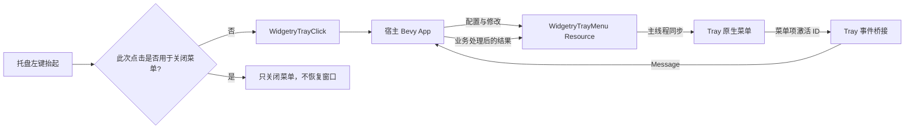

# 托盘右键菜单：整体设计

Tray 保留现有的独立原生图标与左键点击事件，同时增加一个由宿主配置的 Windows 原生右键菜单。控件库只提供菜单结构、运行时状态同步和点击通知，不解释菜单项的业务含义；Gallery 负责把「恢复窗口」「退出程序」以及功能演示项接到已有宿主行为。

整体采用单向状态控制：Resource 是菜单期望状态的唯一来源，原生菜单是显示投影。用户选择菜单项仅通知宿主；复选项的最终勾选状态由宿主决定，不能把原生菜单的即时变化视作业务操作已成功。原生事件仍通过已存在的 winit 唤醒与 ECS 消息路径处理，菜单操作不直接运行宿主回调。

当前插件按每个 Bevy App 一个 Tray 实例管理，无须为多个图标另设公开实例管理 API。不过底层托盘点击与菜单事件处理器是进程级入口，菜单项路由必须按实例或内部唯一标识隔离，避免把别的图标、已销毁菜单项的点击误交给本实例。

实施顺序按独立交付能力安排：先能创建与响应菜单，再能动态维护菜单状态，最后让 Gallery 展示和使用完整能力。验证与文档更新分别随相应功能一起完成。

1. [创建原生右键菜单并转发菜单点击](01-创建原生右键菜单并转发菜单点击.md)
2. [通过 Resource 动态同步菜单结构和状态](02-通过Resource动态同步菜单结构和状态.md)
3. [在 Gallery 接入右键菜单与功能演示](03-在Gallery接入右键菜单与功能演示.md)

最终的应用行为是：未展开菜单时，左键继续恢复托盘隐藏会话，右键展开菜单。**右键菜单展开后，左键再点击托盘图标，只关闭菜单且不恢复窗口；菜单关闭后再进行一次新的左键点击，才恢复窗口。** 点击其他位置或按 Escape 关闭菜单后，下一次独立左键点击仍应正常恢复。菜单「恢复窗口」复用恢复逻辑，「退出程序」直接走现有正常退出流程，不弹出主窗口右上角 × 的退出/隐藏选择窗口。菜单关闭手势和新一轮左键手势必须区分，不能简单地在所有菜单关闭后吞掉下一次点击。
