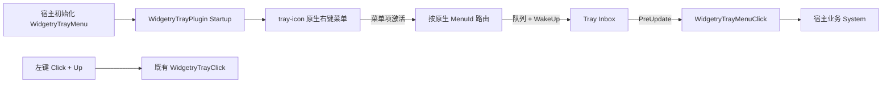
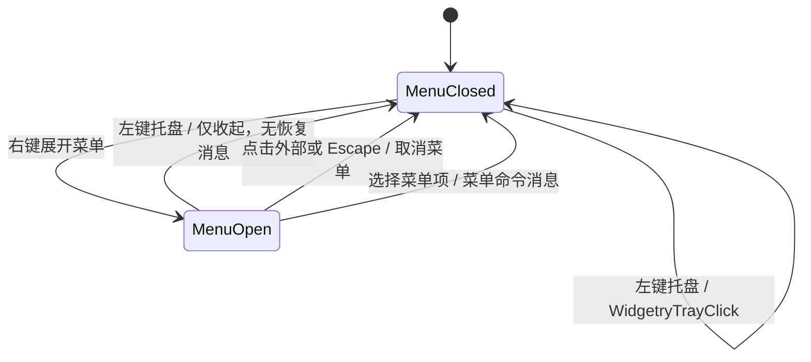

# 创建原生右键菜单并转发菜单点击

让 `bevy_widgetry_tray` 在现有托盘图标上创建可选的 Windows 原生右键菜单，并把菜单项激活转换成宿主可读取的 Bevy `Message`。此增量提供可用的静态菜单与事件路径，不要求此时完成运行时修改；运行时增删和状态同步由下一增量承接。

## 菜单数据与公开契约

采用 Widgetry 自己的 `WidgetryTrayMenu` 描述菜单，不把 `tray-icon::menu` / `muda` 类型泄露到公开 API。宿主在初始化时配置普通菜单项、分隔线与可嵌套的子菜单；可交互项使用稳定的宿主菜单项 ID，激活时通过新的消息（例如 `WidgetryTrayMenuClick { id }`）原样交还。

`WidgetryTrayMenu` 使用 Bevy `Resource` 身份保存宿主期望的菜单树。是否存在菜单由宿主显式配置决定；没有配置菜单的现有 `WidgetryTrayPlugin::new(ico, tooltip)` 使用方式应继续只创建图标、转发左键点击，不出现空白右键菜单，也不要求旧宿主额外配置 Resource。菜单数据公开接口支持明确顺序，并为后续加入 `enabled`、`checked` 等属性保留清晰的扩展位置。

菜单项 ID 表示业务动作，不等于 Windows 命令整数或 `muda::MenuId`。创建原生项时在内部建立映射；相同菜单树内的可交互 ID 不能产生歧义。子菜单与分隔线本身不发普通点击消息。公开消息类型与既有 `WidgetryTrayClick` 相互独立，方便宿主分别处理「左键恢复」和「右键菜单命令」。

## 原生图标创建与事件转发

在 `crates/tray/src/plugin.rs` 的主线程 Startup 中，依据 Resource 构造菜单并绑定到 `TrayIconBuilder`。使用现有 `NonSend` 所有者持有原生托盘图标、菜单对象以及事件桥接所需生命周期资源；不把非 `Send` 原生对象存入普通 `Resource` 或全局回调。

`tray-icon 0.26.1` 提供 `with_menu`，其菜单模块重导出 `muda`。**必须显式将 `with_menu_on_left_click(false)` 用在有菜单的图标上**：该库的默认值是 `true`，不关闭就会让新增右键菜单破坏原有左键恢复操作。右键使用原生菜单展示能力，不用 Bevy UI 绘制模拟弹窗。现有 `TrayIconEvent::Click + MouseButton::Left + MouseButtonState::Up` 仍是正常左键通知的基础条件，右键与双击不误报左键恢复；但菜单展开期间用于关闭菜单的左键手势必须从正常左键通知中排除，详见下节。

菜单选择通过 `MenuEvent` 的进程级事件入口到达 Tray bridge。沿用现有点击通道的原则：回调只做轻量识别、排队和 `EventLoopProxyWrapper` 的 `WinitUserEvent::WakeUp`，不在回调中访问 Bevy World 或调用宿主逻辑；在 `PreUpdate` 把收件箱事件转为 Bevy Message。使用独立的菜单 ID 路由表或等效的内部标识，将菜单事件归属到正确的实例；注意 `MenuEvent` 不包含 tray 图标 ID，不能照搬托盘 Click 的按 `TrayIconId` 查找方式。

只建立一次进程级 MenuEvent handler，避免重复安装导致先前路由失效。和现有 TrayIconEvent handler 一样，这意味着插件需要文档化对相关进程级处理入口的占用。实例销毁后清理其菜单项映射；已过期、别的实例或不可识别的原生 ID 静默丢弃，不能重复投递或调用已经释放的收件箱。注册与销毁顺序保持「撤销路由，再释放原生对象」的生命周期约束。

## 菜单展开时再次左键点击托盘的交互契约

同一个托盘图标需要区分“正常左键激活”和“关闭已展开的右键菜单”两个动作。具体结果如下：

1. 菜单未展开时，左键点击托盘图标仍产生一次 `WidgetryTrayClick`，保留现有恢复语义。
2. 右键打开菜单后，**左键再点击托盘图标只收起菜单，不产生 `WidgetryTrayClick`，也不触发窗口恢复**。
3. 菜单收起后，再进行一次**新的**左键按下/抬起，才产生 `WidgetryTrayClick`。不得由于前一次菜单会话而额外吞掉这个新点击。
4. 点击菜单外部的其他位置或按 Escape 取消菜单，不产生恢复通知；取消后新的正常左键点击仍可恢复。通过菜单项激活产生的是相应菜单消息，而非顺带的左键恢复消息。

`with_menu_on_left_click(false)` **只保证左键不被配置为“弹出菜单”的触发方式**，不等于保证已展开菜单在被左键取消时不会收到原生 `Left + Up`。`tray-icon` 在 Windows 使用原生 `TrackPopupMenu`，系统可能消费关闭菜单的点击，也可能存在需要处理的原生事件先后顺序；因此不能仅凭这一构造选项宣称已经满足第二条。

Tray crate 应在原生菜单交互边界识别用于取消菜单的那次手势，并在转发 `WidgetryTrayClick` 之前抑制它；不要把该判断留给 Gallery，也不要通过固定延迟或简单的“菜单关闭后无条件丢弃下一次左键”实现，否则 Escape/菜单项选中后的一次新点击会被误吞。实现时先确认底层 Windows 事件的真实递送顺序与可获得的菜单生命周期信号，在可验证的原生交互边界上完成过滤；如果所用安全 API 不能可靠观察关闭手势，需要将这一点作为实现阻碍继续核实，不得以猜测的过滤规则代替验收。

## 诊断与验收

新增菜单创建、原生项插入及事件唤醒失败，沿用 `TrayFailure` / `TrayError` / `ErrorFrame` 的真实错误来源和 ECS 错误传播边界。既有 `ClickOverflow`、`Wake`、`RouteLock` 行为不得回退；菜单事件积压也不能阻塞原生回调线程。具体可用复用的有界收件箱机制或等效独立队列，但必须保留每次失败的诊断而不吞掉溢出或唤醒错误。

对应测试覆盖：无菜单旧调用路径；有菜单时能创建预期的普通项、分隔线与子菜单结构；仅可交互项发菜单消息且 ID 正确；重复点击、未知 ID、销毁后的迟到事件、注册/反注册不串到别的实例；点击回调唤醒、队列过载与错误来源；旧左键抬起在菜单未展开时正常转发，左键按下、右键与双击过滤不变。增加菜单会话测试：菜单打开后同一次左键取消手势即使产生原生 `Left + Up` 也不得转发；随后新的左键仍应转发；Escape 或点击其他位置取消菜单后，下一次新左键不能被误吞。需要在真实 Windows 通知区域人工确认右键菜单确实出现，以及“右键打开 → 左键托盘仅关闭 → 再左键托盘才触发恢复”的完整序列；无窗口显示时右键选择仍能唤醒 Bevy 桌面反应式事件循环。

此增量应同时扩展 `crates/tray/src/lib.rs` 的公开导出、`docs/crates/tray.md` 对原先「不提供菜单」的声明，以及 Tray 相关单元测试。不要将 Gallery 的具体业务动作嵌入 Tray crate。
