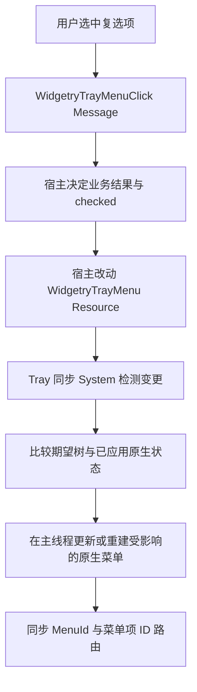

# 通过 Resource 动态同步菜单结构和状态

在已经可创建和响应原生菜单的基础上，让宿主修改 `WidgetryTrayMenu` Resource 就能改变原生菜单，覆盖文本、启用状态、复选状态、普通项/分隔线/子菜单的增删与必要的顺序变化。宿主不直接持有 `muda` 对象，也不通过 `Commands` 向 Tray 下达一系列原生操作；Resource 保存最终期望状态，Tray 负责把它投影到 Windows。

## 单一状态来源与宿主 API

`WidgetryTrayMenu` 是唯一的**期望状态**；原生菜单内部状态不得反向覆盖它。对外提供封装过的菜单树操作，能按稳定 ID 查询并修改普通项的文本、`enabled`、复选项的 `checked`，以及插入、删除、替换相关菜单节点；其中分隔线和子菜单的操作以树节点/父子关系表达，不把 `muda` 对象暴露到宿主。具体方法名由实现时按仓库 API 习惯命名，无须限定为 `set_text` 等演示写法。

对宿主来说，连续多次 Resource 修改属于最终状态更新：例如在一次 Update 中将同一项文字先改为「开始」再改为「停止」，无需将两个中间文字都逐次发给 Windows。Tray 可以借助 Bevy 资源变更检测和已应用的原生菜单快照，只同步实际不同的内容。新增和删除仍由宿主对数据树执行明确操作，但原生更新的执行权在 Tray 中，而不是让宿主直接操纵原生对象。

支持动态加入或清空整个菜单：如果初始没有菜单，后来出现非空资源内容，可通过原生 Tray 的菜单设置能力附加菜单；若宿主移除菜单，则恢复无右键菜单状态，保留原生托盘图标与左键恢复。菜单树中必须保持可交互 ID 唯一、可定位，不能因更改文本或位置而改变业务 ID。已删除项的原生路由须一并撤销，避免迟到点击执行错误动作。

## 同步时机与异常处理

原生菜单和 `TrayIcon` 都是 `!Send / !Sync`，同步 System 仍需在主线程通过 `NonSend` 所有者访问；期望资源可以正常作为 `Res` / `ResMut` 在宿主 ECS 中读写。同步阶段放在宿主当轮写入之后，并明确和当前的 `PreUpdate` 菜单消息消费以及 `Last` 退出清理建立执行顺序，避免菜单使用已释放的图标或把待同步状态误记为已应用。

原生菜单的文本、可用性、勾选状态等可就地更新；结构增删若需要，可利用底层 `muda` 的插入/移除能力，或重建受影响的原生菜单树。无论内部选择哪一种，都不能在结构替换窗口期将旧 `MenuId` 误认成新业务项，也不能因为原生对象被销毁而影响 Tray 图标的存活。资源同步失败时，保留 Resource 的期望状态，原生已应用快照只记录实际成功的修改；诊断保留原始错误来源和操作上下文，后续更新能够重新尝试把两者收敛。不得把「检测到 Resource 变更」直接当成「Windows 已成功应用」。

这种模式不意味着每帧重建菜单，或要求额外的计时轮询。当应用由已有点击回调、菜单事件或正常 ECS 工作唤醒时，使用常规 schedule 同步；若没有新一轮 Bevy 更新，也不承诺从外部任意线程修改数据会凭空触发原生同步。与既有 `WinitSettings::desktop_app()` 的反应式循环保持一致。

## 复选项的控制权

复选项也有稳定 ID、文本、启用状态和 `checked` 状态。点击时只发送菜单项激活消息，由宿主判断业务操作是否成功，再修改 Resource 中的 `checked`。如「静音」操作失败，Resource 仍是未勾选，原生菜单最终必须回到未勾选状态；不能在事件桥接里擅自把 Resource 改成已勾选。

底层原生复选项可能在用户点击时自行切换可见勾选状态，因此仅靠 `Resource::is_changed()` 不一定足够：即使宿主拒绝更新，Tray 也需在处理该激活事件后重新校准原生显示，确保最终以宿主的期望状态为准。需要特别覆盖「宿主接受」「宿主拒绝」「点击后 Resource 根本没变」三种情况。菜单点击消息仍只携带稳定 ID，不把原生即时勾选值当作已确认的业务状态。

## 验证与边界

测试用最小 Bevy App 验证 Resource 更新后的文本/可用性/勾选状态、插入和删除、子菜单内更新、稳定 ID、同帧多次修改以最终状态生效；验证无变化时避免不必要的重复原生操作，以及 Resource 修改失败/非法结构不会留下部分更新的错误路由。菜单刷新失败、原生创建错误继续按 Tray 诊断规则报告，原有 `WidgetryTrayClick` 和退出清理不受影响。

在真实 Windows 通知区域验证菜单打开后执行状态变更、复选项的自动切换校准、禁用项不可激活、运行时增删可见。修改 `docs/crates/tray.md` 描述 Resource API、变更同步、菜单消息与复选项宿主决策原则；不扩展到气泡通知、双击 API、动态图标、动态 Tooltip 或 Bevy UI 菜单绘制。
