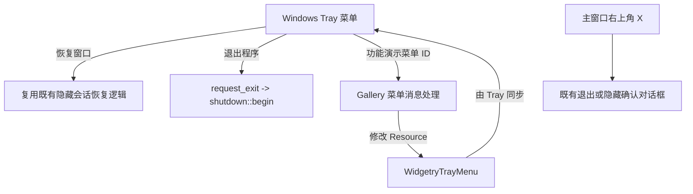

# 在 Gallery 接入右键菜单与功能演示

让 Gallery 实际消费 Tray 的新菜单 API，在原生右键菜单顶部提供可用的窗口恢复与退出动作，并以独立「功能演示」子菜单展示普通项、复选项、禁用状态、文本变化和运行时增删。展示不引入新的页面，也不把 Gallery 的操作策略写入 Tray 库。



## 对用户可见的菜单

菜单预期布局示意（实际文字纳入 Gallery 既有中英文国际化）：

```text
恢复窗口
──────────────
功能演示  >
    ☑ 复选测试
      禁用菜单项（初始不可点击）
      切换禁用项状态
      修改演示项文字
      添加动态菜单项
      删除动态菜单项
      [动态添加的项目：初始不存在]
──────────────
退出程序
```

主菜单保持简单，展示操作集中在「功能演示」子菜单。普通菜单点击发消息；复选测试由 Gallery 接收 ID 后按自身测试状态更新 Resource 的 `checked`，不是由 Tray 擅自决定；「切换禁用项状态」使初始不可点击项能够在运行时启用/恢复禁用；「修改演示项文字」展示文字更新。动态项初始不存在，添加后可见且可点击，删除后原生菜单与 ID 路由均消失；重复点击添加或删除不会产生重复 ID 或破坏菜单结构。需要展示动态项自身的点击消息可以由 Gallery 记录/输出日志，不扩展其他业务逻辑。

Gallery 创建菜单 Resource 的时机必须早于 Tray 在 Startup 读取配置；动态演示代码只修改这个 Resource，不直接操作原生 `muda` / `TrayIcon`。Gallery 本身有 `Language` Resource 和 `LocalizedText` 体系，菜单文案纳入 `gallery/src/i18n/key.rs`、`zh_cn.rs`、`en_us.rs`；当 Gallery 切换语言时，更新资源中的菜单文本，保持原生菜单与窗口文本语言一致。

## 恢复窗口与退出程序的差别

现有 `gallery/src/close.rs` 在 `restore_from_tray` 中通过 `WidgetryTrayClick` 消息恢复 `hidden_windows`，并在后续更新中恢复主窗口焦点。菜单「恢复窗口」必须复用同一个隐藏会话恢复行为，不另起一条简化路径；可将消息转化为共享恢复入口，或在同一宿主 handler 中统一处理，保持现有隐藏窗口范围、最小化请求与焦点时序语义。主窗口本来已显示时该菜单动作不应意外改变窗口布局。托盘图标左键恢复功能仍然可用，但其消息必须遵守 Tray crate 的菜单会话过滤契约：**菜单打开后左键点击托盘图标，只关闭菜单、不发送恢复消息；菜单关闭后下一次独立左键才恢复隐藏窗口**。Gallery 只消费 Tray 确认有效的 `WidgetryTrayClick`，不为此维护第二套菜单开闭状态。

菜单「退出程序」**不触发**主窗口 × 的 `WindowCloseRequested` 确认流程，也不弹「退出或隐藏」的二选一对话框。它直接调用 Gallery 现有 `request_exit(world)`，最终由 `shutdown::begin(world, AppExit::Success)` 负责正常退出与后台任务清理，而非立即强行杀死进程。即使 Gallery 的窗口已全部隐藏，或关闭确认框尚在，也不能进入隐藏托盘循环；现有 `GalleryTrayState::exiting` 状态与 `shutdown::prepare_windows` 的恢复/清理逻辑继续生效。

这里「直接退出」指直接发起**正常退出流程**，而不是跳过内部已有的任务收尾等待或超时处理界面。主窗口右上角 × 仍保留原本的退出/隐藏选择，不因新增 Tray 菜单而变更。

## Gallery 验证与直接影响

在 Gallery 的关闭/托盘模块接入菜单项 ID 的处理，保留旧 `WidgetryTrayClick` 的消息订阅与当前关窗对话框行为。针对宿主层至少验证：菜单恢复与左键恢复对相同隐藏会话产生同样结果；已经恢复、没有隐藏会话、部分窗口此前已隐藏、存在最小化请求等场景；菜单退出只调用正常关闭入口而不打开选择窗；重复菜单退出不会重复启动 shutdown；隐藏全部窗口时菜单依旧可操作；演示中复选和禁用状态、文本切换、动态项增删反映到 Resource。

在 Windows 实机通知区域做最终交互验收：菜单未打开时左键可恢复；**窗口隐藏时先右键弹菜单，再左键点击托盘图标，菜单关闭但窗口保持隐藏；再次独立左键点击托盘才恢复窗口**。还需验证菜单通过 Escape、点击其他位置、选择菜单项关闭后，下一次正常左键没有被误吞，且关闭菜单的点击不会造成隐藏窗口闪现或聚焦。窗口可见/隐藏时均能操作菜单；弹出子菜单，点击、禁用、勾选状态和动态新增/删除均有效；中英文切换后的文字正确；点击退出不会出现「退出还是隐藏」的二次确认，而是进入现有正常收尾并最终移除托盘图标。Headless 或 BRP 测试可辅助验证 ECS 行为，但不能替代原生菜单交互确认。

本增量只动 Gallery 所需的菜单装配、菜单消息处理、既有恢复/退出接口复用、国际化和相关测试，不增加托盘气泡、全局热键、新窗口或新的图库导航页。
