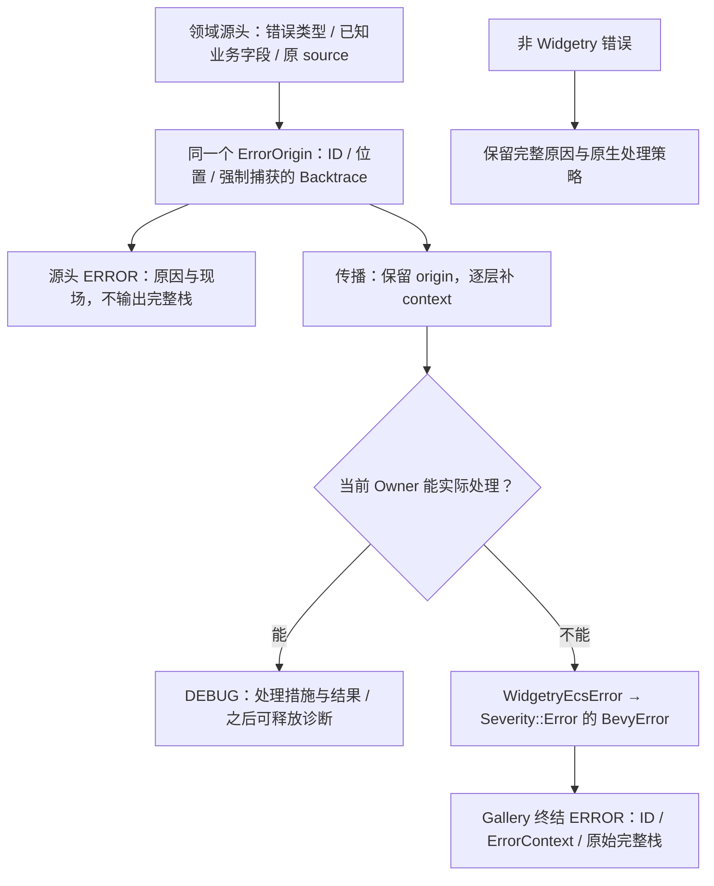
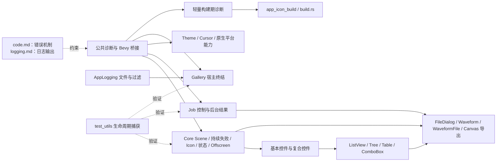

# Widgetry 错误体系的整体迁移

这次迁移不另建一套应用级异常框架。各 Crate 用领域类型表达失败，统一诊断载体保存现场；Bevy 要求的执行边界继续使用 BevyError，最终处理策略由宿主拥有。普通领域 API 可以破坏性更改，不为旧的 String 错误形状保留兼容层。

错误机制以 `rules/code.md` 为准，日志事件及输出以 `rules/logging.md` 为准。两份规范已明确这些约定；实施序列从公共诊断能力开始，不再包含重写规范的工作。

## 一次失败的身份贯穿传播

捕获与输出是两件事。源头始终强制捕获；源头日志和普通错误格式化不输出完整回溯。错误中途被处理后释放回溯是正常行为，不补打栈。只有最终未处理才由宿主输出原始回溯，并避免重复源头原因。调用栈不是 World 快照，也不会自动重建跨线程因果关系，因此线程/请求/Session 等仍要靠领域字段和传播上下文定位。

统一的 WidgetryFailure<E>、共享 ErrorOrigin 和非泛型 WidgetryEcsError 是既定的类型分层。公共模块的物理落点、上下文帧的具体表示与跨线程结果的共享接口，由诊断载体方案在依赖约束下确定；不能让各 Crate 分别实现近似但不兼容的包装。尤其 Job/Tray/PowerInhibit 不应反向依赖 UI，构建期能力不应因此引入完整渲染栈。

## 迁移沿现有组合关系展开

图表示能力使用关系，不表示所有节点互相调用。Facade 只聚合导出；Gallery 使用这些接口并拥有日志系统和全局 Handler。测试基础设施只出现在 dev-dependencies。asset 的资源常量和路径登记被纳入覆盖，但没有真实失败入口的内容不强行增加错误枚举；SVG/像素与实际加载失败由拥有它们的层迁移。

简单控件的配置、API 和样式迁移形成一个小增量；具有独立后台通道、渲染器、编辑器或文件格式的模块按真实能力继续拆开。每个生产者改签名时同时修改直接消费者，避免整条序列到最后才重新可编译。测试和必要文档随相应功能完成，不另设纯“最终验收”方案。

## 必须补齐的传递缺口

现有实现中的问题不是只有“错误类型不统一”。需要同时消除以下会破坏既定语义的通道：

- 工作闭包、JobOutcome、文件回执及几何/数据适配中的 to_string/format 不能成为诊断的唯一载体。展示文本仍可派生，但不可替代尚未处理的错误对象。
- 多实体循环保留首个 failure 时，不能丢失其余未处理诊断。批量传输不生成新的故障身份，每个源头都可到达最终报告。
- LoggedError(String) 与 Scene 多层包装必须迁移；识别错误不能依赖字符串，也不能仅假设所有包装都能通过 std::error::Error::source 自动穿透。
- 持续同一异常、多个独立请求、结果仅被观察与实际被消费是不同情况。不能用相同文案去重，也不能收到 Failed 就记录“已处理”。
- Startup、原生回调、Drop、构建脚本不天然进入 ECS Handler；必须由其真正的 Owner 明确处理或转交。外来错误和 Panic 策略不能被 Widgetry 的去重逻辑覆盖。

这些要求分别落在公共桥接、Owner 诊断以及相关后台/宿主方案中，不通过一个跨全库的大型日志队列回避所有权。

## 覆盖范围

以下覆盖全部库成员与 Gallery。编号只指出主要迁移落点；公共签名的直接调用方修复仍随产生变更的增量完成。

| 成员 | 主要实施方案 |
| --- | --- |
| `crates/internal_log/` | [01](01-diagnostic-payload.md) |
| `crates/job/` | [11](11-job-control-errors.md)、[12](12-job-outcome-diagnostics.md) |
| `crates/app_logging/` | [58](58-app-logging-preservation.md) |
| `crates/app_icon_build/` | [57](57-build-icon-errors.md) |
| `crates/asset/` | [06](06-core-icon-errors.md) |
| `crates/theme/` | [09](09-theme-errors.md) |
| `crates/bevy_widgetry/` | [02](02-bevy-error-bridge.md)、[59](59-gallery-error-host.md) |
| `crates/core/` | [04](04-scene-diagnostics.md)、[05](05-persistent-failure-state.md)、[06](06-core-icon-errors.md)、[07](07-core-state-errors.md)、[08](08-offscreen-errors.md) |
| `crates/canvas/` | [54](54-canvas-model-errors.md)、[55](55-canvas-svg-errors.md)、[56](56-canvas-png-errors.md) |
| `crates/button/` | [13](13-button-loading-errors.md)、[14](14-link-button-errors.md) |
| `crates/hold_button/` | [16](16-hold-button-errors.md) |
| `crates/toggle_button/` | [15](15-toggle-button-errors.md) |
| `crates/combo_box/` | [32](32-combo-box-errors.md) |
| `crates/radio_group/` | [18](18-radio-group-errors.md) |
| `crates/segmented/` | [19](19-segmented-errors.md) |
| `crates/date_picker/` | [28](28-date-picker-errors.md) |
| `crates/tabs/` | [22](22-tabs-errors.md) |
| `crates/collapsible/` | [23](23-collapsible-errors.md) |
| `crates/slider/` | [25](25-slider-errors.md) |
| `crates/number_input/` | [27](27-number-input-errors.md) |
| `crates/progress_bar/` | [24](24-progress-bar-errors.md) |
| `crates/splitter/` | [21](21-splitter-errors.md) |
| `crates/scroll_area/` | [20](20-scroll-area-errors.md) |
| `crates/list_view/` | [30](30-list-model-errors.md)、[31](31-list-runtime-errors.md) |
| `crates/tree/` | [33](33-tree-model-move-errors.md)、[34](34-tree-view-errors.md) |
| `crates/table/` | [35](35-table-model-errors.md)、[36](36-table-render-errors.md)、[37](37-table-clipboard-errors.md)、[38](38-table-edit-errors.md) |
| `crates/waveform/` | [49](49-waveform-read-errors.md)、[50](50-waveform-runtime-errors.md)、[51](51-waveform-view-errors.md) |
| `crates/waveform_file/` | [52](52-waveform-recording-errors.md)、[53](53-waveform-disk-reader-errors.md) |
| `crates/check_box/` | [17](17-check-box-errors.md) |
| `crates/text_field/` | [26](26-text-field-errors.md) |
| `crates/tooltip/` | [29](29-tooltip-errors.md) |
| `crates/test_utils/` | [03](03-diagnostic-test-support.md) |
| `crates/window/` | [39](39-native-window-errors.md)、[40](40-window-scene-errors.md) |
| `crates/tray/` | [42](42-tray-errors.md) |
| `crates/power_inhibit/` | [43](43-power-inhibit-errors.md) |
| `crates/message_box/` | [41](41-message-box-errors.md) |
| `crates/file_dialog/` | [44](44-file-dialog-contract-errors.md)、[45](45-file-dialog-directory-errors.md)、[46](46-file-dialog-operation-errors.md)、[47](47-file-dialog-preference-errors.md)、[48](48-file-dialog-consumption-errors.md) |
| `crates/cursor/` | [10](10-cursor-fallback-errors.md) |
| `gallery/` | [59](59-gallery-error-host.md) |

## 共同交付边界

正常 Option 缺失、Asset 等待、输入 Guard、协作取消和合法 No-op 保持正常结果；不能为了使所有 Err 都有日志而制造错误，也不能为了减少日志掩盖真实失败。每个真实源头发出一次 ERROR，处理 DEBUG 只描述已完成的实际措施。持续状态恢复的 INFO 保持独立语义。

涉及代码、构建和测试行为的增量按现有工程规则完成针对性测试和独立 Review。Windows / PowerShell 是实际验证环境；相关 docs/crates、docs/architecture 与 COVERAGE 随行为变化同步。只在最终具有真实交付的 Gallery 宿主增量中执行整体闭合检查，不在每个小方案反复复制全仓命令。

正式独立运行采用无环境变量的源头捕获，并验证完整的日志过滤链、非默认有损写入和退出 flush。匹配符号是否随发布产物可用要在干净运行目录验证；“能捕获栈”和“具有可读文件/行号”不能混为一谈。外来错误缺少原栈时如实报告，不能用终结处的新栈伪装。

## 唯一实施顺序

按下面的编号依次实施。相邻方案可能只是顺序相邻，具体依赖在各方案正文中列出。

1. [建立领域错误的统一诊断载体](01-diagnostic-payload.md)
2. [保留诊断身份地进入 Bevy 错误边界](02-bevy-error-bridge.md)
3. [让测试能观察完整错误生命周期](03-diagnostic-test-support.md)
4. [在 BSN 与 Scene 展开中保留原始诊断](04-scene-diagnostics.md)
5. [区分持续异常状态与新的独立失败](05-persistent-failure-state.md)
6. [为 Icon 与 SVG 失败保留资产现场](06-core-icon-errors.md)
7. [统一 Core 共享状态操作的错误上下文](07-core-state-errors.md)
8. [使离屏目标失败保留资源归属与清理结果](08-offscreen-errors.md)
9. [为主题切换提供可识别的领域失败](09-theme-errors.md)
10. [记录光标资源失败与实际降级结果](10-cursor-fallback-errors.md)
11. [为 Job 提交与控制 API 保留结构化失败](11-job-control-errors.md)
12. [让后台 Job 的失败跨线程保持原诊断](12-job-outcome-diagnostics.md)
13. [统一 Button 状态与结构失败的诊断](13-button-loading-errors.md)
14. [使 LinkButton 打开失败可追溯且可标记已处理](14-link-button-errors.md)
15. [使 ToggleButton 的目标与样式失败可识别](15-toggle-button-errors.md)
16. [保留 HoldButton 构造与材质失败的现场](16-hold-button-errors.md)
17. [让 CheckBox 批量样式失败全部到达兜底](17-check-box-errors.md)
18. [为 RadioGroup 结构与选择失败保留归属](18-radio-group-errors.md)
19. [为 Segmented 的严格单选结构接入诊断](19-segmented-errors.md)
20. [区分 ScrollArea 的布局等待与结构失败](20-scroll-area-errors.md)
21. [为 Splitter 比例与 Pane 失败保留数值现场](21-splitter-errors.md)
22. [让 Tabs 配对结构失败保持实体关系](22-tabs-errors.md)
23. [为 Collapsible 内部结构失败保持组合来源](23-collapsible-errors.md)
24. [为 ProgressBar 校验保留实际配置](24-progress-bar-errors.md)
25. [为 Slider 数值契约建立领域诊断](25-slider-errors.md)
26. [为 TextField 内容与编辑器错误保留映射](26-text-field-errors.md)
27. [保留 NumberInput 的原数值类型与失败现场](27-number-input-errors.md)
28. [区分 DatePicker 日期错误与 Today 降级](28-date-picker-errors.md)
29. [保留 Tooltip 构造与 Popup 失败来源](29-tooltip-errors.md)
30. [让 ListView 数据与选择请求使用领域失败](30-list-model-errors.md)
31. [保留 ListView 虚拟化与渲染的完整失败集](31-list-runtime-errors.md)
32. [让 ComboBox 组合失败继承下层诊断](32-combo-box-errors.md)
33. [为 Tree 节点移动保留结构化拒绝原因](33-tree-model-move-errors.md)
34. [为 Tree 视图与 Renderer 失败保留节点身份](34-tree-view-errors.md)
35. [保留 Table 模型与投影请求的行列现场](35-table-model-errors.md)
36. [让 Table 虚拟化与单元格展开完整传播失败](36-table-render-errors.md)
37. [保留 Table 复制回调和剪贴板失败的原因链](37-table-clipboard-errors.md)
38. [区分 Table 编辑拒绝与编辑基础设施失败](38-table-edit-errors.md)
39. [保留原生窗口与渲染初始化的失败现场](39-native-window-errors.md)
40. [使 Window 场景与生命周期失败保持拥有关系](40-window-scene-errors.md)
41. [为 MessageBox 解析与样式失败保留诊断](41-message-box-errors.md)
42. [保留 Tray 原生回调到 ECS 的未处理诊断](42-tray-errors.md)
43. [保留电源请求主失败与清理失败的各自原因](43-power-inhibit-errors.md)
44. [为 FileDialog 状态与公开操作建立领域错误](44-file-dialog-contract-errors.md)
45. [保留目录枚举与快照流水线中的真实失败](45-file-dialog-directory-errors.md)
46. [为 FileDialog 单次文件操作保留请求诊断](46-file-dialog-operation-errors.md)
47. [保留 FileDialog 偏好持久化与结果递送双重失败](47-file-dialog-preference-errors.md)
48. [明确 FileDialog 运行时与界面的错误消费责任](48-file-dialog-consumption-errors.md)
49. [为 Waveform 数据契约保留可匹配错误](49-waveform-read-errors.md)
50. [让 Waveform 后台降采样失败保持原任务现场](50-waveform-runtime-errors.md)
51. [保留 Waveform 视图和控制栏的组合失败](51-waveform-view-errors.md)
52. [为波形文件读写与索引错误保留文件现场](52-waveform-recording-errors.md)
53. [保留磁盘 Waveform Reader 跨线程失败](53-waveform-disk-reader-errors.md)
54. [为 Canvas 文档与几何操作建立领域诊断](54-canvas-model-errors.md)
55. [保留 Canvas SVG 导出的完整原因链](55-canvas-svg-errors.md)
56. [让 Canvas PNG 导出在 Render 与 Job 间保留诊断](56-canvas-png-errors.md)
57. [明确构建期图标失败的诊断与终结边界](57-build-icon-errors.md)
58. [让宿主日志保存必要诊断而不默认丢弃](58-app-logging-preservation.md)
59. [在正式 Gallery 中完成错误终结与独立运行接入](59-gallery-error-host.md)
