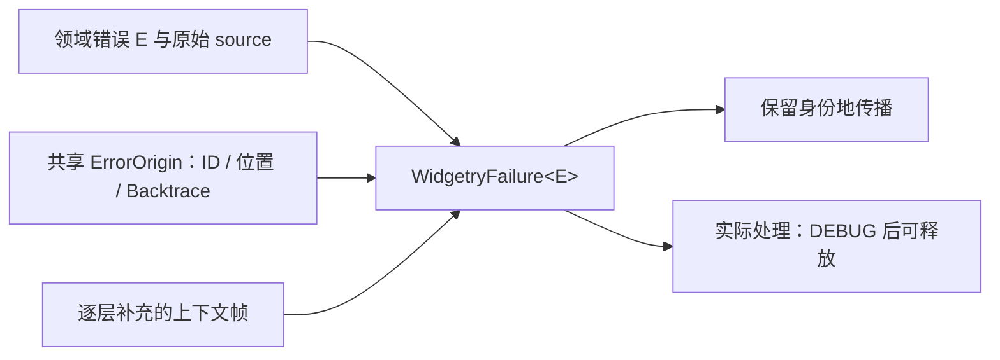

# 建立领域错误的统一诊断载体

实现 WidgetryFailure<E>，让领域类型负责“失败是什么”，公共载体负责同一次失败的身份和现场。新建错误与包装既有错误必须是不同操作，防止跨 Crate 时不断生成新 ID、重新捕栈和重复日志。



## 修改落点与前置能力

涉及：`统一诊断模块的新增源码与 Cargo 清单`、`crates/internal_log/src/lib.rs`、`crates/internal_log/Cargo.toml`、`Cargo.toml`。

本项依据 `rules/code.md` 与 `rules/logging.md` 的既有约定实现公共能力，不再修改两份规范。

## 结构与所有权

沿用诊断结构：ErrorOrigin 保存进程内唯一 ErrorId、源头 Location 和 Backtrace；WidgetryFailure<E> 保存领域错误 E、Arc<ErrorOrigin> 与上下文帧。字段保持受控可见性，提供 kind()/origin()/source()/with_context() 等访问，不允许调用方任意更换已经生成的 origin。

领域错误保留 Entity、PathBuf、请求号、实际值/范围、操作阶段等有用字段。动态 source 必须保留真实错误对象和 std::error::Error::source() 链；只有 UI 显示、测试说明或外部文本协议允许派生字符串，不能用字符串替换唯一诊断载体。上下文帧保存操作名及已掌握的对象信息；不保存 World 引用、MutexGuard 或庞大业务缓冲区。

Backtrace 不要求 Clone。共享的是 origin；需要跨线程广播时共享不可变诊断，不要求底层 io::Error、回溯或所有领域枚举实现 Eq/Clone。相等性测试比较业务 kind/字段，而不是堆栈。

同一失败必须至少保留“为什么失败、操作/对象、底层原因、首次观察位置”这些已知信息，不要求底层一次知道上层Root或Session；上层逐层添加。捕获的是该时刻当前线程栈，不是整个World快照，也不是跨线程完整因果轨迹。

## 领域 API 与载体的形状

类型关系示意如下。ErrorId 的分配、ErrorFrame 的内部表示及公共模块路径在本增量中落实；字段不直接向外提供可写权限。

```rust
use std::{backtrace::Backtrace, panic::Location, sync::Arc};

pub struct ErrorOrigin {
    id: ErrorId,
    location: &'static Location<'static>,
    backtrace: Backtrace,
}

pub struct WidgetryFailure<E> {
    kind: E,
    origin: Arc<ErrorOrigin>,
    contexts: Vec<ErrorFrame>,
}
```

例如 Job 的提交 API 从 `Result<T, SubmitError>` 迁为 `Result<T, WidgetryFailure<SubmitError>>`；调用方通过 `kind()` 匹配 ZeroCapacity、PoolUnavailable 等领域类别，而日志通过 `origin()` 关联同一次失败。Tree 的 InvalidMove 应保留 view、moving、target 和结构化拒绝原因，不只保留英文描述。跨线程结果所承载的具体领域错误和 source 必须满足相应 Send + Sync + 'static 约束；不满足约束的借用错误需在可观察处提取实际拥有的数据，不能保存仍持锁的 guard，也不能据此无条件把所有 source 字符串化。

## 首次构造与转交

统一源头构造入口用 #[track_caller] 保留业务调用点，使用 Backtrace::force_capture()，生成 ID，并通过统一日志入口记录一次 ERROR。源头日志包含已知上下文但没有完整 Backtrace；普通 Display/Debug 也不能偷偷输出堆栈。ID 的并发分配不得静默回绕复用，诊断构造失败不得递归创建诊断错误。

包装下层 WidgetryFailure 时移动或共享原 origin，增加上层 context/source，不能调用新的源头构造器。首次接收未受管外部错误才建立 origin；此位置称“首次观察/纳入位置”，不伪造依赖内部源头。处理记录入口接收明确措施/结果并关联 ID；不在析构时推断已经处理。普通传播不会新建日志事件。

增加 widgetry_debug!，保留既有宏 target 和源位置行为。库仅发事件，不安装全局 Subscriber。

## 诊断模块落点的约束

实现必须让 Job、Tray、PowerInhibit 等底层能力无需反向依赖 UI Core；构建期 app_icon_build 也不能为了错误包装被迫引入完整渲染栈。公共模块的具体目录、是否拆出轻量核心/Bevy 适配以及上下文字段的具体表示尚未在原设计中锁定，本增量实施前需确定并记录在 docs/architecture.md；这不改变上述语义契约。

可行落点是独立的底层 diagnostics crate，将不依赖 ECS 的载体和带 Bevy 的适配隔离。不要把这一落点当作已经存在的仓库事实，也不要为此引入新的应用级错误处理器。

## 完成条件

- 无 RUST_BACKTRACE/RUST_LIB_BACKTRACE 的子进程中，真实源头产生 origin，Windows 支持环境下状态为 Captured；源头日志和 Debug 格式没有堆栈。
- 嵌套包装、增加 context、跨线程共享后 ID 与 origin 相同，底层错误仍可 downcast/source 访问。
- 新失败即使文案相同也具有不同 ID；并发构造不重复 ID。
- 处理入口只在调用者实际消费错误后记录 DEBUG；纯转换无日志；最后一个 Arc 释放后诊断可销毁。
- 内部日志宏测试覆盖 DEBUG、中文正文、英文字段、bevy_widgetry target，不安装 Subscriber。

在 Windows x86_64-pc-windows-msvc / PowerShell 7 下执行本项相关测试：

```powershell
cargo test -p bevy_widgetry_internal_log
```

对本项实际改动的包与直接消费者进行编译/Clippy 检查；触及 Gallery 时至少检查其编译。GUI、后台时序或性能敏感路径按本节具体场景复验，不重复运行未受影响的整套全仓验收。

新增诊断能力文档并同步 docs/architecture.md；若新增集成测试，建立对应 tests/COVERAGE.md。

代码、构建或测试行为变更按适用工程规则完成必要的独立 Code Review；修复和回归仍归入本增量。

## 保持的边界

不建立巨大跨 Crate 错误枚举；不兼容旧 String-only 错误。确切公共模块落点是本方案的实施前提，不能在其他方案各自另造一套。

## 顺序衔接

后一项：[02 保留诊断身份地进入 Bevy 错误边界](02-bevy-error-bridge.md)。编号规定唯一执行顺序，技术依赖以上文列出的能力为准。
