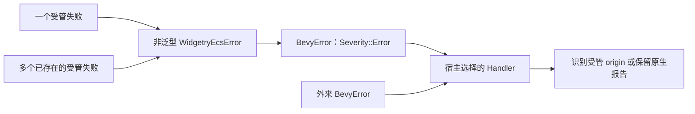

# 保留诊断身份地进入 Bevy 错误边界

把受管领域错误转换为 BevyError，但让宿主仍能识别统一的非泛型 WidgetryEcsError。桥接负责保真，不负责安装宿主处理器。

## 修改落点与前置能力

涉及：`统一诊断模块中的 Bevy 适配模块`、`crates/bevy_widgetry/src/lib.rs`、`相关 Cargo 清单`。

实际前置为[01 建立领域错误的统一诊断载体](01-diagnostic-payload.md)。这些引用表示本项直接使用的能力，不要求相邻编号之间存在调用关系。

## 边界转换不能等于字符串重建

WidgetryEcsError 持有可访问的原始领域/source 和共享 origin、传播上下文；在真正的 Bevy 返回类型边界显式设置 Severity::Error。不能用 blanket From 或裸 ? 让默认转换引入 Panic；所有边界调用都用同一转换函数。

Handler 通过 downcast_ref::<WidgetryEcsError>() 取得统一诊断，不分别枚举 TreeError/JobError 等类型。BevyError 自身不是公共诊断接口的替代物，不能依赖不存在的公开 backtrace getter，也不能假设动态 source 链能穿透所有 Bevy 专有包装。原始回溯由自己的 origin 保存；若 Bevy 另外捕获了边界栈，不能把它当作源头栈输出。

原始非 Widgetry BevyError 进入业务包装时必须专门保留对象及其 Severity/panic 信息，不能要求它满足任意 std::error::Error 泛型约束或通过 to_string() 绕过约束。桥接要明确区分受管业务失败和宿主原生错误。

## 一轮中的多个失败

现有批量 System 常保留第一个错误并继续处理其他实体。按新规则，后面的未处理错误不能只剩源头日志而丢掉回溯。桥接需要支持一组已经形成的诊断；集合只是传输容器，不为集合生成新的源头错误、ID 或 Backtrace。

每个子错误保留自己的身份，宿主逐个输出未处理事实和对应栈；不能拼成一个 String。集合用于原来确实继续处理多项工作的路径，不把原来的 fail-fast 操作擅自改成批处理。具体集合 API 的命名是实施细节，但这个信息保真条件是必须补齐的迁移要求。

## 宿主选择与边界测试

提供显式可调用的转换和报告函数，Facade 只重导出，不在 Plugin.build 中调用 App::set_error_handler。应用可以保留 Bevy 默认 Handler；自定义 Gallery Handler 的去重输出在最后的宿主增量接入。

非 Widgetry 错误继续完整报告，不因无法 downcast 而静默返回；原有 Panic Severity 不因“统一 Error”而被全局降级。

## 完成条件

- 真实 Bevy System、Observer、Commands::queue 分别返回受管失败，捕获 Handler 检查 Severity::Error、ID 和原 origin。
- 两到三项独立失败的集合均可被读取，不能只有首项；成功项仍按原语义执行。
- 跨多个包装层后底层 source 可识别；外来 BevyError 与 Panic 路径没有被转成 String 或静默忽略。
- 安装库 Plugin 不改变宿主既有 Handler；默认宿主仍能看到可读错误信息。

记录公共转换入口、非泛型载体和集合语义，更新 Facade 导出文档。

代码、构建或测试行为变更按适用工程规则完成必要的独立 Code Review；修复和回归仍归入本增量。

## 保持的边界

不让所有普通函数直接返回 BevyError；不依靠运行时环境变量替代 origin 中的强制捕获。

## 顺序衔接

前一项：[01 建立领域错误的统一诊断载体](01-diagnostic-payload.md)；后一项：[03 让测试能观察完整错误生命周期](03-diagnostic-test-support.md)。编号规定唯一执行顺序，技术依赖以上文列出的能力为准。
