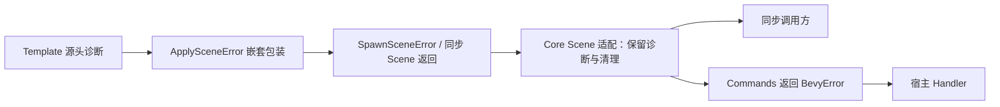

# 在 BSN 与 Scene 展开中保留原始诊断

替换 LoggedError(String) 的已记录标记，让 Template 创建的诊断穿过嵌套 Scene 错误仍可被宿主识别。失败清理行为保持不变。



## 修改落点与前置能力

涉及：`crates/core/src/scene.rs`、`crates/core/src/lib.rs`、`crates/core/tests/`、`crates/bevy_widgetry/src/lib.rs`、`直接使用 logged_error/scene_error_logged 的调用处`。

实际前置为[02 保留诊断身份地进入 Bevy 错误边界](02-bevy-error-bridge.md)、[03 让测试能观察完整错误生命周期](03-diagnostic-test-support.md)。这些引用表示本项直接使用的能力，不要求相邻编号之间存在调用关系。

## 嵌套包装的识别

当前 logged_error 把诊断退化成 String，scene_error_logged 仅识别 TemplateBuildError 的旧标记。改为结构化诊断的显式适配：处理 SpawnSceneError、ApplySceneError、CachedSceneApplyError、RelatedSceneError 和 TemplateBuildError 的实际包装路径。已受管错误不重新构造 origin；外来 Scene 错误在首次纳入时创建诊断，并附根实体/展开阶段。

保留 native Scene 包装的有用上下文，不能只从深层取出一句原因，也不能假设只看最外层 BevyError 就能 downcast。同步 World/EntityWorldMut API 与 deferred Commands 入口必须共用识别规则。

## 延迟执行与清理

保留 Commands::queue 路径以免 EntityCommands 的额外包装改变 Severity。预留根实体在执行前被删除属于正常取消，返回正常结果，不创建错误。

构造失败回收本次创建的空实体及所属新根，不能清理其他调用或既有实体。已有 Root 的部分 Patch 和已写入业务 Component 不自动回滚。清理完成只是 Scene 操作的补救动作；仍然需要向调用者传播的原失败不能被记录为“已处理”。

## 完成条件

- 嵌套缓存 Scene/RelatedScene/Template 失败保持相同 ID、source 和源头栈，只有一条源头 ERROR。
- 同步 API 直接返回诊断，不自动调用 Handler；由测试调用方显式传播到 System 后，连同 deferred spawn/apply 一起验证真实 Handler 调用和 Severity::Error。
- 保留预留根取消、空实体清理、既有 Root 部分写入和独立实体不被误删的回归。
- 迁移旧 helper 的调用点及测试，不保留依靠 String 已记录标记的第二条路径。

在 Windows x86_64-pc-windows-msvc / PowerShell 7 下执行本项相关测试：

```powershell
cargo test -p bevy_widgetry_core -p bevy_widgetry
```

对本项实际改动的包与直接消费者进行编译/Clippy 检查；触及 Gallery 时至少检查其编译。GUI、后台时序或性能敏感路径按本节具体场景复验，不重复运行未受影响的整套全仓验收。

同步 core 的 Scene 设计说明和 tests/COVERAGE.md；上层源码只做调用适配，不提前重写全部领域错误。

代码、构建或测试行为变更按适用工程规则完成必要的独立 Code Review；修复和回归仍归入本增量。

## 顺序衔接

前一项：[03 让测试能观察完整错误生命周期](03-diagnostic-test-support.md)；后一项：[05 区分持续异常状态与新的独立失败](05-persistent-failure-state.md)。编号规定唯一执行顺序，技术依赖以上文列出的能力为准。
