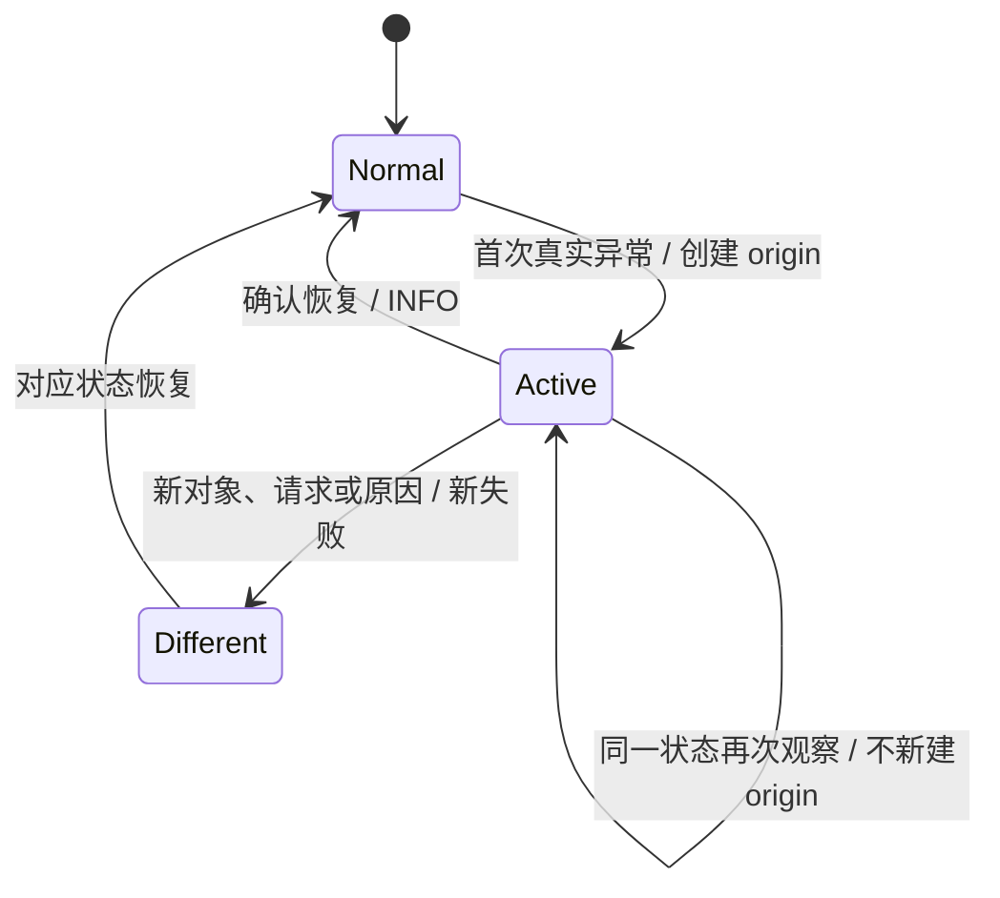

# 区分持续异常状态与新的独立失败

把 Core FailureState 从“比较错误显示文本的第一行”改为由行为 Owner 识别异常状态。这样既能避免每帧重复捕栈和重复日志，也不会合并两个文案相同的独立失败。



## 修改落点与前置能力

涉及：`crates/core/src/diagnostics.rs`、`使用 FailureState 的 Core 与控件模块`、`crates/core/tests/`。

实际前置为[01 建立领域错误的统一诊断载体](01-diagnostic-payload.md)、[02 保留诊断身份地进入 Bevy 错误边界](02-bevy-error-bridge.md)、[03 让测试能观察完整错误生命周期](03-diagnostic-test-support.md)。这些引用表示本项直接使用的能力，不要求相邻编号之间存在调用关系。

## 身份不由 Display 决定

当前 FailureState::observe 会先 error.to_string() 再比较首行。新机制由调用方提供稳定的业务异常键，例如 owner、操作、失败类别及目标代次；第一次进入异常状态才调用创建诊断的 closure。已有状态的再次观察不凭文本新建 origin，也不因正常等待而视作恢复。

新操作、不同请求代次、不同实体或不同原因属于独立失败，必须取得新的 ID。不得以降低日志量为由跨失败合并。原来需要返回失败的 API 继续返回对应失败语义，不能把“已经报告过”当作 Ok。

## 报告和恢复各有含义

状态 Owner 保存异常期间必要的诊断身份；恢复时记录一次 INFO 并清理状态。已完成降级的单次错误只记录处理 DEBUG，不额外把整个持续状态标成已恢复。

持续未处理状态进入兜底的频率与重复观察需要统一约定：同一个保留的诊断不得每帧重新输出整段 Backtrace；若沿原返回路径再次上报，同次报告的去重应附着于该诊断/Owner，而不是进程级按字符串去重表。这个报告状态与错误“已经被业务处理”不是一回事。

各使用者在其迁移增量中提供具体异常键；本增量提供可编译的公共能力与最小调用适配，不要求立即重写所有控件。

## 完成条件

- 异常→重复观察→等待→恢复→再次异常：源头一次、重复不新捕栈、等待不恢复、恢复一次 INFO、再次异常新 ID。
- 两个并发对象出现相同文案，各自保留诊断；两次独立用户请求不能共用 ID。
- 验证重复上报不会清除失败返回语义，也不生成虚假的 handled DEBUG。

在 Windows x86_64-pc-windows-msvc / PowerShell 7 下执行本项相关测试：

```powershell
cargo test -p bevy_widgetry_core
```

对本项实际改动的包与直接消费者进行编译/Clippy 检查；触及 Gallery 时至少检查其编译。GUI、后台时序或性能敏感路径按本节具体场景复验，不重复运行未受影响的整套全仓验收。

同步 core 诊断辅助的契约；各控件具体键和恢复策略随所属迁移文档更新。

代码、构建或测试行为变更按适用工程规则完成必要的独立 Code Review；修复和回归仍归入本增量。

## 保持的边界

不新增每帧诊断遍历，不改变 Owner 原来的业务轮询/重试节奏。

## 顺序衔接

前一项：[04 在 BSN 与 Scene 展开中保留原始诊断](04-scene-diagnostics.md)；后一项：[06 为 Icon 与 SVG 失败保留资产现场](06-core-icon-errors.md)。编号规定唯一执行顺序，技术依赖以上文列出的能力为准。
