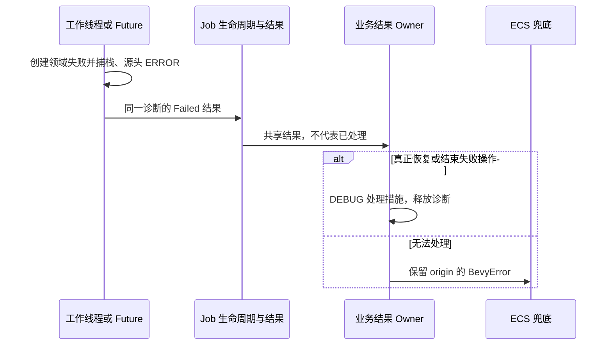

# 让后台 Job 的失败跨线程保持原诊断

取消业务失败到 String 的中转，使受管线程、I/O future 和 CPU future 都能把原始 ID、source 和源头栈交给实际消费结果的一方。



## 修改落点与前置能力

涉及：`crates/job/src/manager.rs`、`crates/job/src/types.rs`、`crates/job/src/lifecycle.rs`、`crates/job/src/receiver.rs`、`crates/job/src/wake.rs`、`crates/job/src/shutdown.rs`。

实际前置为[11 为 Job 提交与控制 API 保留结构化失败](11-job-control-errors.md)。这些引用表示本项直接使用的能力，不要求相邻编号之间存在调用关系。

## 后台结果不是错误字符串

spawn_thread/spawn_io/spawn_cpu 当前以 E: Display 接收错误，并在 work 完成后 to_string()。调整执行结果契约，能够传递受管失败或保留原类型的外部错误，不能用格式化文本作为唯一结果。

JobOutcome::Failed 持有可共享的诊断报告；状态快照、广播和多个 receiver 共享 origin，而非复制/重新捕获回溯。存入 JobStatus、发送 Finished、观察 outcome 都不等于错误被处理。明确结果消费 Owner，只有完成恢复/放弃操作的一方记录处理 DEBUG；观察者不能因读到失败就谎报处理完成。

失败和结果递送失败、线程退出查询失败可同时存在，应保存多个原因与各自 origin，而不是 format!("业务失败; 递送失败")。

## 清理与 Panic 边界

保留 catch_unwind 的既有运行语义和 native thread 真实退出回收。第三方 Panic 与显式业务 Err 分开建模；在 catch 之后捕获的是观察点栈，不能冒充展开前的原始 panic 栈。本次不另建全进程 panic hook 来承诺不可得的信息。

锁中毒、wake 失败和 shutdown 中实际失败进入诊断；确实恢复受保护状态后才能记 DEBUG。清理时只写日志却没有交代处理结果的路径，要显式落到恢复/任务终止状态或继续传播。停止后的正常接收器关闭与取消仍是正常状态。

## 诊断承接与调用方迁移

错误采用领域分类和统一诊断包装；同一次失败的 ID、source 与原始 Backtrace 在包装/跨线程传递时保持。源头 ERROR 不输出完整栈，纯传播不重复记录；真正消费失败后 DEBUG 记录实际措施，随后诊断可以释放。只有未处理错误在 Bevy 要求的边界显式转为 Severity::Error，最终由宿主输出原栈。正常等待、取消、合法 No-op 不人为转换为错误。

本增量改变的公开签名、回调或结果形状，必须在同一个增量更新所有直接消费者、测试、examples/benches 和所需 Facade 导出。不能用兼容 String 的临时入口掩盖未迁移调用，也不能把基本编译修复推迟到最终 Gallery 增量。

## 完成条件

- 真实 OS 线程和真实任务池分别产生受管失败，接收方可访问原source，ID/Backtrace origin 与工作函数处一致。
- 两个订阅者和 status 快照不重复源头日志或回溯捕获；仅查看 Failed 不输出 handled DEBUG。
- 业务失败与结果递送/退出查询失败同时发生，两份诊断均保留；完成或取消不伪造成失败。
- Panic 路径区分观察栈和源头栈，不通过 should_panic 代替普通错误传播测试。
- 迁移所有后台调用者的泛型和失败匹配，保持退出收割、容量与Reactive wake回归。

在 Windows x86_64-pc-windows-msvc / PowerShell 7 下执行本项相关测试：

```powershell
cargo test -p bevy_widgetry_job
```

对本项实际改动的包与直接消费者进行编译/Clippy 检查；触及 Gallery 时至少检查其编译。GUI、后台时序或性能敏感路径按本节具体场景复验，不重复运行未受影响的整套全仓验收。

同步 JobOutcome、工作闭包和线程生命周期契约，更新 Job COVERAGE。

代码、构建或测试行为变更按适用工程规则完成必要的独立 Code Review；修复和回归仍归入本增量。

## 保持的边界

只迁移错误表示、传递、处理记录及直接受影响的调用。允许破坏性 API 更改，但不改变既有正常交互、状态通知、资源归属或业务算法；不加入与该错误路径无关的重构。

## 顺序衔接

前一项：[11 为 Job 提交与控制 API 保留结构化失败](11-job-control-errors.md)；后一项：[13 统一 Button 状态与结构失败的诊断](13-button-loading-errors.md)。编号规定唯一执行顺序，技术依赖以上文列出的能力为准。
