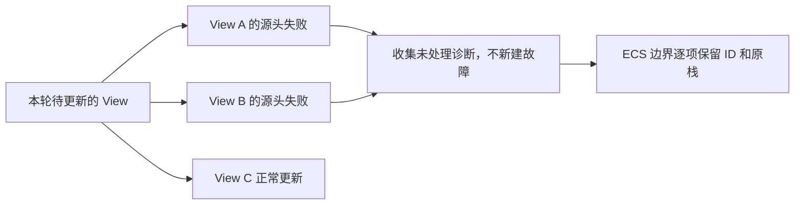

# 保留 ListView 虚拟化与渲染的完整失败集

把列表runtime的模糊invariant错误改为具体部件/行身份诊断，并保留同一轮所有未处理失败。



## 修改落点与前置能力

涉及：`crates/list_view/src/virtualization.rs`、`crates/list_view/src/view.rs`、`crates/list_view/src/behavior.rs`、`crates/list_view/src/drag.rs`、`crates/list_view/src/style.rs`、`crates/list_view/src/colors.rs`。

实际前置为[04 在 BSN 与 Scene 展开中保留原始诊断](04-scene-diagnostics.md)、[05 区分持续异常状态与新的独立失败](05-persistent-failure-state.md)、[30 让 ListView 数据与选择请求使用领域失败](30-list-model-errors.md)。这些引用表示本项直接使用的能力，不要求相邻编号之间存在调用关系。

## 从来源校验到行展开

runtime的viewport/content/top/bottom、source行、投影key、渲染revision和总高度失败分别保留Root及实际数据。虚拟化中Scene renderer失败保留原Template诊断并追加row/key/range，清理只限本次展开所有权。

reconcile当前clear_rows后只保留first failure。改为保留所有仍需向外报告的诊断，不能因为清掉行就自动标记已处理；只有既有业务契约明确采用空列表降级并终止失败才记录DEBUG。连续异常使用业务状态键，不格式化回溯判断相等。

## 保持虚拟化与交互边界

零/未完成布局viewport、合法range为空、滚动clamp、无拖放目标和普通输入过滤继续是正常状态。批量恢复不增加逐帧全Model诊断扫描；原来的数据投影与可见范围更新节奏不变。

旧FailureState和Scenehelper退出本crate，样式颜色真实结构损坏接入同一领域分类。

## 诊断承接与调用方迁移

错误采用领域分类和统一诊断包装；同一次失败的 ID、source 与原始 Backtrace 在包装/跨线程传递时保持。源头 ERROR 不输出完整栈，纯传播不重复记录；真正消费失败后 DEBUG 记录实际措施，随后诊断可以释放。只有未处理错误在 Bevy 要求的边界显式转为 Severity::Error，最终由宿主输出原栈。正常等待、取消、合法 No-op 不人为转换为错误。

本增量改变的公开签名、回调或结果形状，必须在同一个增量更新所有直接消费者、测试、examples/benches 和所需 Facade 导出。不能用兼容 String 的临时入口掩盖未迁移调用，也不能把基本编译修复推迟到最终 Gallery 增量。

## 完成条件

- 多个Root/行renderer同帧失败可分别进入Handler；健康行继续按原契约处理。
- 非法source、缺viewport/spacer、重复key、不可用行能定位view/source/key，source链不被重建。
- 删除/替换Model、滚动/拖放/选择修复、空viewport和重建失败清理的回归保持。

在 Windows x86_64-pc-windows-msvc / PowerShell 7 下执行本项相关测试：

```powershell
cargo test -p bevy_widgetry_list_view
```

对本项实际改动的包与直接消费者进行编译/Clippy 检查；触及 Gallery 时至少检查其编译。GUI、后台时序或性能敏感路径按本节具体场景复验，不重复运行未受影响的整套全仓验收。

更新 ListView renderer/虚拟化错误及 COVERAGE；受影响的工作量断言保持。

代码、构建或测试行为变更按适用工程规则完成必要的独立 Code Review；修复和回归仍归入本增量。

## 保持的边界

只迁移错误表示、传递、处理记录及直接受影响的调用。允许破坏性 API 更改，但不改变既有正常交互、状态通知、资源归属或业务算法；不加入与该错误路径无关的重构。

## 顺序衔接

前一项：[30 让 ListView 数据与选择请求使用领域失败](30-list-model-errors.md)；后一项：[32 让 ComboBox 组合失败继承下层诊断](32-combo-box-errors.md)。编号规定唯一执行顺序，技术依赖以上文列出的能力为准。
