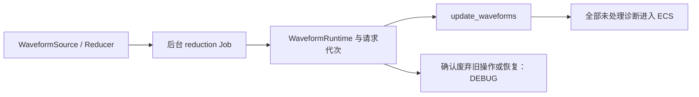

# 让 Waveform 后台降采样失败保持原任务现场

保留reduction Job到WaveformRuntime再到System的同一诊断，修复结果String化和多Waveform只返回首错的问题。



## 修改落点与前置能力

涉及：`crates/waveform/src/runtime.rs`、`crates/waveform/src/source.rs`、`crates/waveform/src/algorithm.rs`、`crates/waveform/src/playback.rs`。

实际前置为[05 区分持续异常状态与新的独立失败](05-persistent-failure-state.md)、[12 让后台 Job 的失败跨线程保持原诊断](12-job-outcome-diagnostics.md)、[49 为 Waveform 数据契约保留可匹配错误](49-waveform-read-errors.md)。这些引用表示本项直接使用的能力，不要求相邻编号之间存在调用关系。

## 异步工作和会话代次

replace_session的metadata.map_err不再to_string；PendingReduction、handoff、JobOutcome与取消/退休记录保留真实诊断。保存job_id、reader/session/target generation、算法、viewport/range和输出规模。

update_waveforms当前把runtime错误format为Waveform entity字符串且只保留首项。改成添加entity context并聚合所有未处理错误，维持其他Waveform继续更新的行为。last_error可作为界面文本，不能替代仍待传播的诊断。

## 消费、停用与过期

真正停止当前播放/保留上一有效输出并安全结束失败操作后，实际Owner按契约记录处理DEBUG；还要向外返回的失败不被说成handled。换source/算法/目标代次时，过期工作正常取消，已经形成的失败若被废弃要明确消费记录。

保持真实Job收割、reducer所有权返还、buffer移交和Reactive唤醒，不因日志增加额外每帧访问。持续异常不按字符串比较；同一独立请求的新失败有独立身份。

## 诊断承接与调用方迁移

错误采用领域分类和统一诊断包装；同一次失败的 ID、source 与原始 Backtrace 在包装/跨线程传递时保持。源头 ERROR 不输出完整栈，纯传播不重复记录；真正消费失败后 DEBUG 记录实际措施，随后诊断可以释放。只有未处理错误在 Bevy 要求的边界显式转为 Severity::Error，最终由宿主输出原栈。正常等待、取消、合法 No-op 不人为转换为错误。

本增量改变的公开签名、回调或结果形状，必须在同一个增量更新所有直接消费者、测试、examples/benches 和所需 Facade 导出。不能用兼容 String 的临时入口掩盖未迁移调用，也不能把基本编译修复推迟到最终 Gallery 增量。

## 完成条件

- 后台source/reducer失败在System仍能定位工作函数origin，不只剩主线程转换栈。
- 多Waveform同帧失败全部保留；失败和cleanup同时出现不会覆盖主因。
- 切换会话/算法/viewport、正常Pending与取消、停止后的消息收割不回归。
- 保留已有性能工作量与数据一致性验证，不用日志掩盖失效输出。

在 Windows x86_64-pc-windows-msvc / PowerShell 7 下执行本项相关测试：

```powershell
cargo test -p bevy_widgetry_waveform
```

对本项实际改动的包与直接消费者进行编译/Clippy 检查；触及 Gallery 时至少检查其编译。GUI、后台时序或性能敏感路径按本节具体场景复验，不重复运行未受影响的整套全仓验收。

同步WaveformRuntime异步错误、last_error展示与覆盖模型。

代码、构建或测试行为变更按适用工程规则完成必要的独立 Code Review；修复和回归仍归入本增量。

## 保持的边界

只迁移错误表示、传递、处理记录及直接受影响的调用。允许破坏性 API 更改，但不改变既有正常交互、状态通知、资源归属或业务算法；不加入与该错误路径无关的重构。

## 顺序衔接

前一项：[49 为 Waveform 数据契约保留可匹配错误](49-waveform-read-errors.md)；后一项：[51 保留 Waveform 视图和控制栏的组合失败](51-waveform-view-errors.md)。编号规定唯一执行顺序，技术依赖以上文列出的能力为准。
