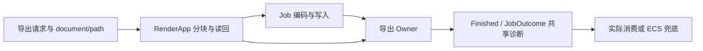

# 让 Canvas PNG 导出在 Render 与 Job 间保留诊断

统一PNG请求、GPU分块读回、编码写入和完成事件中的错误身份，正常取消单独表达。



## 修改落点与前置能力

涉及：`crates/canvas/src/export/png.rs`、`crates/canvas/src/export.rs`、`crates/canvas/src/lib.rs`、`Gallery PNG任务结果与取消处理`。

实际前置为[08 使离屏目标失败保留资源归属与清理结果](08-offscreen-errors.md)、[12 让后台 Job 的失败跨线程保持原诊断](12-job-outcome-diagnostics.md)、[54 为 Canvas 文档与几何操作建立领域诊断](54-canvas-model-errors.md)、[55 保留 Canvas SVG 导出的完整原因链](55-canvas-svg-errors.md)。这些引用表示本项直接使用的能力，不要求相邻编号之间存在调用关系。

## 一次导出的多执行环境

非法scale/resolution、缺RenderDevice/renderer、tile/texture/buffer限制、读回、编码和IO失败保存document、path、export entity、job_id、tile/band及实际尺寸/限制。GPU/RenderApp回调先保留其观察时的诊断，不到主线程后才重新捕栈。

CanvasPngExportFinished与JobOutcome如果承载同一失败，应共享origin；事件投递不是处理完成。Job、Core offscreen和Scene失败沿原source传递，Render(String)/InvalidGeometry(String)不再成为唯一错误载体。

## 取消、清理和完成的责任

CanvasExportError::Canceled若用于正常用户取消，迁为明确正常取消结果，不能让正常取消经过真实错误构造。已发生的IO/编码失败不能因晚取消被改写成Canceled。

导出Owner负责确定哪条结果通道消费失败，避免Finished事件和Job状态都各自报一次终端错误。只有实际取消/放弃/恢复完成才DEBUG；释放临时GPU资源不自动代表主错误已处理。清理失败与原失败各自保留，保持原分块内存预算、真实Job结束和输出发布边界。

## 诊断承接与调用方迁移

错误采用领域分类和统一诊断包装；同一次失败的 ID、source 与原始 Backtrace 在包装/跨线程传递时保持。源头 ERROR 不输出完整栈，纯传播不重复记录；真正消费失败后 DEBUG 记录实际措施，随后诊断可以释放。只有未处理错误在 Bevy 要求的边界显式转为 Severity::Error，最终由宿主输出原栈。正常等待、取消、合法 No-op 不人为转换为错误。

本增量改变的公开签名、回调或结果形状，必须在同一个增量更新所有直接消费者、测试、examples/benches 和所需 Facade 导出。不能用兼容 String 的临时入口掩盖未迁移调用，也不能把基本编译修复推迟到最终 Gallery 增量。

## 完成条件

- 尺寸/设备/读回/编码/写入各类错误可定位tile与source；主/Render/Job跨界后ID与origin不变。
- 事件和JobOutcome双通道不产生两个源头或两次伪处理；未处理失败可被宿主消费。
- 正常取消、晚取消遇到真实失败、导出失败后的相机/image/job资源释放都验证。
- 保留PNG颜色/alpha、分块拼接、边界尺寸与大图工作量回归；GUI/BRP验证完成/取消提示。

在 Windows x86_64-pc-windows-msvc / PowerShell 7 下执行本项相关测试：

```powershell
cargo test -p bevy_widgetry_canvas
```

对本项实际改动的包与直接消费者进行编译/Clippy 检查；触及 Gallery 时至少检查其编译。GUI、后台时序或性能敏感路径按本节具体场景复验，不重复运行未受影响的整套全仓验收。

同步PNG导出/结果事件/取消协议与覆盖。

代码、构建或测试行为变更按适用工程规则完成必要的独立 Code Review；修复和回归仍归入本增量。

## 保持的边界

只迁移错误表示、传递、处理记录及直接受影响的调用。允许破坏性 API 更改，但不改变既有正常交互、状态通知、资源归属或业务算法；不加入与该错误路径无关的重构。

## 顺序衔接

前一项：[55 保留 Canvas SVG 导出的完整原因链](55-canvas-svg-errors.md)；后一项：[57 明确构建期图标失败的诊断与终结边界](57-build-icon-errors.md)。编号规定唯一执行顺序，技术依赖以上文列出的能力为准。
