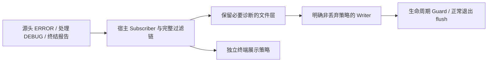

# 让宿主日志保存必要诊断而不默认丢弃

改造AppLogging的输出策略，使源头ERROR、处理DEBUG和最终报告能够在正式运行时保存；日志落盘不是BevyError自动保证的能力。



## 修改落点与前置能力

涉及：`crates/app_logging/src/logging.rs`、`crates/app_logging/src/lib.rs`、`crates/app_logging/Cargo.toml`、`crates/app_logging/tests/`、`Gallery LogPlugin配置接口`。

实际前置为[01 建立领域错误的统一诊断载体](01-diagnostic-payload.md)、[02 保留诊断身份地进入 Bevy 错误边界](02-bevy-error-bridge.md)、[03 让测试能观察完整错误生命周期](03-diagnostic-test-support.md)。这些引用表示本项直接使用的能力，不要求相邻编号之间存在调用关系。

## 写入与过滤的两个独立保证

当前tracing_appender::non_blocking(file)使用默认配置。对必须保存的诊断不能依赖满时丢事件的有损模式；采用明确的非丢弃写入/背压策略，并把阻塞行为作为错误风暴下的实际代价测试，不能在持有被日志线程依赖的锁时制造死锁。

文件层保留必要处理DEBUG，而普通模块DEBUG/TRACE仍可过滤。不能只在custom file_layer上加允许规则，却被外层全局EnvFilter提前丢弃事件；从整个Subscriber/LogPlugin组合检查。终端与文件可以不同过滤策略，但正式文件不得丢掉必要诊断。release的编译期max_level同样不能裁掉这些事件。

## 初始化与退出

AppLogging::new的本地时区、目录、文件创建等失败保留原source与path/阶段，不先通过隐式Bevy转换丢失信息。它发生在正式Subscriber就绪前，不能仅调用当时可能无人接收的error!就当成已经保存。源头标志只能证明发出了事件，不能证明后端已经持久化；缺少接收器时由启动 Owner 保留完整原因供应急输出。把完整诊断返回宿主，由宿主启动终结路径报告。

install只安装必要Resource/返回Guard，不替应用设置ECS Handler。主日志初始化失败的应急输出和应用退出策略由Gallery拥有；不能在日志后端递归使用同一失效后端报告自己的写失败。

保留WorkerGuard到日志生产者完成之后，正常关闭等待可控flush。磁盘错误、写端断连必须可被测试观察；进程强杀/断电等条件下不许宣称绝对持久化。

## 完成条件

- 受控小缓冲与慢writer压测：必要事件不按容量静默丢弃，正常背压可结束且不死锁。
- 实际Subscriber组合中保留诊断DEBUG及多行Backtrace；普通DEBUG可按配置过滤，测试不只验证孤立layer。
- 无权限目录/文件创建失败、writer失败与正常Guard退出分别有明确可观察结果，不递归记录。
- 库不会替换宿主全局错误处理器；现有终端/file时间与格式不发生无关变化。
- 源头事件发出而正式 Subscriber 尚未安装的路径由启动 Owner 补齐诊断，不把调用日志宏等同于成功保存。

在 Windows x86_64-pc-windows-msvc / PowerShell 7 下执行本项相关测试：

```powershell
cargo test -p bevy_widgetry_app_logging
```

对本项实际改动的包与直接消费者进行编译/Clippy 检查；触及 Gallery 时至少检查其编译。GUI、后台时序或性能敏感路径按本节具体场景复验，不重复运行未受影响的整套全仓验收。

同步app_logging输出、过滤、生命周期及COVERAGE。

代码、构建或测试行为变更按适用工程规则完成必要的独立 Code Review；修复和回归仍归入本增量。

## 保持的边界

只迁移错误表示、传递、处理记录及直接受影响的调用。允许破坏性 API 更改，但不改变既有正常交互、状态通知、资源归属或业务算法；不加入与该错误路径无关的重构。

## 顺序衔接

前一项：[57 明确构建期图标失败的诊断与终结边界](57-build-icon-errors.md)；后一项：[59 在正式 Gallery 中完成错误终结与独立运行接入](59-gallery-error-host.md)。编号规定唯一执行顺序，技术依赖以上文列出的能力为准。
