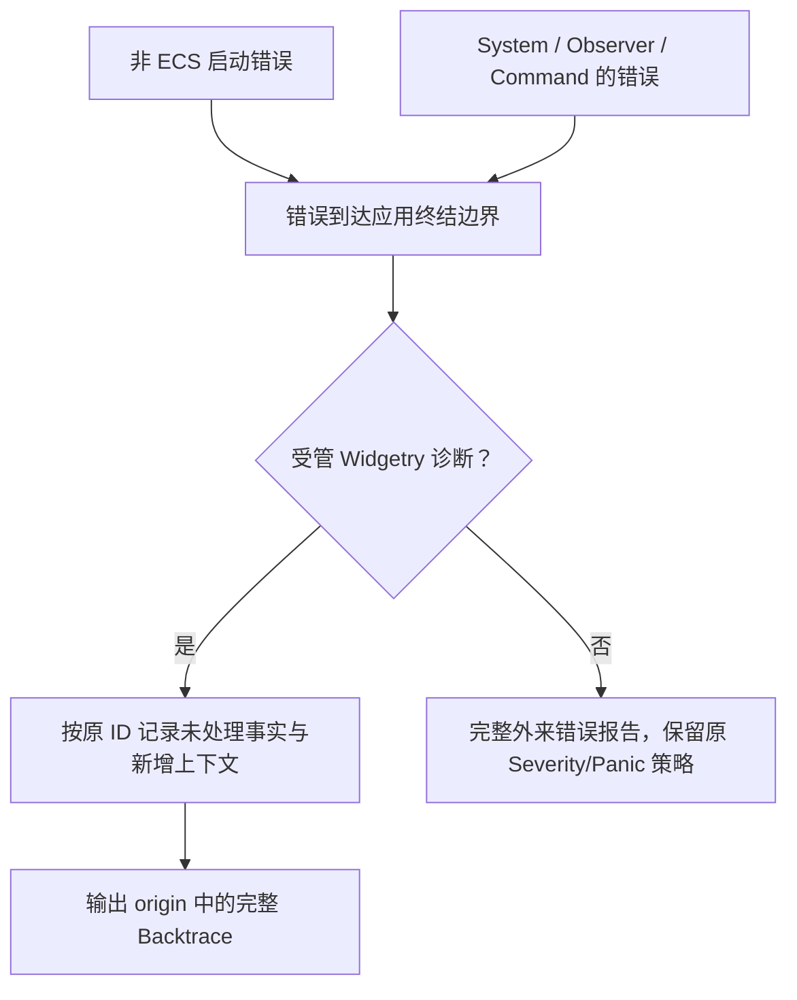

# 在正式 Gallery 中完成错误终结与独立运行接入

由Gallery成为诊断的最终宿主：正确安装ECS Handler，接管不在ECS里的启动/应用操作失败，并使已安装的程序无需环境变量也能输出原始堆栈。此增量同时闭合全库迁移的实际入口。



## 修改落点与前置能力

涉及：`gallery/src/main.rs`、`gallery/src/config.rs`、`gallery/src/close.rs`、`gallery/src/pages/`、`gallery/src/waveform_data.rs`、`gallery/src/canvas_experiment.rs`、`gallery/src/*benchmark*`、`gallery/examples/`、`gallery/benches/`、`gallery/Cargo.toml`、`Cargo.toml 的相关构建profile`、`crates/bevy_widgetry/src/lib.rs`、`crates/bevy_widgetry/Cargo.toml`。

实际前置为[02 保留诊断身份地进入 Bevy 错误边界](02-bevy-error-bridge.md)、[03 让测试能观察完整错误生命周期](03-diagnostic-test-support.md)、[04 在 BSN 与 Scene 展开中保留原始诊断](04-scene-diagnostics.md)、[12 让后台 Job 的失败跨线程保持原诊断](12-job-outcome-diagnostics.md)、[48 明确 FileDialog 运行时与界面的错误消费责任](48-file-dialog-consumption-errors.md)、[50 让 Waveform 后台降采样失败保持原任务现场](50-waveform-runtime-errors.md)、[51 保留 Waveform 视图和控制栏的组合失败](51-waveform-view-errors.md)、[53 保留磁盘 Waveform Reader 跨线程失败](53-waveform-disk-reader-errors.md)、[56 让 Canvas PNG 导出在 Render 与 Job 间保留诊断](56-canvas-png-errors.md)、[57 明确构建期图标失败的诊断与终结边界](57-build-icon-errors.md)、[58 让宿主日志保存必要诊断而不默认丢弃](58-app-logging-preservation.md)。这些引用表示本项直接使用的能力，不要求相邻编号之间存在调用关系。

## 安装一个宿主Handler

在应用构造处显式配置一次App::set_error_handler，覆盖主App与需要继承的SubApp；保留已有独立Handler的宿主语义，不让任一库Plugin重新配置。

受管错误通过统一非泛型桥取得origin。Handler记录一条最终未处理ERROR，包含error_id、ECS ErrorContext、源头完整Backtrace及必要新增传播语境，不重放已经记录的源头原因/业务字段。对批量载体逐项处理，不丢首项之后的错误；同一保留诊断的重复状态上报按其生命周期去重，不把不同ID按文案合并。

非Widgetry错误保留完整原因、可用Backtrace及原Severity/Panic策略。不得因downcast失败静默返回，也不得统一降级Panic。没有原始栈的第三方错误不能伪装成已有原栈；如果补观察点栈，必须标明来源。

## 普通调用和启动失败

main返回Result并不等于进入ECS Handler。current_exe、配置、日志准备、透明renderer、图标Plugin构造以及各install函数的失败，由应用入口显式终结，保留诊断而不只交给默认Debug退出。尽早建立可用的诊断输出；主文件日志尚未可用时必须走应用拥有的应急输出，并让失败结果可见，不能声称源头宏已落盘。

Gallery主动消费库错误的页面、关闭流程、后台任务UI、演示数据发生器和bench均按实际措施记录DEBUG；只是读取JobOutcome/显示一段错误不是自动处理。未知外来错误在应用首次纳入时建立Gallery领域语境。保留原来的演示INFO和正常交互静默，不为诊断添加新的全局输入监听或轮询。

Facade仅重导出公共诊断/领域API并按现有feature组织，不变成另一个错误框架；关默认feature的独立宿主仍可按需使用。各前序签名变更应已经在当次改完调用者，本增量不承担让此前数十步暂时不编译的“最后修调用”任务。

源头事件已发出不等于已有接收器承接。启动期的去重必须先确认源头原因进入了可用输出；若此前 Subscriber 尚未就绪，应用终结报告须补齐同一 ID 的原因与现场，不能仅因识别到受管包装就省略。正常已接收路径仍不重放原因。应急输出不能递归依赖正在初始化或已经失败的主文件写入器。

## 捕获、格式化与发布符号

源头使用自己的force_capture，完整堆栈在最终报告时直接从origin格式化，不能依赖BEVY_BACKTRACE=full解除Bevy内部过滤；普通Display/Debug与处理日志仍不输出堆栈。bevy_ecs/backtrace用于原生Bevy诊断时按实际依赖feature显式验证，不把它等同于自己的origin捕获。

正式Windows MSVC构建保留所需debuginfo并验证符号部署。启用release debug并不自动证明安装目录有可用PDB；必须在脱离源码/target目录的环境验证。如果要求可读文件/行号，就将匹配符号作为实际发布产物处理。cargo install路径也单独验证，不能依赖开发机上的旧PDB。优化和平台展开限制不能被描述成恢复完整历史执行轨迹。

子进程环境显式移除RUST_BACKTRACE、RUST_LIB_BACKTRACE、BEVY_BACKTRACE，不在多线程进程运行后用unsafe set_var替代设计。

## 本增量的收口验证

在Windows x86_64-pc-windows-msvc与PowerShell 7环境验证，不以其他平台检查替代实际目标。执行cargo fmt --all -- --check、cargo check --workspace、cargo clippy --workspace --all-targets、cargo test --workspace及release Gallery构建。Facade关闭默认、默认和代表性组合验证公共类型没有反向UI依赖或feature泄漏；新独立宿主通过本地路径依赖检查下层crate可单独使用。

构建并安装Gallery到临时目录，再脱离工程工作目录运行。注入一个源头被处理的失败和一个最终未处理的失败，校验前者只有源头ERROR/处理DEBUG且没有堆栈，后者关联ID并仅在终结处输出原始栈；另测外来错误、多失败和启动失败。日志文件中的必要DEBUG、完整多行栈与正常退出flush必须可见。

GUI/BRP只验证受影响的真实交互：组合控件、FileDialog后台/关闭、Waveform换源、Canvas导出、托盘/电源和窗口生命周期；不重做全套无关UI验收。正常页面不会因为新诊断增加逐帧日志。全库残留搜索核对BevyError直接构造、logged_error/scene_error_logged、错误to_string/format、Result<_,String>、首错聚合、inspect_err重复日志、let _/ok()吞错和Drop路径，逐处区分合法显示/控制流与遗漏，不机械要求零命中。

## 完成条件

- 必要诊断在实际发行运行中可保存，Handler不重复源头原因，源头/处理阶段没有完整Backtrace。
- 没有RUST_BACKTRACE等环境时，受管错误的origin仍是首次创建位置；正式目录验证可用符号而非开发机偶然解析。
- 已处理/未处理、同步/Command/Observer/Job/启动、单个/多个、Widgetry/外来错误全部有真实路径证据。
- 源码、测试、bench/example与docs中的旧异常用法完成迁移；全局回归失败回到所属功能修复。
- 日志系统尚未就绪时触发初始化失败，应急输出仍包含原因、现场、同一 ID 和最终原栈，不能只剩一条没有原因的未处理记录。

在 Windows x86_64-pc-windows-msvc / PowerShell 7 下执行本项相关测试：

```powershell
cargo test -p widget_gallery -p bevy_widgetry
```

同步docs/gallery.md、Facade公共API、docs/architecture.md及本次实际变更的crate文档；不把历史plans当成实现事实。

代码、构建或测试行为变更按适用工程规则完成必要的独立 Code Review；修复和回归仍归入本增量。

## 保持的边界

不把日志成功发出说成磁盘在任何故障下必然持久；不恢复已处理错误的堆栈输出；不改正常业务交互或宿主原生Panic策略。

## 顺序衔接

前一项：[58 让宿主日志保存必要诊断而不默认丢弃](58-app-logging-preservation.md)。编号规定唯一执行顺序，技术依赖以上文列出的能力为准。
