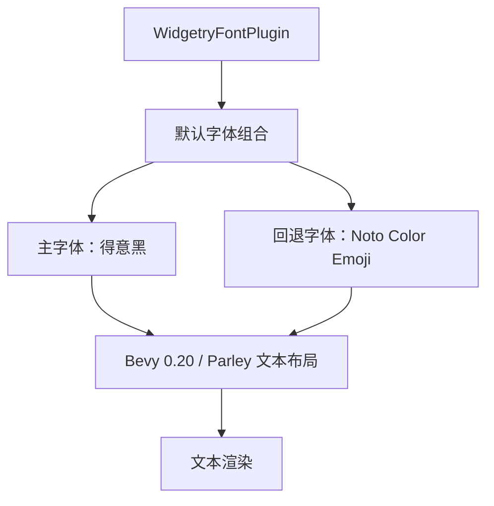

# Widgetry 默认字体增加 Emoji 回退支持

## 设计思路

Widgetry 当前使用得意黑（`SmileySans-Oblique.ttf`）作为内建默认字体，但得意黑对 Emoji 字符的覆盖不足。

本次增加 Google Noto Color Emoji 字体，作为默认字体链的第二优先级。正常文字继续使用得意黑，得意黑无法提供的字符交给 Noto Color Emoji 尝试渲染。

两套字体均由 Widgetry 内部管理。应用不需要注册 Emoji 字体，也不需要在创建文本时指定 Emoji 字体。



使用 Bevy 0.20 已有的 `FontSource::list()` 实现字体回退，不自行识别 Emoji Unicode 范围，也不拆分文本。

## 内建字体资源

### 增加 Noto Color Emoji

在 `crates/asset/src/assets/fonts/` 中增加：

`NotoColorEmoji.ttf`

使用 Google 官方仓库中的字体文件：

https://github.com/googlefonts/noto-emoji/blob/main/2D/fonts/NotoColorEmoji.ttf

字体采用 SIL Open Font License 1.1。与现有得意黑资源保持相同的许可证管理方式：

- 将 Noto Color Emoji 对应的 OFL 许可证加入 `crates/asset/LICENSES/`。
- 在 `crates/asset/LICENSES/README.md` 记录字体来源、上游版本或 Commit、许可证和文件名称。
- 原样保留字体文件，不做格式转换或裁剪。

### 扩展 BuiltinFont

保持 `BuiltinFont::Default` 的含义不变，仍然表示得意黑。

增加 `BuiltinFont::Emoji`，表示 Noto Color Emoji。

在 `crates/asset/src/constants.rs` 中增加字体资源常量，并由 `WidgetryAssetPlugin` 注册为 Embedded Asset。

这样两套字体都使用现有的内建资源机制，不需要增加独立的 Emoji Asset Plugin。

## 默认字体组合

### WidgetryFontPlugin 负责组合字体

修改 `crates/core/src/font.rs`。

`WidgetryFontPlugin` 初始化时加载 Emoji 内建字体，并保留其 `Handle<Font>`。

默认字体从原来的单一得意黑变成：

```rust
FontSource::list([
    FontSource::Handle(smiley_sans),
    FontSource::Handle(noto_color_emoji),
])
```

这里的主字体和 Emoji 字体只加载、管理一次。不同文本实体复用相同的字体资源句柄。

`WidgetryFontPlugin` 必须保证 `WidgetryAssetPlugin` 已注册，即使应用此前调用了 `set_default_font()` 也是如此。不能继续只在加载内建得意黑时才初始化内建资源插件。

现有应用仍使用正常的 Bevy Asset 基础设施，不需要额外调用 `BuiltinFont::Emoji.path()`。

### 保留 set_default_font 的行为

现有接口：

```rust
app.set_default_font(custom_font);
```

仍然用于修改主字体，但不替换掉 Widgetry 内建的 Emoji 回退字体。

例如应用设置自定义中文字体后，最终组合为：

```rust
FontSource::list([
    custom_font,
    FontSource::Handle(noto_color_emoji),
])
```

实现时分别保存应用指定的主字体 `FontSource` 和内部 Emoji 字体句柄，由 `apply_default_font` 组合。不要在插件初始化时把组合结果固化，否则之后再次调用 `set_default_font()` 会失去 Emoji 回退。

如果传入的主字体本身是 `FontSource::list()`，仍将整个列表视为主字体优先级链，Emoji 追加在最后。

### 默认字体的应用范围

保留现有 `apply_default_font` 的规则：

- 仅处理新增的 `TextFont`。
- 仅当 `TextFont.font == FontSource::default()` 时应用默认字体组合。
- 调用方显式指定的字体保持不变，包括显式指定的 `FontSource::list()`。
- 修改默认字体不追溯修改已经创建的文本实体。

因此，Widgetry 内建默认字体自动具备 Emoji 回退能力，但不会强行覆盖应用自行管理的文本字体。

## 测试与验证

### 自动化测试

扩展 `crates/asset/tests/embedded.rs` 和 `crates/core/tests/default_font.rs`，覆盖以下行为：

1. `BuiltinFont::Emoji` 能正确解析到 Embedded Asset Path，并成功加载为 Bevy `Font`。
2. 没有调用 `set_default_font()` 时，新增文本获得得意黑与 Emoji 组成的默认字体链。
3. 调用 `set_default_font()` 后，自定义主字体生效，Emoji 回退仍然存在。
4. 调用方显式指定的 `TextFont` 不被修改。
5. `Text`、`TextSpan`、`Text2d` 和 `EditableText` 保持现有默认字体应用行为。
6. 多个文本实体共享内建字体资源，不为每个实体重新创建字体资产。
7. 默认字体应用仍发生在 Bevy 文本重排检测之前。

由于插件现在始终需要内建 Emoji 字体资源，现有不安装 `AssetPlugin` 的轻量测试需要调整初始化环境，保留原有行为断言。

### Gallery 显示验证

在 Gallery 中增加一个字体测试区域，验证中英文、普通 Emoji 和复杂 Emoji 的混合渲染。

测试内容：

```text
中文 English 12345
你好，世界！😄 🎉 🚀
❤️ ☀️ ⭐ ✔️
👍🏽 🇨🇳 🏳️‍🌈
```

重点检查：

- 普通中文和英文仍使用主字体，视觉风格没有变化。
- 普通 Emoji 能正确显示，优先呈现彩色字形。
- Emoji 与中文混排时，基线、行高及字符间距正常。
- 变体选择符、肤色修饰符、旗帜及 ZWJ 组合字符能够正确布局。
- 改变 `TextColor` 时，彩色 Emoji 不出现意外着色。
- 在不同 DPI Scale / `UiScale` 下没有异常裁剪、错位或明显模糊。

这里需要区分字体回退和 Emoji 渲染能力：`FontSource::list()` 负责选择字体；复杂 Emoji 的正确组合与彩色显示仍依赖 Bevy 0.20、Parley 和 Swash 的实际行为。

若遇到不支持的组合，记录具体字符与渲染结果，不在本次引入独立的 Emoji 渲染器。

## 实现边界

本次只扩展默认字体资源及字体组合机制。

不增加对外 Emoji 注册 API，不增加独立 Emoji Plugin，不修改各个 Widget 的文字构造逻辑，也不引入 Unicode Emoji 分类器。

同步更新 `docs/crates/asset.md` 和 `docs/crates/core.md`，说明内建 Emoji 字体、默认字体优先级以及 `set_default_font()` 的新行为。

**完成标准：** 应用正常安装 Widgetry 字体基础设施后，不需要执行任何额外的 Emoji 字体注册或配置，使用默认字体的文本即可自动获得 Noto Color Emoji 回退能力。
