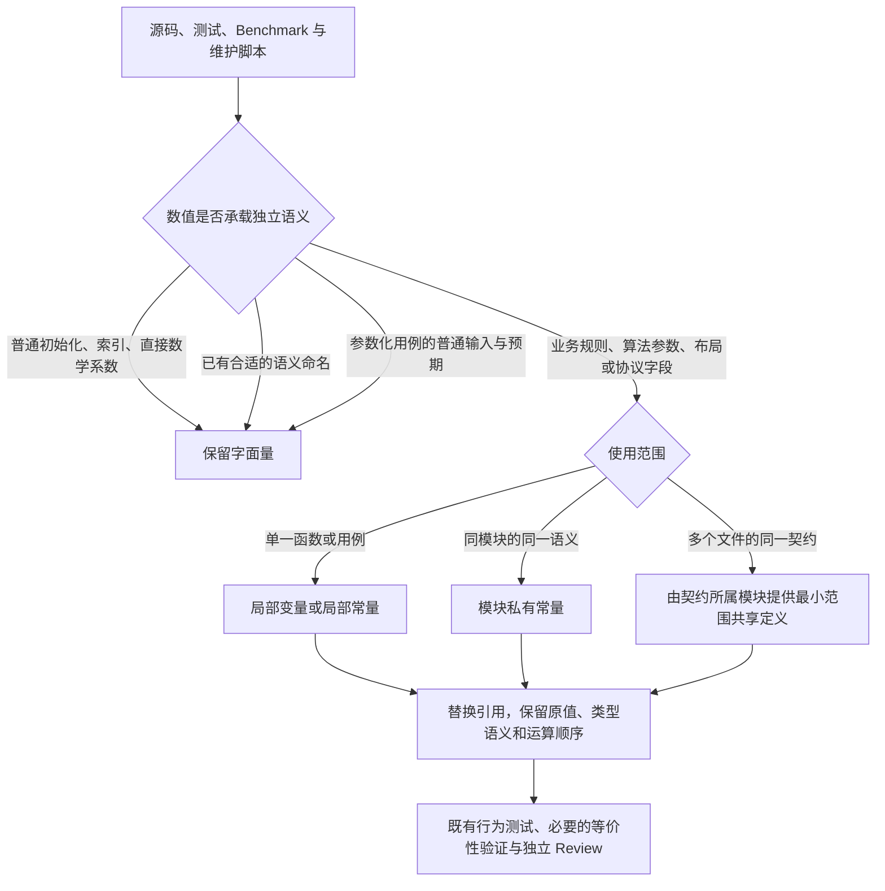

# Magic Number 语义命名重构方案

本次是一个完整的重构任务，不拆分为独立方案。目标是落实 `rules/code.md` 的 `Magic Number` 规范：为具有独立业务或算法含义的数值提供名字，并让同一语义的重复使用引用同一份定义。数值、功能、对外行为和测试所验证的契约均不改变。

**检查范围说明：**本次核对了 Workspace 清单、相关工程规则，以及下文列出的跨模块源码和测试。整仓下载未成功，GitHub 代码搜索返回了不完整结果，因此尚未完成每个源码文件的穷尽检查。“已确认修改点”来自实际读取的代码；“全仓覆盖检查”列出的其余范围仍需在实施时逐文件核销，不能据此认定那些目录没有 Magic Number。本文不包含已实施的代码变更或已通过的运行验证。

## 整体处理方式

不建立统一收纳所有数字的 `constants` 模块，也不把每个数字都改成 `const`。先判断数值表达什么，再将名字放到实际使用它的最小作用域中。

同一函数中的交互系数可以是局部变量；被多个函数共同使用的尺寸或时间间隔适合成为私有常量；跨文件共用的序列化布局应归属于对应 crate 的文件格式定义。只因数值相同而产生的“复用”不成立。



参数化测试例外不覆盖业务规则本身。例如，用例中的普通输入 `5` 可以保留，但表示交互超时门槛的 `400ms` 仍应命名。

## 命名与定义放置

| 实际情况                                 | 本次采用的处理方式                                           |
| ---------------------------------------- | ------------------------------------------------------------ |
| 一个函数内使用的系数、阈值或默认值       | 优先使用语义明确的局部变量；需要编译期求值时使用常量         |
| 多个函数共同依赖的同一数值               | 放在所属模块中，使用私有常量                                 |
| 多个文件共同遵守的内部约定               | 由约定所属模块提供最小可见性定义；确有需要时增加小型私有模块 |
| 已经是有名字的颜色、向量、数组或参数集合 | 保留整体定义，不逐项拆出没有独立意义的数字常量               |
| 数字相同，但职责不同                     | 分别命名，不建立错误的共享关系                               |
| 测试所验证的业务契约                     | 在测试侧独立命名预期值，不默认引用生产实现的内部常量         |

名称表达用途，而不是重复数值。例如使用 `initial_repeat_delay`、`search_field_height`、`max_rounding_error_step_fraction`，不用 `value_400`、`height_40` 或 `tolerance_1`。

需要区分单位时，在名称或类型中表达单位。时间间隔在合适的位置使用 `Duration`；像素、逻辑坐标、物理坐标和无量纲比例不能混用。提取后的标量类型应保持原表达式的精度与转换语义，不能为了共享定义将原来的 `f64` 计算先降为 `f32`。

## 已确认的修改点

以下是本次实际核查到的修改落点，不是全仓问题数量统计。表中的名字用于表达目标语义，实施时可以结合模块上下文调整，但不能退化成按数值命名。

### 交互时间、步进与命中区域

| 文件及位置                                                    | 当前数值与含义                                                  | 修改方式                                                                                   |
| ------------------------------------------------------------- | --------------------------------------------------------------- | ------------------------------------------------------------------------------------------ |
| `crates/number_input/src/repeating.rs`，`tick`                | 首次重复延迟 `400ms` 在两处分支出现；后续重复间隔为 `100ms`     | 定义 `INITIAL_REPEAT_DELAY` 和 `REPEAT_INTERVAL`，两个首次延迟分支引用同一定义             |
| `crates/hold_button/src/headless.rs`，默认 Props 与 `advance` | 默认蓄力 `3s`、衰减 `1200ms`；成功判定使用 `8.0 * f32::EPSILON` | 为默认时长与成功判定误差系数分别命名；保留 `Timing::default` 从 Props 默认值取值的现有关系 |
| `crates/slider/src/input.rs`，键盘步进路径                    | 未指定步长时取范围的 `0.01`                                     | 命名默认键盘步进比例，保留“已配置 step 优先”的行为                                         |
| `crates/canvas/src/input.rs`，`zoom_by_scroll`                | 像素滚轮输入除以 `100.0`；对数缩放增量乘以 `0.1`                | 分别命名像素输入归一化尺度和每行滚动的对数缩放增量                                         |
| `crates/canvas/src/scale.rs`，`hit`                           | 已有 `HANDLE_SIZE`，但命中半径额外加 `2.0`                      | 只为额外命中边距补充名字；求半径的 `0.5` 与平方运算保留                                    |
| `crates/list_view/src/drag.rs`，落点判定                      | `abs(local.y) < height / 6.0` 决定 Inside 区域                  | 为判定尺度或局部阈值命名，保留原除法与严格小于比较；说明该阈值对应中心区域的半高           |
| `crates/table/src/selection_drag.rs`，坐标夹取                | 从视口尺寸中减去 `0.001`，使选取坐标位于最大边界以内            | 命名边界内缩量，保留原坐标空间和夹取顺序，不替换成机器 epsilon                             |
| `crates/app_logging/src/writer.rs`，`LoggingGuard::finish`    | 日志结束等待上限 `5s`                                           | 提取日志 flush 超时定义，不改等待、失败传播和清理行为                                      |

NumberInput 可以直接保留原调度方式，仅替换时间间隔：

```rust
const INITIAL_REPEAT_DELAY: Duration = Duration::from_millis(400);
const REPEAT_INTERVAL: Duration = Duration::from_millis(100);
```

不把 `now + REPEAT_INTERVAL` 改为基于旧 deadline 的补偿调度，不增加漏帧追赶，也不改实际输入时钟和测试手动时钟之间的选择。

### 布局尺寸与重复的几何定义

**ComboBox 搜索框与弹窗高度。** `crates/combo_box/src/popup.rs` 的 `scene` 将搜索框高度设为 `px(40)`，`sync_geometry` 又使用 `40.0` 计算弹窗高度。这是同一语义，应引用共同的搜索框高度定义。弹窗边框厚度为 `1px`，高度计算中的 `2.0` 表示上下边框总高度；应明确这层关系，而不是留下独立的裸 `2.0`。可以在确认类型与结果完全相同后，用边框厚度计算总高度。初始弹窗高度、无搜索框、搜索无结果以及正常列表的计算路径都要使用对应定义。

其余窗口边距、搜索提示间距和圆角也按实际布局职责命名，不因为都等于 `8` 或 `4` 就与其他控件合并。此处不改为测量式布局，不引入配置 Resource，也不改变弹窗的 Scene 结构。

**DatePicker 网格和面板。** `crates/date_picker/src/view.rs` 的 `scene` 中，`7` 表示一周的天数，`6` 表示显示的周数，`42` 表示日历格子总数。三者应有明确的命名关系，创建格子、声明网格及其他相关使用点一起核对。`0..42` 中的 `42` 不是普通循环索引，不能因为写在循环里就豁免。

同文件中的 `304×352` 根尺寸、`36` 导航栏高度、`28` 星期标题高度、`240` 日期网格高度、`268` 面板高度、`26` 清除区域高度，以及导航按钮尺寸、内边距和圆角，都属于布局参数，按作用域命名。候选面板的 `3×4` 布局及 `12` 个候选项按导航面板语义处理，不仅因为月份也有十二个就强行共用同一个常量。Today 图标的 `152` 栅格化尺寸和 `0.25` 显示缩放也应表达其用途，保持栅格化与显示策略不变。

**Tooltip。** `crates/tooltip/src/style.rs` 的 `popup_scene` 在四个方向上重复使用 `gap: 6.0`，应共用弹窗间距定义。窗口边距 `8.0`、横纵 padding `8/6`、边框 `1` 和圆角 `4` 分别按语义命名；弹窗间距与纵向 padding 虽然都等于 `6`，不能因此共用名字。

**Table 与 FileDialog。** `crates/table/src/resize.rs` 的 `ensure_handle` 使用 `6px` 列宽调整命中区域，应命名为调整手柄宽度。`crates/file_dialog/src/window.rs` 的窗口标题左边距 `10px` 也作为其局部布局参数处理，不由此改造窗口构造流程。

**Gallery 主窗口。** `gallery/src/main.rs` 的 `gallery_window` 和 `setup` 都使用 `1920×1080`。使用同一份启动物理尺寸定义，但保留初始化及 Startup 两次设置：后者有现成的跨 DPI 初始化补偿职责，不能作为“重复代码”删除。

### 数值算法与时间轴策略

`crates/slider/src/gesture.rs` 在步数计算中使用 `1e-6`；`crates/slider/src/value.rs` 使用 `4.0` 和 `0.001` 控制可达值的舍入容差。这些属于独立的算法策略，应命名，但不调整数值。

局部变量就足以表达 `reachable` 中的语义，例如：

```rust
let rounding_epsilon_factor = 4.0_f64;
let max_rounding_error_step_fraction = 0.001_f64;
let tolerance =
    (rounding_epsilon_factor * f64::from(f32::EPSILON) * magnitude)
        .min(step * max_rounding_error_step_fraction);
```

这里保持原来的乘法顺序、`f32::EPSILON` 到 `f64` 的转换和 `.min(...)`。不把不同算法的容差归并成全局 `EPSILON`，也不顺便“优化”舍入判断。

`crates/waveform/src/time_axis.rs` 需要同时整理下面几组语义：

| 数值                                                  | 应表达的语义                                           |
| ----------------------------------------------------- | ------------------------------------------------------ |
| 多处 `1_000_000_000` 及精度计算中的 `9`               | 纳秒与秒的换算、纳秒小数位数                           |
| `[1, 2, 5]` 与 `[5, 2]`                               | 主刻度候选倍数、次刻度划分的尝试顺序；分别命名整个数组 |
| 多处 `90.0` 与 `20.0`                                 | 标签最小间距、次刻度最小间距                           |
| `8.0` 与 `16.0`                                       | 标签间隔及测量余量；先区分两者职责，不仅凭倍数关系合并 |
| 边界比较中的 `0.5`                                    | 标签边界允许的几何误差，与计算中心点的 `0.5` 区分      |
| 刻度高度 `6/3`、标签位置 `7`、字号 `12`、透明度 `0.4` | 时间轴外观参数                                         |

时间换算继续使用原来的整数宽度和运算顺序，不能改为另一套 Duration 或浮点换算流程。刻度候选数组的顺序、整除判断、取整和字符串格式必须保持。

`crates/canvas/src/scale.rs` 中的 `f32::from_bits(1)` 表达最小正次正规数。如果为这项数值补充名字，应保留原始位模式，不能替换成含义不同的 `f32::MIN_POSITIVE`。

### Waveform 文件格式

这部分比普通尺寸常量更需要集中定义，因为读取、写入和索引计算必须遵守同一个二进制布局。

已确认的落点是 `crates/waveform_file/src/recording.rs` 与 `crates/waveform_file/src/lttb_index.rs`。当前代码存在以下重复的长度和偏移量：

| 布局对象         | 现有布局                                                               | 命名与共享方向                                                              |
| ---------------- | ---------------------------------------------------------------------- | --------------------------------------------------------------------------- |
| 原始采样记录     | `5` 字节：前 `4` 字节为 little-endian `f32`，偏移 `4` 为有效性字节     | 原始采样记录长度、数值字段范围、有效性字段偏移由格式所属模块定义            |
| MinMax span      | `24` 字节：`0..8` 起点、`8..16` 终点、`16..20` 最小值、`20..24` 最大值 | 命名记录长度和各字段范围，读写两侧共同引用                                  |
| 索引表项         | `16` 字节：两个 `u64`，分别是位置与数量                                | 使用独立的索引表项长度及字段定义                                            |
| LTTB 数据点      | `16` 字节：`u64` 采样位置、`f32` 数值、`u32` 断线标志                  | 使用独立的数据点记录长度，不能与索引表项长度合并                            |
| 文件开头         | 现有 `MAGIC` 为八字节 `WFRIDX02`，原始数据从其后开始                   | 命名原始数据起点，并与现有文件头定义核对；不要把所有数字 `8` 当成同一个含义 |
| 原始样本有效性   | 记录中的 `0/1` 表示无效/有效样本                                       | 作为格式标记命名，不能按普通初始值豁免                                      |
| 构建时生产批大小 | 裸 `65_536` 控制一次向生产者请求的帧数                                 | 独立命名生产批大小，不因它与 `MAX_BUCKET` 或 LTTB 的 `BLOCK` 相等就合并     |

优先由现有格式所属模块提供最小可见性的共享定义。如果需要让两个文件共同使用字段布局，可以增加 crate 内部的私有格式模块，但不暴露新的公共 API，不引入序列化框架。

长度必须表示**磁盘编码长度**，不能使用 `size_of::<WaveformSpan>()` 等内存结构大小替代。`as_chunks` 的编译期长度、切片偏移、容量计算、checked arithmetic 和错误上下文中的长度参数应同步替换，保留各处 `usize/u64` 的原有语义。

已经命名的 `MAGIC`、`STRIDES` 等定义无需拆散其中的每一个数字。若发现同一文件中语义相关的其他偏移、单位标识或层级倍数，也按相同方法检查；没有读取到的分支不视为已排除问题。

### Gallery 配置、Benchmark 与工具

| 文件                                        | 已确认的语义数值                                                                                                    | 修改方向                                                                              |
| ------------------------------------------- | ------------------------------------------------------------------------------------------------------------------- | ------------------------------------------------------------------------------------- |
| `gallery/src/config.rs`                     | 默认缩放 `1.25`、允许的缩放数组、默认 BRP 端口 `15702`、端口范围 `1024..=65534`、排除端口 `15703`                   | 分别命名默认值、候选集合和端口策略；保持校验范围及现有报错内容                        |
| `gallery/benches/waveform.rs`               | 启动等待 `60s`、完成等待 `120s`、关闭等待 `15s`、不同轮询间隔、RPC 与指针等待上限，以及场景元数据中的负载和预热参数 | 按阶段和职责命名；同为 `10s` 的不同超时不自动合并；核对元数据与实际执行参数的对应关系 |
| `gallery/tools/generate_waveform_data.rs`   | 文件版本 `1`、采样率 `8000`、通道数 `4`、总帧数 `240000`、方波及三角波幅度、方波占空比                              | 让文件头和生成循环引用相同的相应定义；保持通道顺序、相位公式与字节输出                |
| `gallery/tools/summarize_waveform_bench.py` | P95/P99 的分位参数、最低样本数、`12s` 预热门槛、毫秒换算、渲染诊断 `720` 帧门槛                                     | 命名统计策略，保持筛选条件、取整方式、输出字段与错误信息                              |

`12s` 与 `720` 帧是两项现有筛选条件，不因为看起来满足 `12 × 60 = 720` 就将它们改成相互推导的逻辑。`65534` 也不能顺便改成 `u16::MAX`。

数据生成工具使用的 `WFRM` 与 `waveform_file` 的 `WFRIDX02` 是不同的现有格式，分别维护其定义，不能通过这次命名重构统一格式。

## 测试如何一起整理

功能代码和测试代码遵守相同的语义命名原则，但测试仍要能独立发现生产行为被改错。

### 保留边界测试的独立预期

`crates/number_input/tests/repeating.rs` 使用 `399 + 1ms` 验证首次 `400ms` 门槛，使用 `99 + 1ms` 验证后续 `100ms` 间隔。这里应以测试侧的名字表达预期首次延迟、预期重复间隔和边界推进量。预期值在测试侧独立保留，不改为直接读取生产常量后再生成所有等待和断言。

既有“长空闲后按下”“长帧不补发多次重复”“释放后停止”“重新按下重新计时”等序列全部保留。`2000ms` 等长帧输入也按测试意图命名，不能为简化测试改成不同时间。

同文件 fixture 的 `600` 测试视口、`40` 根偏移、`226/56` 命中点，以及固定推进 `6` 帧，都有夹具语义，应为整体尺寸、位置或推进次数提供名字。命中点应作为完整坐标命名，不要求把两个坐标拆成互不关联的常量。

### 不把测试改成生产实现的复述

Slider 的正常步进、端点反向、较大偏移和次正规数场景应保留原始数据与断言。为步长、不可达样本和特定边界输入命名即可，不把所有预期结果重新调用被测算法计算。

`rstest` 的普通 case 输入与预期值仍可直接保留。循环驱动的数据表应按实际测试语义判断，不能仅因为放进数组或循环就将业务阈值变成“无须命名的数据”。也不为了规避规范而把所有测试迁移成参数化测试。

不增加只比较 `const == 同值字面量` 的测试。真正需要保护的是行为关系、边界和对外契约。

### 测试基础设施与特殊输入

`crates/test_utils/src/scene.rs` 中的默认测试视口 `600` 和手动帧时长 `16ms` 应明确命名。保持原来的更新次数、时钟和插件组合，不用真实 sleep 替换手动推进。

`crates/app_icon_build/src/lib.rs` 的非 UTF-8 Windows 路径测试使用 `0xd800`。应将它表达为未配对的 UTF-16 高代理项测试输入，保留原值，不能在整理输入时将它变成合法 Unicode。

跨 crate 共享的真实测试设施继续归 `test_utils`；仅用于单个文件的预期值不搬进去。不得为了让集成测试访问常量而扩大生产代码的可见性。

## 已有定义与应当保留的字面量

`crates/tooltip/src/headless.rs` 已有 `COLD_WARMUP`、`WARM_DELAY` 和 `COOLDOWN`，这些声明本身已经满足要求。

`crates/theme/src/common.rs` 已用 `WINDOW_BACKGROUND`、`SURFACE`、`PRIMARY` 等名字定义完整颜色。RGB 分量属于这些有名字的颜色值，不需要再造 `RED_255` 之类的常量。同色值的不同主题角色也不应因去重而绑定在一起。

计算中点的 `0.5`、平方的指数 `2`、普通索引、自增 `1`、没有特殊约定的初始 `0` 可以保留。判断依赖具体语义，而不是维护“所有 0 和 1 都放行”的数字白名单：协议标记、默认端口和业务数量即使很小，也可能需要名字。

## 全仓覆盖检查与实施顺序

已确认的修改点不是任务边界。实施时在同一个任务中完成全仓覆盖，不只修改本文举出的文件，也不将其余目录默认判为合规。

以 Git 跟踪文件为基础建立检查清单，至少覆盖 Rust 源码及现有 Python、PowerShell 维护脚本。下面的命令可以列出这些文件，但不负责判断数字是否为 Magic Number：

```powershell
git ls-files -- '*.rs' '*.py' '*.ps1'
```

继续核对是否有其他实际参与运行的源码类型或内嵌代码，避免仅按文件后缀漏扫。普通字符串中的数字、字段访问 `.0`、类型名中的数字、注释、依赖版本和资源数据不能机械计入。十六进制、科学计数法、带下划线的整数、类型后缀、宏参数和测试属性中的字面量则要纳入候选。

| 检查范围             | 应覆盖的目录与代码                                                                                                    |
| -------------------- | --------------------------------------------------------------------------------------------------------------------- |
| 基础设施与门面       | `diagnostics`、`internal_log`、`job`、`app_logging`、`app_icon_build`、`asset`、`core`、`bevy_widgetry`、`test_utils` |
| 主题、窗口与系统集成 | `theme`、`cursor`、`window`、`tray`、`power_inhibit`、`message_box`、`file_dialog`                                    |
| 基础交互控件         | `button`、`hold_button`、`toggle_button`、`check_box`、`radio_group`、`segmented`、`tabs`、`collapsible`、`tooltip`   |
| 表单与布局控件       | `slider`、`number_input`、`combo_box`、`date_picker`、`text_field`、`progress_bar`、`splitter`、`scroll_area`         |
| 集合、绘图与波形     | `list_view`、`tree`、`table`、`canvas`、`waveform`、`waveform_file`                                                   |
| Gallery 与辅助程序   | `gallery/src`、`gallery/tests`、`gallery/examples`、`gallery/benches`、`gallery/tools`，以及构建和安装脚本            |

上表中的 crate 均位于 `crates/`。每个 crate 不仅检查 `src`，还检查其实际存在的内联测试、`tests`、`benches`、`examples` 和构建代码。相应目录不存在时跳过，不为形式完整创建目录或文件。

先建立本任务的临时进度记录，确认实际实施基线和已有未提交修改，再核查上述文件。对候选作出“需要命名”“已由语义定义承载”或“符合字面量例外”的判断；不以正则命中数作为问题数。

随后在既有测试保护下替换定义和引用，优先一起处理有真实关联的使用点，例如 ComboBox 的构建与计算、文件格式的读取与写入。模块内单点值就地命名，同一语义多处使用才提升作用域。保持单一任务和单一方案，不据此拆成多个独立交付计划。

修改后重新审阅所有残留候选、宏展开相关使用和未启用 feature 下的源码，确认没有只修改默认编译路径。核销完整文件清单后才能记录“全仓检查完成”；没有完整检查的文件保留待核查状态，不能以“未命中搜索结果”代替。

## 验证行为没有改变

### 基础检查

在仓库规定的 Windows 64 位、`x86_64-pc-windows-msvc` 环境中，使用 PowerShell 7 执行验证。实施前确认相关基线测试状态，实施后至少完成：

```powershell
cargo fmt --all -- --check
cargo check --workspace --all-targets
cargo clippy --workspace --all-targets
cargo test --workspace
```

`--all-targets` 用于覆盖实际存在的测试、示例和 Benchmark 编译目标，不表示所有 feature 都已验证。对于修改到的条件编译代码，再按仓库实际支持的 feature 组合补充检查，不盲目启用互斥配置。

只读方案阶段不运行上述命令。实施中的失败应区分基线已存在的问题与本次引入的问题，并记录未通过或未执行的验证，不能写成全部通过。

### 重点等价性检查

| 修改区域                                    | 需要保留并验证的结果                                                           |
| ------------------------------------------- | ------------------------------------------------------------------------------ |
| NumberInput 与 HoldButton                   | 首次触发门槛、重复间隔、取消、禁用、释放与重新按下、成功事件次数及长帧行为不变 |
| Slider                                      | 键盘默认步进、步长网格、端点、反向拖动、大偏移及次正规数输入结果不变           |
| Canvas、ListView、Table                     | 缩放曲线、指针锚点、命中区域、Inside/Before/After 分界与选择边界不变           |
| ComboBox、Tooltip、DatePicker、Gallery 窗口 | 既有布局值、弹窗尺寸、日历格子数量、显示状态与 DPI 补偿行为不变                |
| Waveform 时间轴                             | 相同输入下刻度位置、主次刻度选择、标签文本及显示筛选结果不变                   |
| Waveform 文件格式                           | 既有文件可读；固定输入的编码字节、字段顺序、长度和标记保持一致                 |
| 数据生成与统计脚本                          | 固定输入下生成内容、筛选样本、统计结果、输出字段及错误行为不变                 |

文件格式不能只依赖读写 round-trip：读写两侧一起偏移也可能使 round-trip 通过。优先复用现有固定样本或独立预期字节；覆盖不足时，以重构前的确定性输出补充必要的行为保护。新增测试应验证实际编码或解析契约，而不是静态常量相等。

布局和命中参数涉及真实 UI 时，按 `rules/gui-debugging.md` 使用 BRP 对受影响的代表场景做针对性验证，覆盖当前支持的相关 DPI 配置。不以编译成功代替运行期布局验证，也不要求执行与本次修改无关的全量 GUI 场景。

Python/PowerShell 脚本按其实际运行环境执行语法检查、已有测试和必要的固定输入输出比较。生成工具验证使用临时输出，不覆盖或提交现有资源。统计脚本保留原有数据选择与分位数算法，不顺便修正统计设计。

本任务不声明性能改善。单纯命名替换没有改变计算量、分配或调度时，不为形式完整强制执行全部 Benchmark；依照 `rules/benchmark.md` 在进度记录中说明。若实际修改影响了这些路径，应先收回不必要的改动，确有需要保留时执行对应场景验证，不能放宽负载或预算。

### Review 与文档

完成必要验证后，按照 `rules/code-review.md` 对完整改动执行独立 Review，重点检查遗漏的关联使用点、错误合并的语义、精度变化、测试预期耦合及 BSN 捕获变化。不能只 Review 最后一个修改文件。

纯内部命名重构不改变对外事实时，不机械修改 `docs/architecture.md` 或各 crate 功能文档。只有测试覆盖职责真正发生变化时才同步 `tests/COVERAGE.md`。本方案若保存进仓库，应放在 `plans/`，不写成已实现功能文档。

## 重构边界与完成条件

本次只允许命名、引用替换及由真实语义关系支撑的最小范围共享。不改变公共接口、配置格式、事件顺序、错误策略、UI 结构、ECS 调度、文件版本、Benchmark 负载或生成资源，不新增依赖、crate、通用参数框架或 Magic Number lint。

浮点运算保持原精度、括号、转换与计算顺序。不得将除法改成乘倒数、将不同容差统一成机器 epsilon、将次正规数替换成最小正规数，或为了“更合理”改变任何阈值。整数运算保持原来的宽度、checked/saturating 行为和边界比较。

同一语义的重复值可以共享；如果核查发现相关位置当前数值并不一致，不在这次重构中擅自统一。先分别命名并保留原行为，将是否修复不一致作为独立问题记录。

局部命名不得改变原先的分配次数、延迟求值时机或 BSN/template 的捕获与所有权关系。不要为了消除字面量而引入新的运行期查询或额外状态。

完成时应满足：全仓源码清单已核销；具有独立语义的数字已命名或已由适当的命名值承载；例外保留有语义依据；共享没有跨越不相干的职责；测试仍独立验证原契约；必要检查与 Review 已完成，未验证项明确记录。验收目标是语义清楚且行为不变，不是源码里不再出现数字。

执行依据为本基线的 `AGENTS.md`、`rules/code.md`、`rules/project-context.md`、`rules/development.md`、`rules/testing.md`、`rules/benchmark.md` 和 `rules/common-commands.md`；实施时还需按实际变更选择适用的专项规则。
