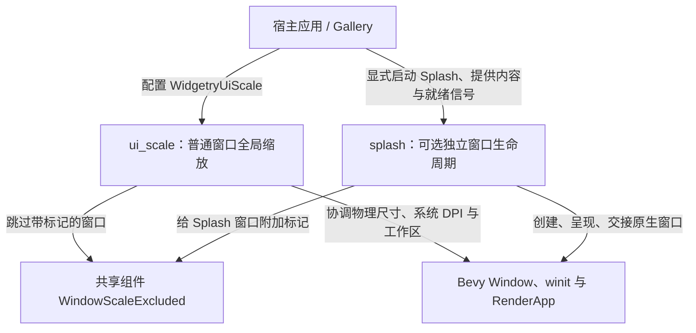

# 全局窗口缩放与独立 Splash 的整体设计

目标是把 Gallery 目前直接操作窗口 DPI Override、维护 Popup 物理尺寸的逻辑抽成可复用能力，同时把覆盖在主窗口中的 Splash 改成可选的独立原生窗口。两项能力在职责上独立：普通窗口受全局应用缩放管理，Splash 是明确排除的特殊窗口；没有启用 Splash 时，主窗口仍按普通方式独立启动。

应用缩放和操作系统 DPI 不能混为一谈。`WidgetryUiScale` 是应用控制的统一比例，默认 `1.0`；Gallery 从配置中提供初始值，默认 `1.25`。普通窗口以逻辑尺寸为设计基准，物理窗口要随应用缩放变化，同时仍正确处理 Windows 的显示器 DPI、用户 Resize、窗口最大化/最小化和工作区限制。Splash 则不参与这套应用缩放：它固定 Bevy 的 DPI Override 为 `Some(1.0)`，保持外部指定的物理尺寸，而且无边框、无原生标题栏、不可 Resize。

Splash 只负责其独立窗口与主窗口的生命周期协调，不知道应用要显示什么图片、BSN/Scene、Camera、动画或跳过按钮。宿主提供完整的 `Window` 基础配置及内容，但 Splash 对无边框、不可 Resize、固定 DPI 和按主窗口所在显示器居中等专属属性具有最终控制权。宿主还负责发出 `SplashReady`、`SplashFinished`、`MainWindowReady`；渲染是否完成则由库在实际呈现路径上检查。Splash 动画已经结束但主窗口尚未就绪时，宿主继续保持 Splash 的最后一帧。

Splash 是编译期与运行期双重可选能力。Facade 中 `splash` Feature 默认关闭，Gallery 显式启用；仅添加 `SplashPlugin` 不得自动隐藏主窗口或创建启动会话。启动会话被应用明确选择后，主窗口必须从原生创建时就处于隐藏状态，以免小尺寸 Splash 前后露出空白的主窗口；相应的首帧安全显示和正常交接由后续增量建立。

错误传播沿用 `WidgetryFailure<领域错误>`、`ErrorFrame` 和 ECS `Severity::Error` 的现有规则。Splash 不替宿主决定回退、重试、销毁、显示主窗口或退出程序；它只负责提供可识别的错误、保留诊断信息，并避免在已失败的前提下继续执行无效操作。

## 实施顺序

下列编号是唯一实施顺序；编号相邻不一定表示存在 crate 依赖。前两份为可复用缩放功能的基础及 Windows 尺寸正确性，第三份将 Gallery 切换到该能力。第四至第六份逐步构建可选 Splash，最后迁移 Gallery 原有启动画面与关闭流程。

1. [统一窗口缩放资源与普通窗口管理](01-统一窗口缩放资源与普通窗口管理.md)
2. [Windows DPI 与工作区尺寸协调](02-Windows-DPI与工作区尺寸协调.md)
3. [Gallery 迁移全局窗口缩放](03-Gallery迁移全局窗口缩放.md)
4. [Splash 独立窗口与固定几何](04-Splash独立窗口与固定几何.md)
5. [Splash 首帧安全显示](05-Splash首帧安全显示.md)
6. [Splash 就绪信号与主窗口交接](06-Splash就绪信号与主窗口交接.md)
7. [Gallery 迁移独立 Splash](07-Gallery迁移独立Splash.md)
