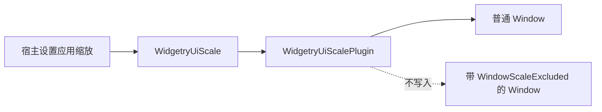

# 统一窗口缩放资源与普通窗口管理

## 目标与位置

新增 `crates/ui_scale`，包名 `bevy_widgetry_ui_scale`，提供 `WidgetryUiScalePlugin` 和全局资源 `WidgetryUiScale`，使应用在一个位置控制所有普通窗口的应用缩放。它替代“每个窗口各自设置 DPI Override、Gallery 直接修改每一个 Window”的用法。此增量建立可运行的普通窗口缩放基础；复杂 Windows 工作区和跨屏 DPI 适配由下一份方案在同一机制上完善。

这里的 Scale 不是系统的显示器 DPI。它是应用想让 UI 以多大比例呈现的选择。默认 `1.0`，无论系统主显示器是 100%、125% 还是 150%，都不直接把这些数值写入 `WidgetryUiScale`；宿主可以主动设置其他比例。Gallery 默认 `1.25`，由后续迁移方案接入。

## 资源、窗口归属与职责

`WidgetryUiScale` 是整个应用统一的缩放状态。所有**普通**原生窗口默认参与管理，包含主窗口及后续创建的 Popup、独立业务窗口；不要求调用者逐一注册。资源值发生实际变化时，参与管理的窗口采用相同目标 Scale。应用不应再直接遍历所有窗口写 `set_scale_factor_override` 来模拟全局设置。

特例由 `WindowScaleExcluded` 明确标记。标记表示“此 Window 不参与应用控制的窗口 Scale 管理”，并不表示禁用 Bevy UI 缩放或 Windows DPI。缩放系统不能覆盖已排除窗口的 DPI Override、物理尺寸和窗口策略；日后 Splash 创建窗口时会自动附带该标记。缩放系统不依赖 Splash crate，Splash 也不反向成为缩放系统的一部分。

`WindowScaleExcluded` 需要在两个新 crate 都能访问的下层位置定义。讨论中倾向放在 `core` 而非让 `ui_scale` 依赖承载自定义标题栏、主题和窗口 UI 的 `crates/window`。**标记的最终定义位置尚未由使用方单独确认**；实现前应明确公共导出位置，确保依赖单向，不引入 `ui_scale` ↔ `splash` 的依赖环。无论放置位置如何，对外名称和排除语义保持不变。

## 初始化与运行时更新

当 Window 进入 ECS 时，缩放管理器识别其参与状态并获取当前 `WidgetryUiScale`。之后资源值变化会传播至所有参与窗口；后建窗口使用当前值，而不是某个过期的初始配置。外部为普通窗口创建的 `WindowResolution` 与 Resize Constraints 应保留其原有设计意图，不因首次应用 Scale 就丢失逻辑尺寸。

窗口尺寸管理保留独立的逻辑尺寸基准和已请求的物理尺寸，而不是仅依靠本帧 `Window.physical_size()` 反推全部历史状态。对于非暂停的普通窗口：

- 应用缩放改变时，以已保存的逻辑宽高计算新物理宽高，使逻辑可视大小保持稳定。
- 用户实际 Resize 后，更新该窗口的逻辑尺寸基准；下一次缩放按用户的新窗口大小计算。
- 设置相同 Scale 不应反复改变窗口尺寸或产生通知抖动。
- 关闭管理后，排除窗口不能被普通窗口同步系统重新接管；标记与 Window 同一轮创建时不能短暂套用错误的比例。

例如，一个 640×400 的 Popup 在 Scale 为 `1.0`、`1.25`、`2.0` 之间切换，窗口内容的目标逻辑范围仍是 640×400，对应目标物理尺寸为 640×400、800×500、1280×800（未被显示器工作区限制时）。若用户在 Scale 为 `1.25` 时把窗口实际拖拽为 1000×625，则新的逻辑基准应为 800×500，之后的缩放沿用这一新基准。

## 与现有能力的关系

既有 `gallery/src/window_scale.rs` 的 `PopupSize` 通过 `logical`、`expected`、`scale`、`base_scale`、`constraints`、`desktop` 和 `suspended` 分别表达设计尺寸、预期物理尺寸与环境状态。新 crate 可以按必要职责吸收这类状态；不把 `PopupSize` 原样作为公共 API，也不让 Gallery 的 `AppConfig` 进入库依赖。Window 作为 Bevy 原生组件保持原生使用方式，而 `WidgetryUiScale` 是管理器的单一应用级控制来源。

本阶段应从 Facade 暴露应用确需使用的插件、资源与排除标记，不把具体缩放行为放在 Facade 中，也不对未启用插件的普通 Bevy App 添加隐式窗口策略。

## 测试与完成条件

在不依赖真实原生窗口的测试中验证：默认值 `1.0`、后建 Window、多个普通 Window 接收同一比例、排除窗口完全不受应用 Scale 改动、运行时更改保持逻辑尺寸、用户 Resize 更新基准、同值更新无副作用。同步检验 Window 与标记同批插入时的 Observer/调度顺序，避免 Splash 尚未被识别为排除窗口就先遭缩放。

完成时应能通过独立示例/测试创建普通窗口并设置全局 Scale，而不依赖 Gallery、Splash 或具体 Widget 内容。`docs/architecture.md`、对应 crate 文档和 Facade 对外 API 文档随行为落地同步更新；错误类型、日志和必要的 ECS 传播遵守现有诊断规范。

## 边界与未决点

本阶段不负责 Splash 原生窗口、渲染就绪或 Gallery 的配置持久化。对不合法的应用 Scale，应使用有类型的错误表达，不能通过 panic 或静默替换伪装成功；具体输入校验范围需与公共 API 定稿，不把 Gallery 目前仅允许四档选择的业务约束强加给所有宿主。
