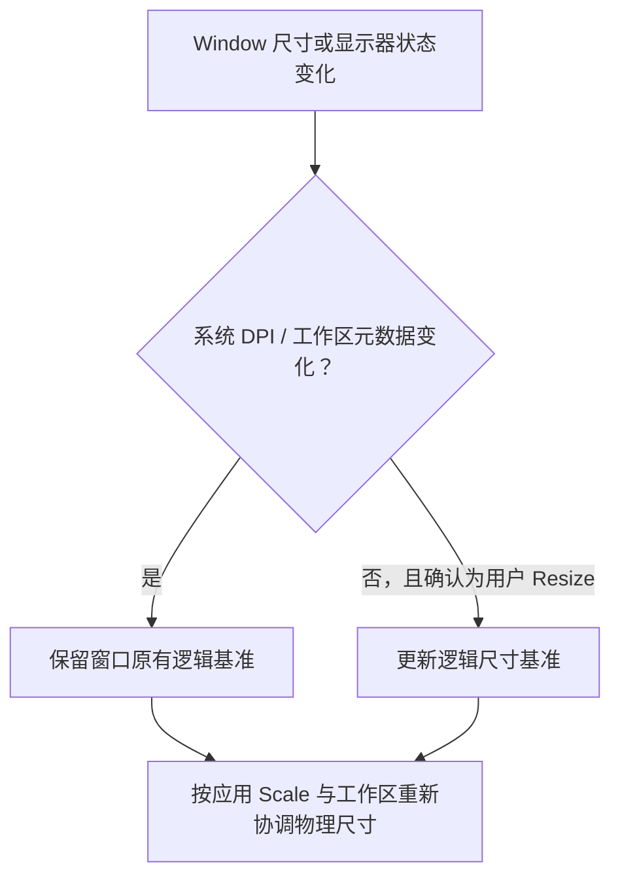

# Windows DPI 与工作区尺寸协调

## 目标与位置

在已有 `WidgetryUiScalePlugin` 的普通窗口缩放能力上补齐 Windows 原生窗口尺寸协调，使窗口移动显示器、系统 DPI 变化、工作区不够大或处于最大化/最小化时，仍保留正确的应用逻辑尺寸。它是对窗口缩放“可以实际用于 Windows 多窗口应用”的独立增强，实施后能与基础缩放分别验收。

应用 Scale 决定预期物理尺寸；Windows DPI 会影响 winit 的原生逻辑/物理换算、窗口初始化及跨显示器行为。二者必须分别跟踪，否则系统 `WM_DPICHANGED` 导致的原生尺寸改动会被误认为用户拖拽，永久污染保存的设计尺寸。

## 显示器、DPI 与真实工作区

从 Bevy 的 `Monitor`、`PrimaryMonitor`、`WindowPosition` 和必要的 winit 原生窗口状态确定窗口所在显示器。窗口已经原生创建时优先考虑其真实当前显示器；原生 Window 尚未就绪时，根据 `Centered(MonitorSelection::Entity/Index)`、`WindowPosition::At` 或主显示器元数据判断。对于按坐标定位且跨越多个显示器的窗口，现有代码具有“重叠面积优先、再按中心点距离”选择显示器的逻辑，不应在抽取时悄悄退化成始终使用主显示器。

Windows 工作区需要按物理像素获取，正确扣除任务栏等占用；已有实现使用 `winsafe::HMONITOR::MonitorFromPoint` 与 `GetMonitorInfo` 获取 `rcWork`。保留负坐标的多显示器布局支持，避免将左侧/上方显示器的坐标当作非法值。

当前 `gallery/src/window_scale.rs` 已在 `desktop_for` 中区分 `base_scale` 与应用目标 Scale：winit 的 Resize Constraints 使用系统逻辑像素，必须依据显示器基本 DPI 将应用控制的尺寸约束转换过去。新 crate 承接这个换算，不把工作区物理像素尺寸直接错误传给 winit 的逻辑约束。

## 尺寸计算、位置修正与窗口状态

正常窗口状态下目标物理宽高可概括为 `round(logical_size × WidgetryUiScale)`，再受 Window Resize Constraints 和当前显示器可用工作区约束。工作区放不下时，**优先让物理窗口留在工作区内**，暂时降低可见逻辑范围；保存原来的设计逻辑尺寸基准，以便将来切换到足够大的显示器或缩小 Scale 时恢复，而不是将临时夹紧后的尺寸写回基准。

例如 Gallery 的逻辑设计尺寸为 1920×1080，Scale 为 1.25 时目标物理尺寸为 2400×1350。若当前显示器可用工作区更小，可以限制实际物理尺寸，但不能因此把原始 1920×1080 设计意图忘掉。

跨显示器 DPI 变化时，应区分监视器元数据先变化和原生窗口 Resize 事件先到达这两种顺序；新的 `base_scale_factor` 与工作区信息暂时不同步时，不应把那一帧的物理尺寸变化认定为用户 Resize。尺寸变化真正来自用户操作且不处于暂停状态时，才更新逻辑基准。

在 Maximized、Minimized、非 `Windowed` 等状态下暂停普通物理几何强制写回，让 Windows 决定当前呈现的窗口边界；Scale 值及设计基准继续保存。恢复到普通窗口状态后，根据原来的逻辑基准重新得到目标尺寸。窗口超出工作区时修正坐标，但不能把所有窗口都无条件居中；明确的 `WindowPosition::At` 应尽可能保留用户的目标位置并只做必要夹紧。

## 实现与依赖边界

复杂几何处理仍属于 `crates/ui_scale`，不迁回 Gallery，也不为此新建额外的业务窗口管理系统。它可使用 Windows/Winit 数据，但不能反向依赖高层 `window` Widget 或 Splash。所有真实系统错误按 crate 领域错误与 `WidgetryFailure` 传播；正常等待 Monitor 元数据、尚未创建原生窗口等合法暂态不应错误化。

本阶段的物理尺寸协调仅针对参与全局管理的普通窗口，必须跳过 `WindowScaleExcluded`；Splash 的固定物理尺寸策略另由 Splash 专属方案保证。

## 验证与完成条件

测试需要覆盖两种 DPI 事件到达次序、相同和不同 `base_scale`、显示器位置为负数、跨屏且重叠的窗口、工作区缩小及恢复、用户真实 Resize、同值 Scale，以及最大化/最小化/恢复切换。重要不变量是：系统 DPI 或临时工作区夹紧不覆盖长期逻辑基准，而实际用户 Resize 会覆盖。

在 Windows 上使用真实原生窗口检查显示器 100%/125%/150% 等缩放比例与跨屏行为；Headless Test 只能验证算法及 ECS 状态，不能代替操作系统窗口实测。属于 GUI 可观察行为的部分按 `rules/gui-debugging.md` 进行针对性 BRP 验证；BRP 不具备真实 OS Window Resize/跨屏模拟能力的场景必须另行标出实际验证证据，不能以 Custom Pointer 模拟结果冒充。

## 防御性约束

不可对未参与管理的窗口施加隐式 Resize；避免在 `Changed<Window>` 回路中重复写入相同尺寸造成持续同步循环。窗口可用工作区或原生元数据暂时不可用时，应按实际可用信息协调，不可构造虚假的屏幕坐标或 Scale。对 Windows 原生调用失败的真实错误要传播，不得只记录日志后继续。
