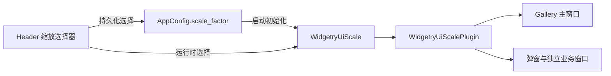

# Gallery 迁移全局窗口缩放

## 目标与位置

把 Gallery 从 `AppConfig` 直接控制每个 `Window.scale_factor_override` 的模式，切换为消费 `WidgetryUiScalePlugin` 和 `WidgetryUiScale`。这份增量可在没有独立 Splash 的情况下落地、运行和验收：它完成全局缩放功能的真实应用接入，并从 Gallery 删除已抽取的通用窗口几何管理职责。

## 配置与控制权

Gallery 的缩放配置仍保存在 `AppConfig.scale_factor`，默认 `1.25`，目前允许 `1.0`、`1.25`、`1.5`、`2.0` 四档。这个限制是 Gallery 的设置 UI 与持久化约束，不意味着库的 Scale 值只能从四档中选取。加载配置时将其交给全局 `WidgetryUiScale`；Header 选择器改变的是该资源，而不是遍历全体 Window 写 Override。

`gallery/src/header.rs` 中的 `ScaleFactorComboBox` 目前含 `target_window`，其同步逻辑从窗口读取 `scale_factor()`，选择变化时调用 `gallery/src/window_scale.rs::apply` 并保存配置。迁移后 Header 的选中值以全局 Scale 资源为准，显示器 DPI 和个别窗口被工作区夹紧都不应使选择器误认为全局设置变化。现有 `ConfigFile` 保存失败的明确降级策略及诊断日志约定继续保留。

目前远端 Header 已使用 `WidgetryComboBoxHeadless` 与相应的已更新 Widget API；改动应立足这个接口，不引入旧版本的 ComboBox 访问方式。Gallery 的主题设置也已改用 `GalleryTheme`，这不是缩放迁移的改造对象，不应为了移除缩放逻辑修改主题体系。

## 主窗口启动尺寸的语义切换

旧 `gallery/src/main.rs` 使用 `STARTUP_PHYSICAL_SIZE = 1920×1080` 并在 `Startup` 中再次调用 `set_physical_resolution(1920,1080)`，目的是修复 winit 创建和定位原生窗口时出现的尺寸漂移。新的含义必须改为 **逻辑设计尺寸 1920×1080**：在 Scale=1.25 且工作区足够大时，物理目标尺寸为 2400×1350，而不是旧的 1920×1080。

因此不能继续保留“无条件恢复到 1920×1080 物理像素”的启动补丁。尺寸初始化、DPI 顺序修正和工作区适配都交给 `ui_scale`；Gallery 只声明设计尺寸、初始 Scale 与自身窗口配置。原生窗口既有的无标题栏、透明渲染等配置由 `prepare_native_window` 继续负责，缩放模块不能顺便取代它。

`gallery/src/window_scale.rs` 目前负责 `PopupSize`、`desktop_for`、`resize_popup` 和 `sync_popup_sizes`。这些通用语义迁到库之后，Gallery 不再持有第二份并行管理状态；`header::install()` 也不再隐式安装 Gallery 自己的窗口 Scale Observer。运行中创建的关闭对话框、Popup 与独立窗口应自然被全局插件接管，不靠 Header 变更时补扫一次全体 Window。

## 与 Splash 的关系

本方案只完成普通窗口缩放迁移，并保留不启用 Splash 时主窗口独立正常启动的能力。旧的覆盖层 Splash 暂时仍属于 Gallery，不能在这一步错误地要求它已经使用新 `splash` crate。独立 Splash 及其排除标记由后面的专属方案接入。

未来启动 Splash 时主窗口将根据运行期选择从原生创建时就隐藏；这并不改变主窗口的设计逻辑尺寸。无 Splash 的路径不能因为新缩放插件而被强制隐藏。

## 测试与完成条件

验证默认 `1.25` 与其持久化回读、四档设置切换、缩放选择器与全局资源一致、主窗口设计逻辑尺寸不漂移、Popup 与关闭对话框能随全局缩放改变、真实 Resize 影响未来尺寸、工作区过小时窗口不出界以及系统 DPI 切换后仍保持应用级设置。测试必须区分“目标尺寸 2400×1350”和“因工作区不足而缩小的实际尺寸”。

Gallery 不强制新增单元测试，但必须编译，并按 `rules/gui-debugging.md` 使用 BRP 验证 GUI 可观察结果；涉及跨显示器、系统 DPI 与真实原生 Resize 的部分另以 Windows 行为证据核查，不能把 BRP 模拟输入视作等价实测。同步更新受影响的库功能文档和当前架构说明，不把尚未迁移的独立 Splash 当作已实现功能。

## 防御性边界

不要把主题、语言、Cursor 等已更新 Gallery 功能迁回旧写法。不要因一次窗口尺寸被约束而修改 `AppConfig.scale_factor`；配置保存只反映宿主确实选择了新值。不得在 Gallery 与 `ui_scale` 里同时留下两套写同一个 Window 物理尺寸的同步系统。
