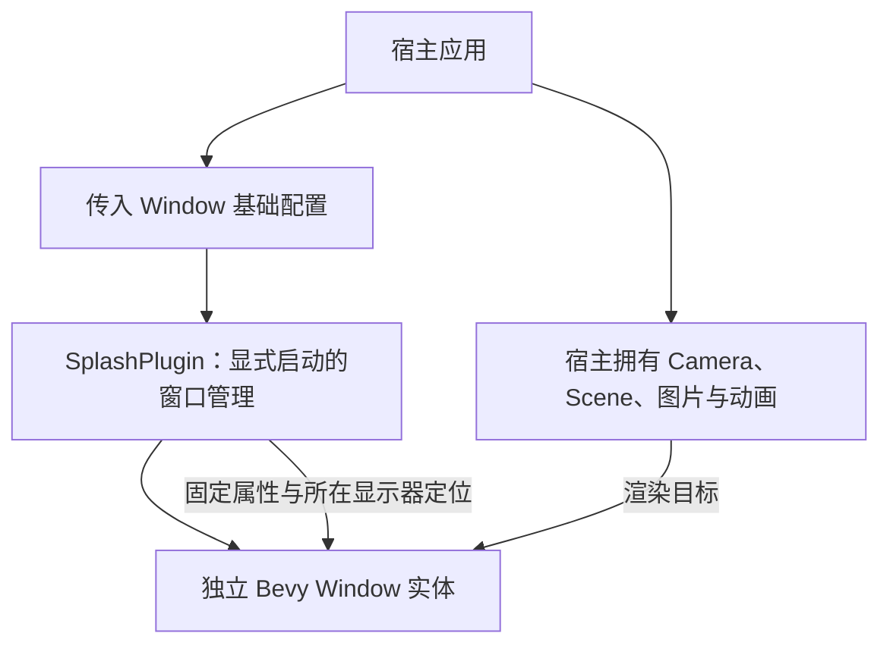

# Splash 独立窗口与固定几何

## 目标与位置

新增 `crates/splash`，包名 `bevy_widgetry_splash`，实现可选的 `SplashPlugin` 与独立 Splash 原生窗口创建能力。这个增量只解决“窗口由谁创建、何时启动、采用什么原生几何策略”，不把 Gallery 图片、动画、跳过按钮或首帧安全交接搬进库。完成后，宿主应能够显式创建一个符合 Splash 固定窗口契约的独立窗口，并自行为它配置 Camera 与场景。



## 按需启用而非加载即启动

Facade 增加 `splash = ["dep:bevy_widgetry_splash"]` 可选 Feature，并按 `#[cfg(feature = "splash")]` 导出相关 API；它不属于默认 Feature。Gallery 显式选用该 Feature。运行时即使添加了 `SplashPlugin`，也不得自动隐藏主窗口、创建 Splash 或启动交接流程；只有宿主明确选择启动时才创建独立窗口。

主窗口始终独立存在，既能不经 Splash 正常启动，也能在 Splash 会话期间成为后续需要交接的对象。库不能把主窗口和 Splash 视为同一个 Window 实体，也不能默认所有应用都存在一个主窗口以外的 Splash。`ui_scale`、`window` 的普通能力不应因新 Feature 而必须依赖 Splash。

宿主传入完整的 `Window` 基础配置，决定尺寸及其他没有被 Splash 契约覆盖的属性；Splash crate 再统一施加它必须保证的原生约束。这样通用库不内置品牌图片、背景色或 Gallery 的窗口宽高，却能确保同类 Splash 的平台行为一致。

## 不能被外部覆盖的 Splash 窗口属性

Splash 创建时由 crate 强制设置：

```rust
window.decorations = false;
window.resizable = false;
window.resolution.set_scale_factor_override(Some(1.0));
```

它没有原生标题栏和边框，也不能由用户拖动 Resize。`Some(1.0)` 的含义是 Bevy 对 Splash 内容采用固定的逻辑/物理比率，并不让全局应用 Scale 控制 Splash。外部给出例如 800×600 的目标物理尺寸，Windows DPI 变成 125% 或 150% 时不应自动把内容区域放大到 1000×750 或 1200×900。跨屏或 Windows DPI 原生通知导致的物理尺寸变化需要按目标物理尺寸恢复，不能只设置 Override 后就认为 OS 不再可能影响原生窗口。

Splash 窗口创建时自动带 `WindowScaleExcluded`。这表示它**不参与普通窗口的全局 Scale 管理**；排除标记与固定 `Some(1.0)` 共同生效，但分属两个不同机制。标记从双方可访问的下层位置导入，不能让 `ui_scale` 与 `splash` 彼此依赖。该共享标记最终定义位置在缩放基础方案中标注为待确认，不能在各阶段各定义一个同名但不同类型的标记。

Splash 的用户尺寸由宿主确定，窗口几何则由 crate 负责；与此前应用可任意指定 `Window.position` 的通用 `Window` 不同，**Splash 的位置固定采用目标显示器居中**，即使宿主传入其他位置，也以居中契约为准。

## 所属显示器与位置

Splash 居中于主窗口所在的显示器，而不是强制放在 Windows 主显示器。主窗口暂时隐藏时，仍通过其目标位置与显示器元数据确定目标显示器；主窗口跨越显示器时，以主窗口中心所在的显示器作为归属。居中计算应使用该显示器的真实物理坐标和 Splash 物理宽高，正确支持负坐标的多显示器布局。

例如，主显示器在 `(0,0)`，副显示器在左侧负 X 方向，主窗口位于副显示器，则 800×600 的 Splash 要在副显示器的中央，而不能因为主窗口尚未显示，就回退到主显示器。位置约定是“显示器中央”，不等同于“主窗口矩形中央”。

**待确认的边界**：若主窗口所在显示器在原生创建前无法可靠判断、显示器元数据缺失或目标物理尺寸大于显示器，应如何对外报告或处理。不能在未约定前擅自把 Splash 改成自动缩放到工作区，也不能默默宣称已正确居中；这些情况应作为实现时需要明确的输入/环境前提。

## 内容完全交给宿主

Splash 不生成默认图片、颜色、文字、布局、跳过控件、动画轨道或 Camera。宿主创建并绑定自己的 Camera、BSN/Scene、Image、Sprite 等内容，决定动画播放、跳过行为以及最后一帧。Splash crate 只保存管理窗口生命周期所需的实体/状态关联，不维护 Gallery 专用 `SplashStatus`、`SplashAnimationClock` 或内建素材。

首次显示前需要隐藏窗口以防空白画面、何时检查渲染帧属于下一个独立增量；这里完成的窗口创建能力不能自行将“创建完成”误当作“内容可以对用户展示”。

## 测试与完成条件

验证 Feature 默认关闭及显式打开时分别能编译，加入 `SplashPlugin` 却不启动会话时主窗口不被影响；主动启动后出现独立 `Window` 实体，外部传入尺寸被保留而约束属性必定为 `decorations=false`、`resizable=false`、Override `Some(1.0)`；`WindowScaleExcluded` 存在且不会被全局缩放重写。

检查主窗口在主/副显示器、负坐标副屏、主窗口暂时隐藏及主窗口跨显示器场景下的居中选择逻辑。物理尺寸与 DPI 变化的计算可以在 Headless Test 检查，真正不可 Resize、Windows 原生尺寸保持和位置必须按 Windows 原生窗口行为验证。Facade、工作区成员、依赖和对应文档随实现同步。

## 失败与职责边界

本阶段不擅自制定错误恢复策略。窗口相关真实失败保留原始原因并按既有 `WidgetryFailure` 体系暴露；库不能因为窗口创建或定位失败而主动退出 App、强行显示主窗口或吞掉错误。错误枚举具体变体以实现中实际可观察的失败类型为依据，不预先伪造无法从 winit/Bevy 取得的底层错误。
