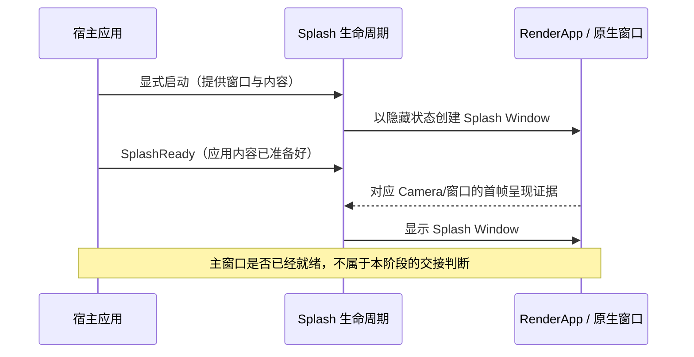

# Splash 首帧安全显示

## 目标与位置

让独立 Splash 窗口能够从原生创建时保持隐藏，直到应用声明内容已准备好、并且库确认该窗口的渲染帧确实到达呈现路径后才对用户显示。此增量只负责 Splash **自己的首帧显示安全**，不要求主窗口已经可以交接。完成后，宿主可以把独立 Splash 当作启动期间真实可见的窗口，而不会仅因创建了 Window 就先展示白屏或空白背景。

Splash 不是原先覆在主窗口里的 `ImageNode`。两个 Window 的背景、位置和大小彼此独立；特别是 Splash 比主窗口小时，若主窗口仍在后面可见，就可能出现周围一圈空白主窗口。这个问题不能通过把 Splash 的背景颜色改为不透明来解决，必须由两窗口的创建时可见性共同保证。

## 可见性与两个不同的就绪条件

Splash 原生窗口必须从创建时就设置 `visible=false`，而非先创建可见窗口再在 Startup 系统中隐藏。否则最早一帧可能已经由 winit/Windows 显示，后续 ECS 系统无法倒回去消除闪烁。

应用自己的图片、SVG、Sprite、UI Scene、Camera 及资源加载由宿主管理；当它认为可以生成正确的 Splash 画面时发出 `SplashReady`。这个信号不是“第一帧已经在屏幕上”的证明，也不等同于“整个主窗口已经就绪”。

库在收到 `SplashReady` 后，再检查与该 Splash Window 对应的 Camera 渲染目标、Render World 中窗口帧的实际获取与提交/呈现情况。只有**应用侧就绪**与**对应窗口的渲染就绪**同时满足，才允许从隐藏切为可见。不能把 `Window.visible=true`、ECS `Image` Asset 已加载、Camera 存在、RenderApp 已初始化等单一条件误认为完整首帧证据。

库不检查特定的 `ImageNode`、`UiBatch` 或图片路径作为 Splash 的通用就绪条件，因为宿主可能使用任意内容类型。对实际绘制什么内容的判断仍由宿主 `SplashReady` 契约承担，库的职责是检查自己能观察到的窗口/RenderApp 呈现证据。

## 与现有渲染链路的协调

现有 `crates/window/src/render.rs` 在 DX12 环境使用 `DxgiFromVisual`，还在 Render 阶段对多 Window 的提交作了处理：无 Camera 的窗口避免初始 Present，同一提交链对多窗口 Swap Chain 采取受控 Flush。独立 Splash 不应绕开这些前提，创建 Window 与绑定宿主 Camera 的顺序也应避免产生额外空白 Present。

`gallery/src/splash/presentation.rs` 和 `gallery/src/startup_cursor.rs` 目前分别针对图片绘制批次、Swap Chain 获取/呈现、`DwmFlush` 等做过检查。这些思路可以作为实现时的调查依据，但不能直接把绑定到特定图片或特定 Gallery Camera 的实现复制进通用 Splash。`DwmFlush` 最多作为 Windows 呈现同步的一部分，不足以单独证明目标内容确实完成了渲染。

## 隐藏窗口能否渲染：必须先闭合的技术前提

这里存在一个已经识别、但尚未通过 Windows/wgpu/DX12 实测解决的前提：**原生 `visible=false` 时，winit/Bevy 是否仍为该 Window 取得可用 Swap Chain 并完成真实渲染。** 如果隐藏状态不能完成首帧呈现，单纯“等到 Present 后才设 visible=true”就会永远等待，导致 Splash 不能显示。

实施本增量时必须以最小真实原生窗口实验检验：隐藏窗口创建、绑定 Camera、准备任意宿主内容、RenderApp 的帧获取与提交、首次显示动作之间是否能闭环。若无法闭环，按此前已讨论的 Windows DWM Cloak 或离屏渲染等方向调查替代机制；**具体回退机制尚未确定，不能在没有实测前把其中某一种写成已选实现**。不允许为了让测试通过，先把窗口展示出来再声称“没有白屏”。

显示器不同 DPI、Splash 固定 `Some(1.0)`、禁止 Resize 与排除全局 Scale 的契约继续由窗口创建方案维持；首帧同步过程不能重新改写这些属性。

## 测试与完成条件

使用不依赖 Gallery 图片的简单宿主内容验证：`SplashPlugin` 注册但没有启动时不影响主窗口；Splash 创建后的初始可见性是 false；没有 `SplashReady` 时即使有窗口或资源也不能显示；有 `SplashReady` 但首帧尚未呈现时不能显示；只有两者都就绪时显示一次，不因重复信号来回切换。多 Camera / 多窗口情况下必须匹配正确的 Window Entity，不能借用主窗口的呈现记录解锁 Splash。

实际 Windows/DX12 验证需要观察最早可见帧，特别是 Splash 小于主窗口或位置与主窗口不同时不能露出主窗口的未准备区域。通过针对性 BRP 截图和 ECS/RenderApp 状态检查验证交互与可见结果；真正的原生 Show/Hide、Present 时序和屏幕闪烁不应仅靠 Headless 或 BRP Custom Pointer 的结论取代实际系统测试。无窗口渲染能力的环境可检验状态机，不得据此报告原生首帧已验证。

## 失败与防御性约束

若首帧检查产生真实失败，应构造可识别的 Splash 领域错误并向宿主传播，不能替宿主做回退、退出或销毁决策；也不能在渲染条件不成立时主动展示空白窗口。正常的 Asset 等待、尚未取得 Swap Chain 等合法暂态不能每帧生成 ERROR。失败后的内部状态只需避免继续执行依赖已失败前提的无效步骤；库不定义强制恢复策略。
