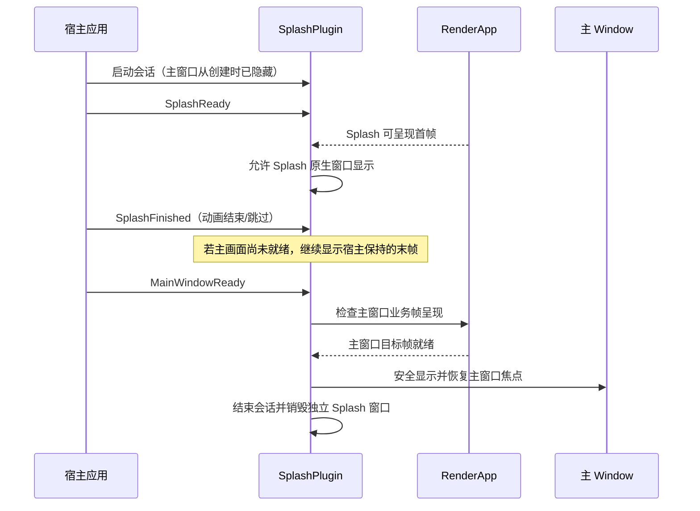

# Splash 就绪信号与主窗口交接

## 目标与位置

在独立 Splash 已能安全显示的基础上，增加“启动画面完成后，等待主窗口真正准备好，然后让主窗口接替 Splash”的完整生命周期协调。这里新增的是通用交接能力，不管理用户的 Splash 动画，也不决定应用加载内容的完成条件。一个完全不使用 Splash 的应用不需要创建这套会话，主窗口仍独立运行。

这条交接链有三类由宿主负责的业务信号：`SplashReady` 表示 Splash 内容准备好，`SplashFinished` 表示播放结束或用户选择跳过，`MainWindowReady` 表示主业务界面准备好。渲染与原生可见性由库协调。三者不能互相替代：Splash 播放结束时主窗口可能仍在加载，主窗口已经构建 UI 时也可能尚未产生可展示帧。

## 主窗口的创建与运行期选择

仅 `SplashPlugin` 注册成功，不意味着应用已经选择了 Splash。宿主需要在创建主原生窗口**之前**知道是否主动开启该启动会话；只有确实开启时，才将主窗口从创建时设为 `visible=false`。没有 Splash、Feature 未启用或运行期明确禁用时，主窗口依照原流程可见，不因库存在而被隐藏。

原生窗口显示顺序不能依赖“先以可见状态构建主窗口，进入 Startup 后再隐藏”，因为较小的 Splash 不能覆盖主窗口全部区域，首帧白边/闪烁仍会发生。宿主提供主 Window 的关联标识与布局，Splash crate 维护交接关系，但不替宿主创建业务 UI，也不自动将所有窗口视为主窗口。

## 会话只是生命周期状态，不是额外窗口

会话表示一次 Splash 从启动、显示、等待交接到结束的过程及相应关联的两个 Window、已收到的信号和呈现状态；它不是第三个窗口，不是可供外部加载内容的独立 UI 树。

正常状态至少要能区别 Splash 尚未显示、正在显示、已收到 `SplashFinished` 但等待主窗口、正在提交交接和已结束。具体 Rust 枚举或 Resource/Component 组织可按实现选择，不能把未讨论过的 `Failed` 公开强制状态及其恢复策略当成既定契约。

在 `SplashFinished` 之后但主窗口未就绪时，库不立刻销毁 Splash，也不自己生成“最后一帧画面”；应用须让其最后一帧继续保持可渲染。必要时仍请求 Redraw，以避免 Windows 桌面窗口被重新曝光时画面失效。主窗口 readiness 的含义由宿主 `MainWindowReady` 与其对应 Camera 的 RenderApp 实际呈现证据共同决定，不能仅以 ECS 场景已生成就提前显示。

交接时先保证主窗口不再呈现空白，再进行原生 Show/Focus 和 Splash 的销毁；具体 Windows 窗口 Z-order、焦点及哪一帧完成前后切换，必须以系统行为验证。Splash 的 Camera、Content 节点由外部拥有，生命周期结束时清理的范围不能越权删除应用仍需使用的业务对象。

## 主窗口隐藏渲染仍需平台验证

独立 Splash 首帧的隐藏渲染问题已在前一增量列为技术前提；**主窗口隐藏期间业务帧能否完成渲染**也同样需要实际 Win32/winit/wgpu/DX12 证据。若无法在 `visible=false` 下获得主窗口真实呈现证据，就不能只靠 `MainWindowReady` 直接打开窗口并宣称无闪烁。

已有讨论允许把 DWM Cloak、离屏准备等作为待调查的回退方向，但没有选定具体替代机制。实施时需在真实 Windows 窗口场景中选出可闭环方案，才能确认主窗口首帧和 Splash 关闭的严格时序。`DwmFlush` 单独并不能证明主业务画面已准备好。

## 错误的类型、传播和外部处理权

`crates/splash` 定义 `SplashError` 领域错误及 `SplashFailure = WidgetryFailure<SplashError>`。错误枚举必须按照实际可区分的失败种类设计，向外部暴露可匹配的类别与必要结构化字段；可能的类别包括原生窗口不存在、呈现失败、不合法状态或能取得原始原因的创建失败，但不把这些候选名称当作未经验证的固定枚举。无法读取到的底层错误不得伪造。

普通 API 返回 `Result<T, SplashFailure>`；System、Observer、Command 等 ECS 边界中确实不能处理的错误，通过统一 `into_bevy_error()` 转换到 `Severity::Error` 后继续传播。首次产生时只记录一次含 `error_id` 的源头 ERROR，保留错误原因链、第一次产生位置及 Backtrace，传播时保留原身份和上下文，不重复报告；真正由宿主处理后才记录 handled DEBUG。不要为错误另建 `Message<SplashError>` 通道，也不能仅记录日志便当作已传播。实现沿用 `bevy_widgetry_diagnostics`，库不自行安装 Error Handler。

**错误应由宿主决定处理**。Splash 不自动恢复主窗口、不自动回退、不自行终止程序，也不因为出错就强制销毁或强制保留空白 Splash 作为外部必须接受的策略。内部可以停止依赖已失败条件的非法推进、维持资源一致性并暴露当前可观察状态；外部决定保留现状、清理窗口、重试、降级或退出。如果外部需要主动终止当前启动过程，应有明确的生命周期/资源清理入口，其语义与正常完成交接不同，不隐含自动恢复策略。

与内容相关的图片加载、场景展开、动画失败属于宿主内容层错误，除非是真正由 Splash crate 管理的原生窗口/呈现机制失败，不应一律包装成 SplashError。

## 完成条件与验证

在测试宿主中覆盖三个 readiness 信号不同到达顺序、重复信号、播放完成但主窗口未就绪、主窗口先就绪而动画未结束、正常终止后不会重入旧会话、未启用 Splash 的普通启动、错误发生前后不隐式显示主窗口等行为。重要不变量是：未达到显示条件不打开任一未就绪窗口，主窗口已经安全可见后才撤下 Splash，应用内容由应用而非 crate 掌管。

错误测试按原有约定检查领域错误匹配、真实 source、共享 origin/error_id、首次 ERROR、无重复 ERROR、ECS 边界的 `Severity::Error` 和宿主 Handler 实际收到原始诊断。错误已传播不等于宿主一定选择关闭窗口。真正的多窗口 Presentation、焦点、前后帧与跨屏行为需要 Windows DX12 实测，GUI 变化配合 BRP 观察初始和中间状态；不以最终窗口出现代替无闪烁检查。

## 防御性边界与待确认

不设定 Gallery 专属加载超时、预览循环或错误降级策略为 Splash 通用行为；这些属于宿主。若运行环境无法完成隐藏窗口的首帧渲染，具体 Windows 回退机制仍需在该增量完成前验证并确定，不能默认把一个等待不到的 Present 当作永久 Loading 逻辑的正确结果。
