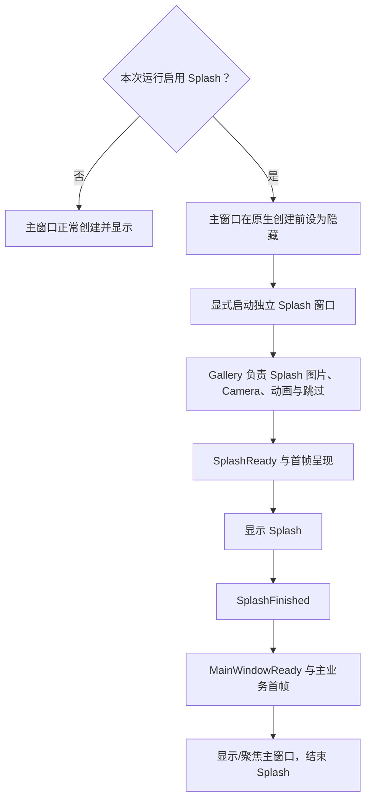

# Gallery 迁移独立 Splash

## 目标与位置

将 Gallery 当前依附于主窗口的覆盖层 Splash，迁移为由可选 `SplashPlugin` 管理的独立原生窗口；原有的图片、动画、预览、跳过行为以及 Gallery 内容就绪判断继续留在应用层。这个增量交付真实的用户可见启动体验，也负责将启动时隐藏主窗口、首帧呈现、关闭与托盘流程串成一条可以实际运行的路径。它不能被拆成“只搬图片”和“另写启动验证”两份没有独立用户行为的收尾任务。

## 启动路径的运行期选择

Gallery 编译时显式启用 Facade 的 `splash` Feature，但运行时仍保留“本次启动禁用 Splash”的路径。现有 `GALLERY_SPLASH_DISABLE` 环境变量、Waveform、File Dialog 和 Page Lifecycle Benchmark 的 Splash 跳过条件，应继续决定是否实际开启启动会话。必须在 `DefaultPlugins` 创建原生主窗口之前统一算出本次是否启用 Splash，避免一个地方决定 `visible=false`、另一个地方却没有创建 Splash，造成用户启动后看不到窗口。

此前 `splash::install(&mut app)` 在较晚阶段决定插入 `SplashEnabled`，`gallery_window()` 已经创建了主窗口配置；新实现不能沿用这个时序再到 Startup 才隐藏窗口。使用 Splash 时，主窗口由 `WindowPlugin.primary_window` 从创建时设为 `visible=false`；不使用 Splash 时，窗口仍按普通路径启动，无额外 Splash 依赖或白屏等待。

Gallery 的主窗口设计尺寸应已由前面的缩放迁移改为逻辑 1920×1080，并由 `WidgetryUiScale` 管理；Splash Window 自身维持独立的目标物理尺寸和固定 Override `Some(1.0)`，不可 Resize、无边框、在主窗口所在显示器中央。启动时不要为了使 Splash 和主窗口重合而再次把 Gallery 主窗口物理尺寸强行重置成旧的 1920×1080。

## 应用内容不进入 Splash crate

`gallery/src/splash.rs` 及其 `scene.rs`、`animation.rs`、`skip.rs`、`benchmark.rs`、`lifecycle.rs`、`presentation.rs` 当前把覆盖层、图片帧、最后一帧及业务逻辑关联在主窗口的 `gallery_camera` 上。迁移后 Gallery 负责创建独立 Splash 目标的 Camera 与 UI 内容，动画时钟、资产句柄、预览/跳过交互仍属于 Gallery；库仅负责独立 Window 的管理与交接，不从 Gallery 搬走素材，亦不为通用 Splash 添加 Gallery 粉色背景或固定帧列表。

原来 `scene::setup` 会在主 `Camera` 上创建 `SplashOpaqueCover` 和 `SplashDisplay` 的高 `GlobalZIndex` 覆盖层。独立窗口不再需要靠这些覆盖节点遮住主窗口，也不能把创建覆盖层等同于创建原生 Window。迁移时要去除过时的主 Camera 清屏/恢复覆盖逻辑，确保 Splash 内容正确绑定自己的 Camera 与 `WindowRef`。

旧 `splash/input.rs` 为了防止输入穿透主窗口而修改 `KeyboardInput` 和 IME 的 Window Entity；两个原生窗口分离后，应按真实 Window 焦点和输入目标处理跳过操作，不再无条件把主窗口消息重定向到已经不存在的覆盖节点。用户跳过只表示 Splash 内容逻辑结束，然后由应用发出 `SplashFinished`，不能因此忽略 `MainWindowReady` 就直接销毁 Splash。

动画完成后，若 Gallery 主画面仍在加载或尚未真正完成呈现，Gallery 应保持 Splash 的最后一帧，避免“动画播放完了就突然出现桌面”。支持应用主动结束、跳过与已有的预览模式，但这些业务模式都通过明确的结束/就绪信号和库协调，不迫使通用 Splash 知道帧索引、淡出时间或具体画面。

## 主窗口首帧、Cursor 与聚焦

`gallery/src/startup_cursor.rs` 目前通过主窗口 RenderApp 检测首帧，并在 `GalleryFirstFrameReady` 产生后设置 Cursor，再根据旧 `SplashEnabled` 判断何时清理自己的启动检查。迁移后需把“Gallery 业务内容就绪”与“主窗口已完成可展示帧”提供给 `MainWindowReady` 与库的呈现检查，避免依赖旧覆盖层资源判断完成。没有启用 Splash 时，该首屏检测机制仍能按原生主窗口启动流程结束，不得无条件引用不存在的 Splash 资源。

远端当前 `startup_cursor.rs` 已通过 `WidgetryCursorTheme::set` 与 `cursor_theme::kamuri()` 更新光标，而非旧式直接写主题资源；迁移时保留新 API 与它的触发条件，不改回旧版本。当前 `main.rs` 也已把主题资源改为 `loaded.config.theme.colors()`，这条与 Splash 无关的初始化不应被回滚。

主窗口最后显示时，需要保证正确 Focus、Z-order 以及 Splash 实体/Camera 释放，且不会出现主窗口首帧闪白、后景暴露或旧 Splash 残影。现有 `crates/window` 对 DX12 多窗口 Present 做了特殊处理；主业务 Window 和 Splash Window 共存期间不得误破坏这个前提。

## 退出、托盘与异常路径

`gallery/src/close.rs` 同时处理主窗口关闭确认、独立业务窗口的关闭事件、托盘隐藏与恢复；`gallery/src/close/shutdown.rs` 在退出开始时可能把隐藏的主窗口设置为可见。新 Splash 的 Window 不是普通 `GalleryIndependentWindow`，不能被旧关闭逻辑误当成可关闭业务子窗口；也不能因“恢复所有隐藏窗口”而在 Splash 交接尚未准备时露出主窗口白屏。

需要让 Gallery 对以下情况有清楚的宿主级响应路径：启动过程中请求退出、用户尝试关闭 Splash、Splash 原生窗口意外消失、主窗口一直尚未就绪、应用进入托盘隐藏或请求恢复，以及正常交接后的清理。Splash crate 只以有类型的领域错误和已有 ECS 错误机制上报其负责的失败，是否继续、终止、降级或重试由 Gallery 处理；不由库自动推出一个固定的错误恢复流程。

现有 `gallery/src/splash/lifecycle.rs` 对 Asset 失败或等待超时采用 WARN 后自动去除覆盖层的策略。业务内容 Asset 错误与 Gallery 专属等待超时仍归 Gallery；迁移时**必须明确 Gallery 自己采用何种失败处理措施**，按现有 `WidgetryFailure` 与日志生命周期规范处理真实错误，不能把旧 `warn!` 的自动降级直接搬进通用 Splash，也不能只把错误发给 Handler 就认为隐藏主窗口已经恢复。Gallery 的具体恢复/退出选择尚未单独约定，作为这份迁移方案的待确认项保留。

## 验收与验证

至少覆盖两条启动路径：不启用 Splash 时主窗口独立出现；启用 Splash 时主窗口在创建时隐藏，Splash 居中于主窗口所在显示器，最早的可见帧就是宿主内容而非空窗口。完成动画或选择跳过后，如果主画面未就绪，保持 Splash 末帧；主画面完成呈现后再显示主窗口并清理 Splash。检查 Cursor 在正确时刻恢复、主窗口 Focus、关闭确认、托盘隐藏/恢复和启动过程中退出不会触发不应出现的白屏或旧覆盖层。

当前环境变量控制的 Splash 资源延迟、Gallery 内容延迟、Asset 错误和超时验证路径需根据独立窗口的语义重新对齐；保留有价值的故障注入与 Benchmark 行为，不要求把所有 Gallery 专属开关变成库 API。Gallery 修改后必须编译，针对性 BRP 观察初始、等待、跳过和交接过程中的截图与 ECS/RenderApp 状态，而不是只看最终主窗口；同时在 Windows 上核查多显示器、系统 DPI 100%/125%/150%、小 Splash 遮不住大主窗口的初始状态、Alt+F4、原生 Show/Hide 和 Focus。对 BRP 无法忠实模拟的 OS-level 行为另留真实验证证据，不能把 Custom Pointer 当成原生窗口操作。

按当前功能实际改动同步 `docs/architecture.md` 与相关 crate 文档，并删除或调整已被取代的旧覆盖层状态、Camera 重定向与无效同步逻辑。最终必须保证 Gallery 原有页面、Popup 缩放及正常关闭能力没有随 Splash 迁移发生回归。

## 防御性边界

不让通用 Splash 吸收 Gallery 素材、动画、预览参数、配置文件或托盘策略。移除旧覆盖层时，只清理确已失去用途的节点与状态，不删除宿主仍然需要的通用首帧检测；不把窗口隐藏或异常后的托盘恢复做成对所有普通窗口的无条件操作。
