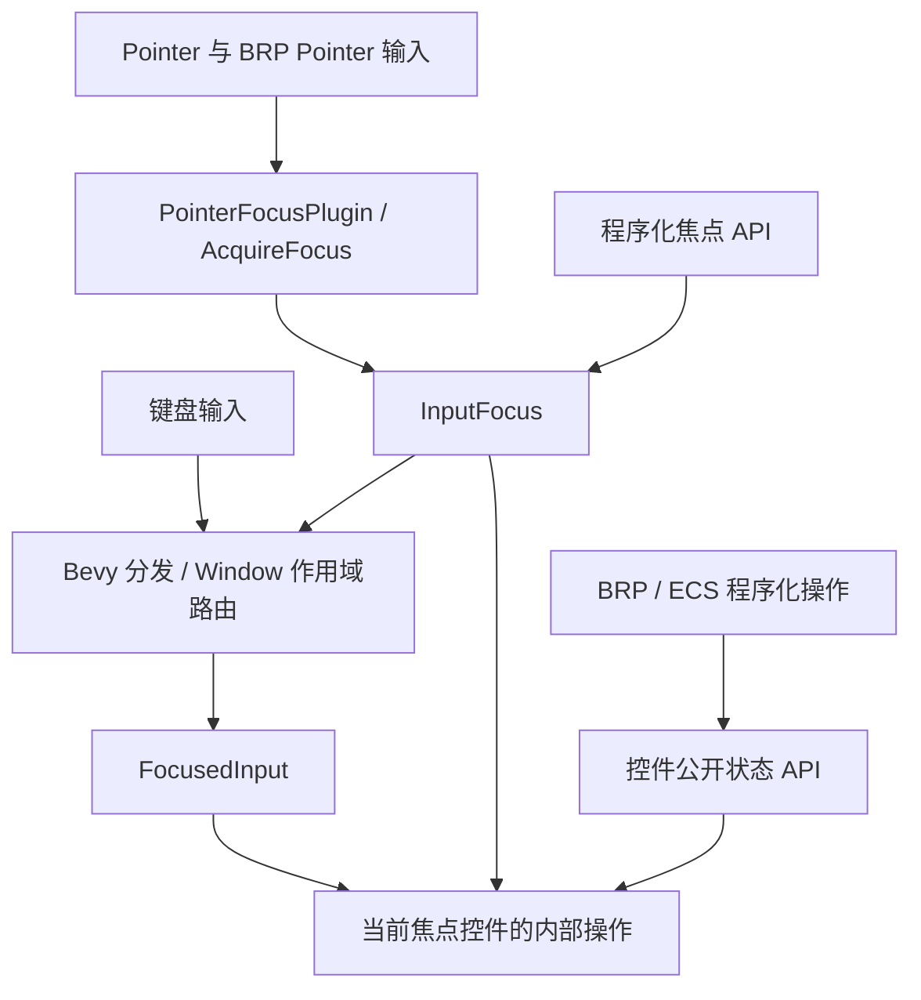
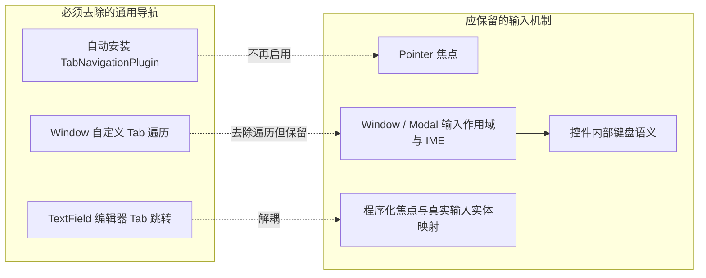

# 输入焦点与键盘导航收敛：整体设计

Widgetry 的交互边界已经确定：Pointer 负责选择、激活控件和获得输入焦点；键盘负责操作当前获得焦点的控件；程序化 API 与 BRP 可以通过已有输入和 ECS 路径完成操作。库不再提供 Tab / Shift+Tab 的跨控件遍历，也不提供跨独立控件的方向焦点导航。

这不是取消焦点或取消键盘。`InputFocus`、`FocusedInput<KeyboardInput>`、`AcquireFocus`、焦点得失事件、复合控件实际输入目标映射、多窗口与 Modal 的输入隔离仍然是必要能力。方向键用于 Slider 调值、TextField 光标移动、ListView / Table 内部定位、Tabs / Segmented / RadioGroup 内部选择等场景时，也应继续工作。BRP 不依赖逐个模拟 Tab 来寻找目标。

旧实现的跨控件跳转分散在多处：一些 Widget 插件会自动安装 `TabNavigationPlugin`，TextField 有自己的编辑器 Tab 导航，Window 还有一份按 `TabGroup` / `TabIndex` 收集候选的遍历逻辑。只删除其中一处不能彻底停用导航。因此先移除通用自动装配，再分别解除 TextField 与 Window 的导航路径；后续清理依赖顺序导航的状态配置及展示。

要区分 **Tab 导航插件** 与 **`TabIndex` 组件**。Bevy 0.20 的 `PointerFocusPlugin` 在没有 `TabNavigationPlugin` 时仍借助 `TabIndex` 识别 Pointer 可聚焦目标。`TabIndex(-1)` 可以继续作为临时的官方 Pointer 焦点标记，不意味着允许 Tab 遍历；非负 `TabIndex` 若仅为顺序导航服务，应删除或改为 `-1`。不为此新造一套 `PointerFocusable` 或第二份焦点状态。

整体调整以七个独立增量完成。前几项解除输入层导航，后几项收敛各控件对 `TabIndex` 的依赖，再清理具体应用。它们按下方唯一顺序实施；其中 Table 编辑焦点的具体目标解析依赖当前编辑器的真实结构，而不是通用 Tab 顺序。FileDialog 的初始焦点依赖 Window 提供独立于 Tab 的选择逻辑，因此放在 Window 之后。Gallery 清理由前面的控件行为收敛支撑。

## 方案顺序

1. [停止 Widget 插件自动安装 Tab 导航](01-remove-widget-tab-plugin-installation.md)
2. [移除 TextField 编辑器的 Tab 跳转](02-remove-text-field-tab-navigation.md)
3. [让 Window 焦点作用域脱离 Tab 遍历](03-window-focus-without-tab-traversal.md)
4. [让 Table 编辑器独立解析输入焦点目标](04-table-editor-focus-target.md)
5. [收敛控件的 Pointer 焦点标记](05-widget-pointer-focus-markers.md)
6. [移除 FileDialog 的动态 Tab Stop 管理](06-file-dialog-tab-stop-cleanup.md)
7. [清理 Gallery 的导航配置与演示](07-gallery-navigation-cleanup.md)

每个增量的测试、BRP 验证及相关 `docs/crates/`、`tests/COVERAGE.md` 同步与实现放在同一份方案中，不另设只负责最终测试的阶段。最后一个增量还负责确认完整组合下不会重新引入跨控件焦点跳转。计划中提到的文件位置对应实现关注点，不构成只能修改这些文件的限制。
