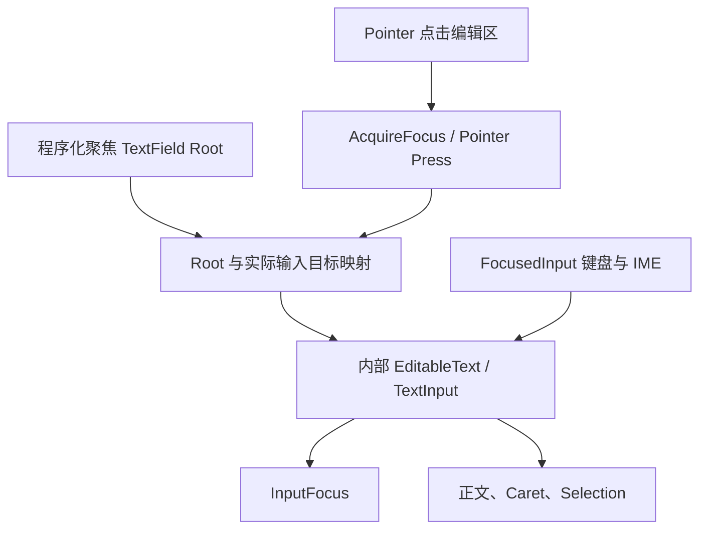

# 移除 TextField 编辑器的 Tab 跳转

TextField 使用根实体表示外部 Widget 身份，真实文字编辑、Caret、Selection、IME 和键盘焦点位于内部 `EditableText` / `TextInput` 实体。目前它另外监听编辑器的 Tab，调用 `TabNavigation::navigate()` 把焦点从编辑器移到下一个控件。这条路径与文本编辑本身无关，且会绕过“Pointer 选择控件、键盘操作当前控件”的边界。

本增量删除 TextField 自带的跨控件导航，保留根到内部编辑器的焦点映射。完成后，单独装配 TextField 不会添加 Tab 导航插件，点击编辑区、程序化聚焦根、编辑和输入法仍然正常。

## 删除的路径

在 `crates/text_field/src/input.rs` 删除 `navigate_from_editor()`：包括监听 `KeyCode::Tab`、用 Shift 区分 `NavAction::Previous` / `Next`、调用 `TabNavigation::navigate()`、处理 `NoTabGroupForCurrentFocus`、更新 `InputFocusVisible` 及向其他控件设置焦点的逻辑。与之配套的导航专用 import 和日志分支也应一起清理。

在 `crates/text_field/src/registration.rs` 移除 `TabNavigationPlugin` 的自动安装与 `input::navigate_from_editor` 的 Observer 注册。不要为保留 Tab 功能而把这段逻辑移到别的 Editor Observer、组合控件或 Window 中。

Tab 是否被官方编辑器解释为内容操作，仍由当前 TextInput 的输入语义决定；本增量只保证它不会被 TextField 当作跨控件焦点导航命令。不应粗暴吞掉全部 Tab 事件，也不需要为此实现全局 Tab 按键拦截器。

## 必须保留的焦点解析

`crates/text_field/src/input.rs` 里其他与焦点有关的函数有不同职责：

- `focus_text_field_on_press()`：Pointer Press 后使真实编辑器取得焦点。既有实现不能简单依赖 `TabIndex`，因为 TextField 根本身不要求有顺序导航标记。
- `retain_text_field_focus_on_acquire()`：控制 `AcquireFocus` 的冒泡及已获得的编辑器焦点，避免未被解析的请求一路传到 Window 导致焦点被清空。
- `redirect_root_focus()` 与 `redirect_gained_focus()`：把针对复合控件外部根实体的焦点转到真实编辑器，供程序化焦点、组合控件以及 Window 初始焦点使用。
- `contain_slot_focus()`：处理 TextField 组合槽位中的焦点归属，不把 Prefix / Suffix 等装饰内容误当成编辑器，也不能阻断真正可交互的内嵌控件。

这些函数中提到 `TabIndex` 的注释应改成说明真正的 Pointer/AcquireFocus 原因，而不是因为导航停用就删除保护机制。`WidgetryInputTarget` 仍然保存 root 到 editor 的映射；外部 `focus_in_world` / 排队 `focus` 接口保持可用。

TextField 的正式文本依旧只由官方 `EditableText` 管理。ReadOnly 保留导航光标、选择和复制，Disabled 仍阻止用户编辑；IME 预编辑与正式提交、Unicode 字素簇限制、编辑队列、Caret/Selection 及 Focus 颜色都不因本次导航删减而改变。NumberInput、ComboBox、FileDialog 等组合方依赖的 editor 实体归属也不能断开。

## 可观察行为与测试

在 `crates/text_field/tests/widgetry_text_field.rs`、`headless.rs`、`pointer.rs`、`read_only.rs`，以及 `crates/bevy_widgetry/tests/focus.rs` 中调整受影响的预期：取消“安装 TextField 必然安装 `TabNavigationPlugin`”断言，取消将 TextField 作为 Tab 遍历入口的测试依赖。此前在 `headless.rs` 中用 `TabIndex(0)` 配置的夹具，需要区分它是为了验证编辑器真实焦点，还是为了制造 Tab Stop；前者可保留必要的 Pointer 焦点标记，后者不再作为目标行为。

至少应覆盖：Pointer 点击 TextField 后 `InputFocus` 指向真实编辑器；点击普通 Button 时 TextField 按既有契约失去焦点；程序化焦点设置根后正确映射到 editor；连续 Keyboard 输入仍改变文本而不误投到其他控件；ReadOnly、Disabled 与 IME 处理没有改变。独立 TextField 场景中按 Tab 不发生跨控件焦点跳转。通过 BRP 验证真实点击、键入与焦点视觉变化；受影响的 Integration Test Coverage 文件同步更新。

同步 `docs/crates/text_field.md` 中有关 Tab / Shift+Tab 与内部槽位导航的旧描述，保留 Pointer / Keyboard Focus、Caret、Selection、ReadOnly、IME、`AcquireFocus`、程序化 Focus 和 root/editor 身份区分。若文档提到自动安装 Tab Navigation，也相应删除。

## 范围与关系

本增量不负责 Window 的自定义 Tab 分发，不调整其他 Widget 的 `TabIndex`，不改写 TextInput 官方编辑行为。若宿主自行显式安装 `TabNavigationPlugin`，其行为由宿主管理；Widgetry 不承诺替宿主拦截该插件。

前一增量使其他 Widget 不再自动注册 Tab 插件。本增量移除 TextField 自身最后一处主动装配及导航观察者。下一增量才会清理 Window 内自有的 Tab 遍历和初始焦点绑定。
