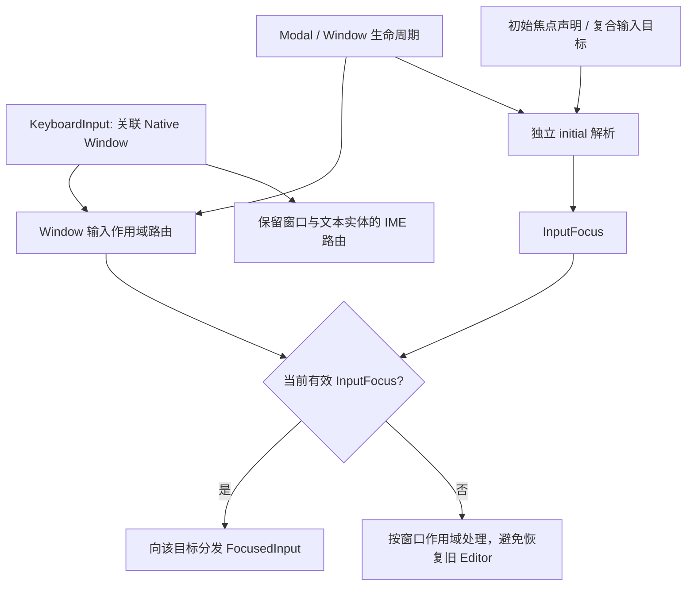

# 让 Window 焦点作用域脱离 Tab 遍历

Window 当前不仅管理多窗口和 Modal 的键盘输入，还自己实现了 Tab / Shift+Tab 焦点遍历：`tab_stops()` 按 `TabGroup`、`TabIndex`、可用性和层级收集控件；`keyboard()` 截获 Tab 决定前后目标；`initial()` 又将 Tab Stop 列表作为窗口初始焦点的候选。这导致移除官方 `TabNavigationPlugin` 之后，跨控件导航仍然存在。

此增量需要彻底拆开两件不同的工作：**Window 继续决定哪个窗口与 Modal 有权接收键盘输入，但不再决定按 Tab 时应切换到哪个独立控件**。窗口初始化和 Modal 打开时仍可主动设置焦点，且不能再依赖 Tab Stop 的存在与排序。

图中的初始焦点只在既有生命周期触发时解析，不表示收到任意普通键盘输入就自动聚焦某个可见控件。

## 移除专用的 Tab 遍历

在 `crates/window/src/input.rs` 删除 `tab_stops()` 及 `TabGroup` / `TabIndex` 导航用 import。`keyboard()` 不再特判 `KeyCode::Tab`、Shift 和循环索引，不再为了 Tab 切换 `InputFocus` 或将 `InputFocusVisible` 强制改为可见。

正常的 `KeyboardInput` 仍沿已经存在的自定义 Window 分发路径送达当前作用域内的 `FocusedInput<KeyboardInput>`。不要吞掉所有 Tab 输入，也不要把 Window 的路由函数、Raw Message、其他 KeyCode 或 FocusedInput 一起删除。原分支中仅用于 Tab 判定的 `ButtonState`、`ButtonInput<KeyCode>` 初始化等引用，如果确认不再由其他 Window 行为消费，可以清理；`InputFocus`、`FocusCause`、必要的 `InputFocusVisible` 资源和排程依赖不能仅因名字带 Focus 就删除。

`replace_keyboard_dispatch()` 目前只替换 Bevy 原始键盘分发，为多窗口、Modal 输入作用域服务；保留该能力及与 Gamepad、Mouse 输入派发互不覆盖的约束。是否由现有 Window 系统继续拥有 Keyboard Dispatch，以真实多窗口与 IME 测试结果判断，不能借此次删减合并为不等价的全局按键监听。

## 初始焦点不再来自 Tab Stop

`initial(world, root)` 目前先得到 `tab_stops()`，然后按 `WidgetryWindowInitialFocus(i32)` 优先级选择候选，最后回退到第一个 Tab Stop 或窗口 Root。删除 Tab Stop 后，初始焦点仍然有独立业务用途，需要保留以下已有契约：

- 候选来自**显式声明的** `WidgetryWindowInitialFocus`，优先级较小者优先，不需要候选同时具有非负 `TabIndex`。
- 复合控件允许在外部 Root 上声明初始优先级，再经 `WidgetryInputTarget` 找到真正的编辑器或其他输入实体。不能把输入焦点误设置在只承担 UI 结构身份的 Root 上。
- 候选必须属于当前窗口或 Modal 的有效范围；禁用、隐藏、失效或已销毁的目标不能成为新的实际输入目的地。没有可用显式候选时，沿既有 Window Root 兜底语义处理，而不是随机挑选第一个可见控件。
- 初始化只在窗口或 Modal 首次取得有效焦点等既有时机进行；程序主动 `InputFocus::clear()` 后，普通键、快捷键 Release 或被隐藏页面的后续文本输入，不能自动恢复记忆中的旧编辑器。

这里**不新增**一套 TabIndex 替代字段、Focusable 排序列表或全局按键导航规则。`WidgetryWindowInitialFocus` 和 `WidgetryInputTarget` 的保留，是因为它们表达的是窗口初始化与复合控件输入目标，而非 Tab 顺序。

## Modal、窗口切换与输入归属

`FocusScopes`、`ModalFocus`、`sync_focus()` 仍须支持：打开 Modal 时记住之前的有效焦点，优先选取本 Modal 显式初始焦点；关闭后恢复父窗口仍然有效的目标；父目标已不可用时遵循父窗口的初始焦点/Root 策略，而不是恢复无效编辑器。已明确清空的焦点不应被普通键盘输入重新唤醒。

实际 Native Window 与内嵌 Widgetry Window 的归属仍按当前 Window Root 路由；不允许 Modal 背后的输入框收到属于前台 Modal 的按键或 IME。`ime()`、`ime_position()`、`TextReadWriteMode`、`EditableText` 的组合/预编辑守卫、源窗口过滤、输入作用域内的 Escape/Enter 都保持原有语义。宿主全局快捷键是否检查 Modal 仍是宿主职责。

## 测试与文档同步

主要覆盖 `crates/window/tests/owned_window.rs`、`window.rs` 以及依赖窗口路由的 `crates/file_dialog/tests/window.rs`：

- 将“复合控件按初始优先级取得焦点，然后 Tab 在候选之间循环”拆开：保留前半部分，删除 Tab 循环断言。没有 Tab Stop 的场景也应能按显式优先级聚焦真实 `EditableText`。
- 验证 Tab / Shift+Tab 不再由 Window 改写焦点；其他 KeyboardInput 仍交给当前有效控件。没有焦点时，不把下一次文本/Release 投递给先前编辑器。
- 验证隐藏、Disabled、被销毁候选与旧 Modal 焦点的处理；Modal 打开、关闭及父窗口恢复仍正确，不能把 Modal 作用域退化为全局事件分发。
- 验证 Native Window 间的键盘/IME 隔离、TextReadWriteMode 的输入资格以及 Escape、Enter 等内部业务行为。BRP 覆盖窗口聚焦、弹窗打开/关闭、Pointer 点击后键入以及可观察的焦点视觉状态。

对应 Integration Test 的 `tests/COVERAGE.md` 与实现同步。`docs/crates/window.md` 删除 Tab 在有效控件间循环、Tab Stop 自动选择等旧契约，保留 Modal Focus Scope、主动清空、InputTarget、初始优先级和原生窗口 IME 路由。`docs/crates/core.md` 中关于 `WidgetryInputTarget` 同时服务“Window 的 Tab 与初始焦点”的描述，应改成仅描述仍有效的焦点目标映射。若 `docs/architecture.md` 的 Window / Core 职责陈述受影响，也同步修订。

## 防御性边界与相邻关系

不可为了删除导航而移除 Window 自定义键盘分发、初始焦点、焦点恢复或 Modal 禁用状态；也不可在普通 Key Press 时悄悄调用新 initial 选择器，重新造成旧编辑器误输入。已应用但仍由未完成窗口操作引用的 Entity 必须按既有有效性规则检查。

前两个增量分别移除 Widget 插件的自动 Tab 装配与 TextField 的主动 Tab 跳转。本增量完成后，完整应用内的三条内建跨控件 Tab 路径才全部被关闭。后续 Table、FileDialog 与 Gallery 的清理只处理遗留导航标记和展示依赖，不再承担全局 Tab 分发职责。
