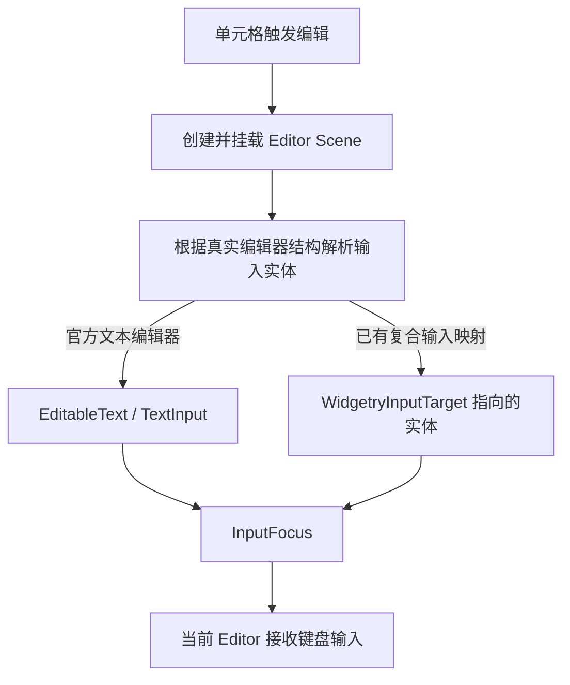

# 让 Table 编辑器独立解析输入焦点目标

Table 的单元格编辑器可以由外部注册的 Renderer / Editor 生成。进入编辑时，`crates/table/src/editing.rs` 的 `focus_editor()` 会遍历编辑器子树：优先寻找 `EditableText`，找不到时选择首个非负 `TabIndex` 实体作为焦点。这把**“哪个实体实际接收本单元格的输入”**错误地绑定到了**“哪个实体参加 Tab 遍历”**，在移除通用导航后会留下隐式行为缺口。

本增量只修正 Table 的编辑焦点解析方式，保证进入编辑模式时仍然能把焦点交给有效的编辑器。Table 根自己的 Pointer 焦点标记由下一增量处理；两者不是同一问题。

## 解除焦点候选对 TabIndex 的依赖

现有 `focus_editor()` 中 `TabIndex(i >= 0)` 的候选分支必须移除。不能把 `TabIndex(0)` 当作自定义编辑器声明“我是输入目标”的替代协议，否则后续任意编辑器都需要携带本项目已取消的焦点遍历信息。

保留遍历真实 `EditableText` 的能力，并检查当前注册编辑器的实现与外部可组合 Editor 结构：如果复合控件已经通过 `WidgetryInputTarget` 公布内部输入实体，就复用该实际映射；焦点目标的有效性、所属编辑器及 Disabled 状态仍按现有 Table 编辑契约约束。不应在没有证据的情况下为所有 Editor 引入新的通用聚焦组件、遍历顺序或改变公开 Editor 注册接口。

**待确认的实现前提**：现有自定义 Editor 中，是否存在既没有 `EditableText`、也没有 `WidgetryInputTarget`，但依赖 `TabIndex(0)` 得到焦点的合法用法。静态检查只能确认当前 fallback 存在，不能据此确定这种用法是否需要额外的显式输入目标声明。实施时应先核实已支持的 Editor 契约和测试夹具；若确有合法用例，需在此增量内部明确其真实聚焦机制，而不是静默退化为编辑器 Root 或创造新导航协议。

### 焦点与业务状态分离

`WidgetryTableEditState` 中的 Cell / Editor 身份以及 `WidgetryTableState` 中的 Focused Cell 是独立业务状态，不等同于 `InputFocus`。Table 的 Pointer 选择、单元格内部方向移动、Selection、Ctrl+C、编辑提交、Escape 取消和滚动 Reveal 都继续使用既有 API。`focus_editor()` 内部设置 `FocusCause::Navigated` 表示程序化转入 Editor，并不意味着提供跨独立 Widget 的键盘导航。

只有当编辑器的真实输入目标获得焦点，编辑中的键盘输入才应归 Editor；结束编辑后，焦点回收、Table 状态更新及结果通知仍遵循原有编辑生命周期，不允许因为取消 TabIndex fallback 而将按键泄漏给 Table Root 或其他控件。

## 可独立验证的交付

使用 `crates/table/tests/editing.rs`、`interaction.rs`、必要的 Editor 相关集成测试验证：默认 TextField / EditableText 编辑器进入编辑后能键入、提交与取消；已有复合 Editor 选用实际内部输入实体；不依赖非负 TabIndex 的焦点选择仍正确。对于原本靠 `TabIndex` 的自定义 Editor，按确认的实际契约更新其配置与断言。

回归检查编辑时 Disabled、销毁、替换、滚动虚拟化与 Focus Lost 等现有路径的焦点归属，不重写无关的 Model/Selection。使用 BRP 在 Table 上 Pointer 选择单元格、进入编辑、键入与提交/取消；必要时结合 ECS 查询确认 `InputFocus`、`EditingState` 和 Focused Cell 的区别。若涉及 Integration Test 的覆盖模型，同步相应 `tests/COVERAGE.md`。

`docs/crates/table.md` 中如存在将编辑目标解析建立在非负 `TabIndex` 或 Tab 导航之上的描述，应改成真实编辑目标解析契约。与 Focused Cell、列冻结后的内部 Reveal、剪贴板和程序化 Selection 有关的描述仍保留。

## 边界与相邻关系

不删除 Table 的 `FocusedInput` 处理器，也不取消内部方向键、复制或焦点可见样式。不得为解决此局部问题给整个 Workspace 增加新的通用导航能力。

前一增量已经使 Window 不再遍历 Tab Stop；此增量独立修复 Table Editor 的隐藏依赖。下一增量会把 ListView、Table 等控件根上的非负 `TabIndex` 调整为 Pointer 可聚焦而不参与顺序遍历的标记，届时编辑器已不依赖这些顺序值。
