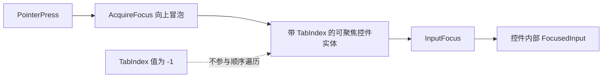

# 收敛控件的 Pointer 焦点标记

取消 Tab 遍历后，控件不应继续为了“排在 Tab 顺序中的第几个位置”声明非负 `TabIndex`。但 Bevy 0.20 的 `PointerFocusPlugin` 当前仍借助 `TabIndex` 判断 Pointer Press 冒泡时哪个实体可以获得焦点，所以也不能机械地把所有 `TabIndex` 删除。

本增量把控件内部的标记收敛成一个简单边界：需要通过 Pointer 获得焦点的实体可以继续携带 `TabIndex(-1)`，但 Widgetry 不再用非负 TabIndex 表达跨控件导航位置。这里复用 Bevy 官方当前机制，不创建新的 `PointerFocusable` 或第二套焦点管理方案。

`TabIndex(-1)` 在此处是 Pointer 焦点目标的兼容标记，不代表应用要求安装 `TabNavigationPlugin`。这一区分是正常实现机制的一部分，不能在文档中把所有 TabIndex 一概称为已经废弃。

## 应调整的根与附加标记

| 位置 | 调整 | 原因 |
|---|---|---|
| `crates/list_view/src/view.rs` | `TabIndex::default()` 改为 `TabIndex(-1)` | 保留根实体的 Pointer 焦点，同时不声明顺序导航入口 |
| `crates/table/src/view.rs` | 同样改为 `TabIndex(-1)` | 保留 Table 根的 Pointer 焦点与内部 Focused Cell 输入 |
| `crates/collapsible/src/collapsible.rs` | 删除 Toggle Button 上额外的 `TabIndex(0)` | 复用 Button 自身 `TabIndex(-1)`；Enter / Space 仍可激活 |
| `crates/message_box/src/scene.rs` | 删除结果按钮额外的 `TabIndex::default()` | 复用 Button 自身的 Pointer 焦点能力，保留 Activate / Escape |

不需要更换 ListView / Table 的业务状态。ListView 的 Selection、Active、虚拟化 Row 与 Focus 是不同维度；Table 的 Selection、Focused Cell、编辑器输入目标仍按各自契约处理。把根改成 `-1` 不应改变它们的内部方向导航、Revealing、滚动、复制或编辑。

## 明确保留的标记

下列现存的 `TabIndex(-1)` 是预期保留项，不属于待删的导航功能：

- `crates/button/src/headless.rs`、`check_box/src/checkbox.rs`、`toggle_button/src/headless.rs`、`hold_button/src/headless.rs`：基础可交互控件被 Pointer 点击后仍可获得焦点，并可响应各自支持的 Enter / Space 或其他内部功能。
- `crates/radio_group/src/group.rs`、`segmented/src/group.rs`、`tabs/src/tabs.rs`：复合控件的 Group 或 Header 仍可通过点击取得焦点；有焦点时方向键在**本控件内部**选择不同选项或标签。
- `crates/combo_box/src/popup.rs`：内嵌 ListView 的输入焦点与 Popup 行为保留；本次不改变内嵌列表的焦点语义。
- `crates/date_picker/src/view.rs` 中相关可交互日期部分的 `TabIndex(-1)`，以及 `crates/table/src/header.rs` 的标题动作标记：保留既有 Pointer 可聚焦目标。

`crates/scroll_area/src/headless.rs` 里用于验证已聚焦 ScrollArea 键盘滚动的 `TabIndex(-1)` 测试夹具也不需要因为名字含 TabIndex 就删除。该测试证明的是区域内部滚动，而非跨控件切换。FileDialog 自己动态设置 Tab Stop 的逻辑归下一增量，不在这里提前改写。

## 测试与文档

更新 `crates/list_view/tests/behavior.rs`、`contract.rs` 里断言 Root `TabIndex(0)` 的用例，以及 Table、Collapsible、MessageBox 相关测试。新的断言应区分组件的存在与值：可被 Pointer 聚焦的根仍带标记，但不参与跨控件顺序遍历。

重点保持以下可观察行为：Pointer 点击 ListView / Table 使正确根得到 `InputFocus`；焦点控件内部方向键移动 Active / Focused Cell 而不切换到其他 Widget；Collapsible、MessageBox 按钮仍可 Pointer 激活，获得焦点后的原有键盘激活保持有效；RadioGroup、Segmented、Tabs 有焦点时的组内箭头选择不消失。验证 Disabled、隐藏目标、Tooltip/装饰节点不会凭空获得交互焦点。对应 GUI 行为使用 BRP Pointer 与 Keyboard 验证，受影响的 Coverage Model 同步更新。

根据行为变化同步 `docs/crates/list_view.md`、`table.md`、`collapsible.md`、`message_box.md` 及实际涉及的其他控件文档；如果之前只描述 Tab Index 而不描述真实焦点行为，应改为 Pointer 焦点及内部键盘操作。单纯保留 `TabIndex(-1)` 的控件不需要为了形式统一改动既有契约。

## 边界与相邻关系

不为了消灭组件名字里的 `Tab` 就改写 Bevy 的 Pointer Focus 实现；也不把内部方向键、FocusVisible 颜色、`InputFocus` 或官方 `AcquireFocus` 事件判定为应删除的导航功能。宿主若自行安装官方导航插件，不属于 Widgetry 自动提供跨控件导航的承诺。

前一增量已让 Table Editor 不依赖非负 TabIndex 才能聚焦。本增量清理 Widget 根上的顺序配置，下一增量再处理 FileDialog 自己维护动态 Tab Stop 的专用业务分支。
