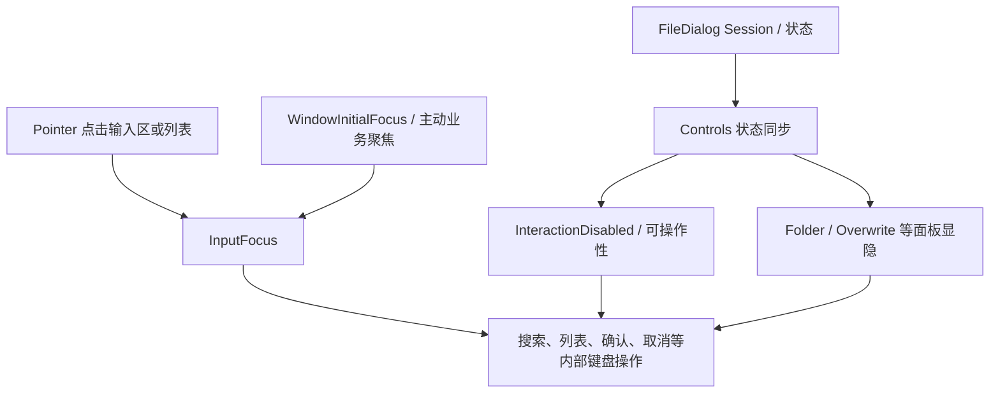

# 移除 FileDialog 的动态 Tab Stop 管理

FileDialog 在自己的控制区额外维护一份“可进入 Tab 遍历”的状态：根据 `InteractionDisabled` 与祖先的 `Node.display`，把可见可用的控件写成 `TabIndex(0)`，其他写成 `TabIndex(-1)`；当文件类型选择框、面板、按钮或侧栏状态改变时，还会重复同步这些标记。这套机制只为通用 Tab 遍历服务，取消跨控件导航后没有必要继续保留。

本增量把这套动态维护完整移除，但保留**控件自身是否可用**、**哪些面板当前显示**、**哪个编辑器或文件列表拥有输入焦点**三项原有业务行为。FileDialog 里很多“导航”指的是目录历史、文件列表 Active 或搜索结果内部移动，不属于要取消的通用焦点导航。

上图故意没有 `sync_tab_stop` 节点：Disabled 和 Display 已经有自己的状态来源，不应再通过修改 TabIndex 形成一份并行投影。

## 专用辅助逻辑的删除范围

`crates/file_dialog/src/style.rs` 中的 `sync_tab_stop(world, entity)` 可以整体删除：它沿父链检测 `InteractionDisabled`、`Display::None`，再更新已有 `TabIndex` 的 0/-1 值。移除其只服务于该函数的 import、注释与调用，保留 `set_intrinsic_disabled()`、控制可用性判定和正常状态更新。

在 `crates/file_dialog/src/controls.rs`：

- 删除对 `crate::style::sync_tab_stop()` 的调用；不再在侧栏、普通动作按钮、Filter 的字段和面板更新中投影 Tab 顺序。
- 删除 `sync_panel_tabs()` 的子树遍历以及调用；Panel 的展开、隐藏、确认结果与业务 Disabled 逻辑仍按原流程执行。
- 删除 Filter 分支中仅为了 `TabIndex(-1)` / `TabIndex::default()` 而进行的重写。其内部真实 `WidgetryButton` 已由基础控件提供 `TabIndex(-1)` Pointer 可聚焦能力，ComboBox 自己的 Popup/Focus 行为不应被改写。
- 删除普通 `UiControl` Button、`FileDialogLocation` Button 上额外的 `TabIndex::default()` 配置，改由这些 Button 自有的 Pointer 焦点能力承担交互。

`crates/file_dialog/src/style.rs` 的按钮、输入框、Entries 区域还有额外的 `TabIndex::default()`：按钮应继承 Button 的 `-1`；TextField Root 的额外顺序配置可删除，真实输入目标由 `WidgetryInputTarget` / editor 解析；需要通过 Pointer 或程序化 `InputFocus` 操作的 Entries 区域则保留可聚焦性，将 `TabIndex(0)` 改为 `-1`，不再表示 Tab Stop。

`FileDialogFilter` 等组合控件 Root 已有的 `TabIndex(-1)`，只有确认它仍是 Pointer 焦点目标时才保留；不能一边删除导航排序，一边意外取消点击获取焦点。实际 Popup Field 被点击后的 InputFocus 归属应以现有控件契约和测试为准。

## 保留真实输入焦点与对话框行为

`WidgetryWindowInitialFocus` 在 FileDialog 的输入区与 Entries 上仍然有用途，不能作为“Tab 相关字段”删除。例如 Filename 显式优先级 `0`、Entries 优先级 `1`、其他输入较低优先级的安排，需要独立于 TabGroup 的 Window InitialFocus 解析继续工作；具体哪一项在当前模式中可用，仍依据模式、可见性及 Disabled 条件决定。`crates/file_dialog/src/controls.rs` 中业务操作后主动 `.set(area, FocusCause::Navigated)` 的行为也应保留。

内部键盘功能继续包括：FileList 的方向键、Home/End、Page Navigation 改变 Active；Space、Ctrl+A、Enter 根据 Pick/Open/Save 模式处理 Selection 与 Activate；搜索框的上下键在匹配结果内移动，Enter 提交，Escape 取消；Path / Filename 输入框分别执行路径导航与模式确认。IME 组合期间不能误触发业务提交或 Escape，隐藏/禁用面板不处理用户输入；Modal 与 Owned Window 的 Cancel、Escape、原生 Close Request 及焦点恢复仍然按实际输入归属工作。

目录历史、搜索、Filter、Sort、隐藏项、常用位置与 Pin、新建文件夹、等待中的 Selection Job / Projection、按稳定 ID 保存的 Selection 等原有状态机不因删 Tab Stop 而改变。不能把所有名称包含 `navigation` 的函数都删掉。

## 测试迁移与验收

重点更新 `crates/file_dialog/tests/style.rs` 和 `window.rs`。原 `tab_focus_opens_filter_popup_and_disabled_fields_are_skipped` 之类测试应以 Pointer 点击 Filter Field、Popup 显示、点击选择、隐藏/Disabled 拦截为主要契约；`TabGroup::new()` 和“按 Tab 跳过禁用字段”不再作为 FileDialog 的完成条件。测试里用 `TabIndex(0)` 断言当前 Tab Stop 的地方，改为检查真实 Pointer 焦点资格、Disabled/Display、Field/Entries 的 InputFocus 归属。Window/Modal 相关旧 Tab 循环测试若在前一 Window 增量中尚有剩余，应在本增量清理。

具体要验证：不同 Dialog 模式下的初始焦点和真实 editor 映射；Search / Filename / Path 输入及 IME；Filter Popup 打开和关闭；列表方向键与选择、Esc/Enter 业务操作；Folder / Overwrite Panel 的显隐和不可用输入拦截；点击不同控制后焦点不会被旧逻辑重新设置。使用 BRP Pointer、Keyboard、Screenshot 与必要的 ECS 状态查询验证可观察行为，尤其是隐藏面板与同帧焦点切换。测试覆盖模型和 `docs/crates/file_dialog.md` 同步修改，明确“不提供 Tab 遍历”并保留真正的目录/列表导航及 Dialog 输入行为。

## 防御性边界与相邻关系

不把 `TabIndex` 的移除作为替代 `InteractionDisabled` 的理由，不通过直接写业务 State 假装模拟了 Pointer 点击，不移除 Popup 的 FocusGuard 或原生 IME。BRP Custom Pointer 与 OS Mouse 的差异仍按既有 GUI 验证规则处理。

本增量依赖前面的 Window 初始焦点改造和基础控件 Pointer 焦点标记收敛，才能去掉 FileDialog 自己的 Tab Stop 维护而不失去输入目标。后续只剩 Gallery 对 TabGroup、示例 TabIndex 的应用层配置需要清理。
