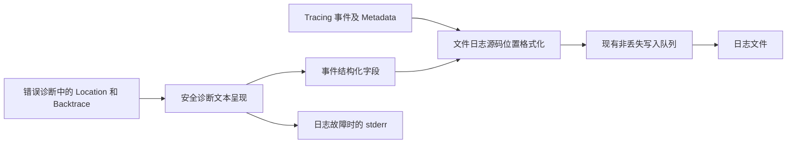

# 发布日志的源码路径规范化

目标是让通过 Stable Cargo 构建和安装的 Gallery 在发布日志中不暴露**构建机器的源码绝对路径**，同时保留日志事件的定位信息，以及错误首次发生时捕获的完整调用栈。运行时实际访问的配置、资源、用户文件路径不属于需要删除的构建信息，仍按业务诊断需要记录。

这不是禁用调试信息的方案。当前 Release 的 `debug = "line-tables-only"`、优化与 Panic 策略保持原样；`ErrorOrigin` 捕获的 `Location`、`Backtrace` 对象也保持原样。路径规范化发生在**向用户可见的输出写入文本**时。

普通 `tracing` 事件的 `Metadata::file()` 和错误诊断中的 `Location::file()`／Backtrace 文本是不同入口。前者可直接从结构化元数据构造安全位置；后者必须在最终报告与应急输出前处理。因此按以下顺序实施，两项修改分别形成可验收的增量，而完整目标以第二项完成后的集成验证为准。

1. [规范化文件日志的事件源码位置](01-规范化文件日志的事件源码位置.md)
2. [规范化错误诊断的来源位置与回溯](02-规范化错误诊断的来源位置与回溯.md)

`cargo install --git` 不会自动读取被安装仓库的 `.cargo/config.toml`；方案不以调用方设置 `RUSTFLAGS` 或安装 Nightly 为前提。Rust 的 `--remap-path-prefix` 可作为受控发布构建的补充，但无法覆盖所有链接器及外部工具生成的路径；Cargo 的 `trim-paths` 目前仍属于不稳定能力，不作为本方案的依赖。

参考：[Cargo install 配置发现规则](https://doc.rust-lang.org/stable/cargo/commands/cargo-install.html)、[Rustc 源码路径重映射](https://doc.rust-lang.org/rustc/remap-source-paths.html)、[Cargo 不稳定特性](https://doc.rust-lang.org/stable/cargo/reference/unstable.html)。
