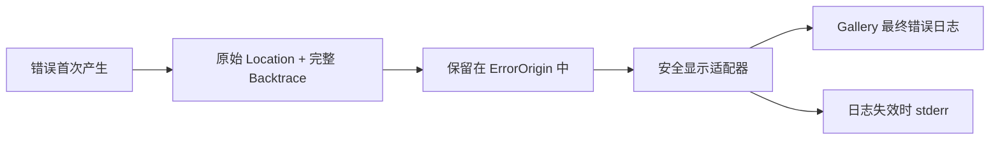

# 规范化错误诊断的来源位置与回溯

普通事件的源码位置不再泄露构建路径后，仍有第二条入口：错误诊断会主动把 `ErrorOrigin::location()` 和 `ErrorOrigin::backtrace()` 放进 `tracing` 字段或直接写向 `stderr`。仅隐藏 `Metadata::file()` 无法处理这些内容。此增量让**错误报告使用安全的文本视图**，而不修改错误本体、栈捕获时机与报告生命周期。

目标是：发布文件日志与项目管理的应急错误输出中，不再出现构建机器的源码绝对路径；仍保留错误 ID、来源、错误原因链、传播上下文、调用栈的每一帧，以及能够安全呈现的模块、文件名、行列号。完整调用栈指保留原始回溯已经捕获并可解析的所有帧，而不是保证缺少 PDB／符号时也能凭空恢复源码位置。

## 错误数据保持原样，显示时转换

`crates/diagnostics/src/origin.rs` 使用 `Location::caller()` 和 `Backtrace::force_capture()` 在错误首次产生时捕获位置与回溯。这些数据继续原样存在于 `ErrorOrigin`，供诊断 API 使用；不在构造错误、传播错误、克隆、处理或 ECS 兜底时剪裁信息。

在应用日志能力中提供一个可复用的**安全显示适配器**，供需要输出诊断的宿主使用。它接收现有 `Location` 或 `Backtrace` 的引用，生成 `Display` 可使用的安全表示，不更改对象内容。`gallery` 的最终错误报告和 `app_logging` 自身的应急报告共用同一套路径识别规则，避免两处各自实现不一致的字符串处理。



### `Location` 的安全位置

位置的 `file()`、`line()`、`column()` 分开读取。源码路径只输出可确认安全的相对部分（优先为可识别的仓库内相对路径；否则使用文件名），行号和列号照常保留。示例：

```text
原始: D:\build-agent\work\gallery\src\diagnostics.rs:132:7
输出: gallery/src/diagnostics.rs:132:7
```

如果相对前缀无法可靠推断，则输出 `diagnostics.rs:132:7`，不尝试从未知机器的目录结构猜测仓库根目录。

### Backtrace 的安全显示

对标准库 Backtrace 的格式化结果逐帧处理：保留帧顺序、帧编号、函数／符号名、可获得的地址和行列号，仅改写其中的**源码位置行**。Windows 盘符路径、`\\?\\` 扩展路径、UNC 路径、Cargo registry/git checkout、Rust toolchain 源码目录、混用分隔符及带空格路径都须纳入识别范围。

对识别到的 Cargo 第三方源码，优先输出包含 crate 名称及版本、`src/...` 的安全后缀；对本地源码优先输出 `gallery/src/...`、`crates/<crate>/src/...` 等安全相对标识；无法安全识别时以文件名或 `[source]` 占位，同时尽量保留行列号。不得把**无法识别**的源码位置原样透传。解析规则应针对回溯中的源码位置行，而不是在整条日志中随意删掉任何类似盘符的字符串。

示例（示意回溯格式，具体帧文本随平台和符号信息变化）：

```text
0: widget_gallery::...
   at gallery/src/diagnostics.rs:132:7
1: bevy_app::...
   at bevy_app-0.20.0/src/app.rs:528
2: std::...
   at library/std/src/...
```

完整回溯**保留全部帧**；当符号源位置不可用时维持原有“仅符号／地址”的信息，不为了让格式整齐而删除帧。保留的 Release `line-tables-only` 有助于诊断，但在 Windows MSVC 上，是否能显示源文件与行号仍取决于相应调试符号是否可用。

## 覆盖所有项目控制的报告出口

`gallery/src/diagnostics.rs` 中的最终 ECS 兜底报告、`startup` 启动失败回退、`logging_shutdown`，以及 `crates/app_logging/src/writer.rs` 中日志后端失败和 `LoggingGuard::drop` 的应急输出，都应统一使用安全位置和安全回溯视图。正常文件层需要处理 `origin`、`backtrace`、可能含来源位置的 `details`／`error` 等字段；不能以修改普通事件格式器代替这一步。

在正常文件输出中，优先针对诊断类字段进行结构化处理；对于第三方事件中实际携带的源码绝对路径文本，提供一个**源位置形态限定的兜底清理**（例如回溯 `at <路径>:<行>`、已知 Cargo checkout／registry／rustup 源目录），并把匹配与替换行为纳入测试。不能笼统把所有 `C:\...` 字符串当作构建路径：日志中的 `config.ron`、资源目录和用户打开的文件可能是应用运行时真实访问的绝对路径，仍需要保留。

错误报告的改动不得改变 `WidgetryFailure` 的错误 ID、首次来源、传播上下文、同一错误只输出一次最终兜底的约束，也不改变库自身的错误捕获、ECS 异常严重级别、异步日志的非丢失队列与 Guard 行为。文件写入故障时不能依赖已经失效的同一文件后端来完成安全输出；应急 `stderr` 的安全显示必须可独立使用。

## 验证与完成条件

使用现有的 `GALLERY_DIAGNOSTIC_PROBE`，分别执行 `lifecycle`、`startup` 和在子进程中的 `panic` 场景；它们已经覆盖受管错误、原生错误、系统／Observer／Command／Job 失败、启动失败及原生 Panic。检查日志文件和项目控制的错误 `stderr`：错误 ID 和上下文存在、最终兜底没有重复原始失败原因、完整可用的回溯帧仍在，但无构建机源码绝对路径。

安全格式化函数以合成输入覆盖：

- `C:\Users\...\.cargo\registry\src\...`、`\.cargo\git\checkouts\...` 和 `\.rustup\toolchains\...`；
- 临时 `cargo install --git` checkout、本地任意盘符目录、带空格／中文路径、`\\?\\` 与 UNC、正反斜杠；
- `Location` 的有／无列号、Backtrace 中有／无行号、只有地址与符号的帧，以及无法识别的源码位置；
- `error`／`details` 字段中嵌套回溯、普通业务文本，以及需保留的运行时 `config`／`assets` 绝对路径。

在本地 Release 构建及实际 `cargo install --git --locked` 安装的程序上核验，而不要求用户设置私有的 `RUSTFLAGS` 或仓库 `.cargo/config.toml`。对正常、启动失败与故障日志扫描构建路径形态（盘符 + Cargo registry/git/toolchain、临时 checkout、本地源码根目录），验证安全输出；不要把合法运行时绝对路径误判为泄露。针对 `stderr` 还要覆盖日志层无法安装、写入失败、收尾失败的独立应急路径。

完成时应同步 `docs/features/app_logging.md` 中“文件另外包含源码位置”的具体展示语义，并保留 `docs/features/diagnostics.md` 中错误对象原样保存回溯的契约。终态验收既检查日志是否泄露路径，也检查诊断能力是否被过度裁剪。

## 失效边界与发布构建

不能靠全局删除任意绝对路径实现目标：那会破坏运行时故障排查，也无法从单纯的日志字符串中证明某个路径属于“构建机”还是“运行机”。需要以编译来源元数据、诊断字段和已知源码路径形态来限定处理，并通过真实构建产生的日志发现、补齐遗漏模式。如果将来要求**可执行文件及独立 PDB 中也不得包含构建目录**，那是比“发布日志无路径泄露”更大的制品治理目标，需要独立评估 Rustc 路径重映射和 Windows 链接器输出。

不采用必须安装 Nightly 的 Cargo `trim-paths` 方案，不更改现有 `[profile.release]`，不删除 Backtrace、不取消源码行号、不调整业务日志等级，也不把日志隐私策略强加给没有选用 `app_logging` 的宿主程序。

参考：[Rustc 路径重映射及 Windows 链接器限制](https://doc.rust-lang.org/rustc/remap-source-paths.html)、[Rust Backtrace](https://doc.rust-lang.org/std/backtrace/struct.Backtrace.html)、[Cargo install](https://doc.rust-lang.org/stable/cargo/commands/cargo-install.html)。
