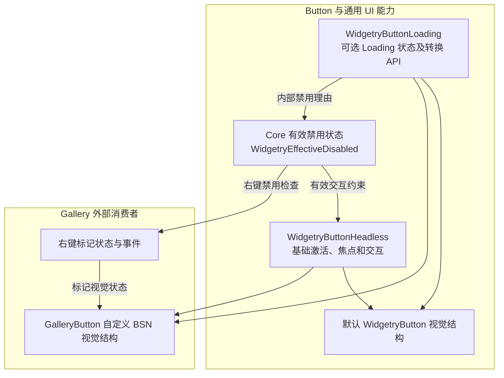

# Button Headless 的可组合能力与 Gallery 实验

这组方案解决一个具体问题：Bevy 已提供基础 Button 交互，但 Widgetry 目前仍在 `WidgetryButton` 的构造与 Loading 操作中耦合默认视觉结构。外部开发者因此难以只复用交互与 Loading 能力，再用 BSN 定义自己的控件。目标不是增加通用 Style 继承框架，而是把真正独立的行为能力变成可组合的公开入口，并用 Gallery 中的 `GalleryButton` 验证。

## 整体设计

`WidgetryButtonHeadless` 只提供最小可用的 Button 交互，不自动附加 Loading，也不创建任何默认背景、内容包装层或 Spinner。Loading 通过独立的 `WidgetryButtonLoading` 按需加入；默认 Button 可以组合两种能力与原有视觉实现，GalleryButton 则在**同一个根 Entity** 上组合所需能力和完全不同的外观。

Headless 组合基础行为并复用 Bevy 的 Hovered、Pressed 与 Core 的有效禁用状态；可选 Loading 维护自己的状态 Authority。Style 从公开的状态 Component 读取当前值，并在初始化及状态变化时更新视觉。必要的业务变化通知可以存在，但事件不是 Style 唯一、也不是必需的状态来源。外部无需运行时更换整套 Style。普通输入、Disabled 和 Loading 的状态操作由能力本身管理；Gallery 新增的右键标记状态与事件由 Gallery 自行拥有。

## 关系和范围

方案一建立可单独使用的最小 Button Headless，并让默认 Button 共用该基础行为。方案二抽出可选 Loading，让它只影响状态和交互限制，默认 Spinner 则留在默认 Style。方案三通过 GalleryButton 的独立 BSN 外观验证前两项接口确实可供外部使用。方案四再为 GalleryButton 添加右键标记，验证不改动库内部逻辑就能增加交互功能。

这些目标形成唯一实施顺序：基础行为先于可选能力，可选能力先于完整的外部视觉演示，外部控件成形后才添加自定义交互。每一项包含自身的功能验证；不单设最终验收阶段。

本次仅验证 Button。其他控件即使使用类似的 Headless / Style 组织方式，也不在本次推广或重构；不增加 Style Trait、OOP 式继承、全局 Style 注册、运行时整套 Style 切换或新 Cargo Feature。现有 API 无需保留向后兼容层，但直接受影响的内部控件与 Gallery 仍须保持其应有功能。

## 实施方案

1. [公开可组合的 Button 最小 Headless](01-button-headless.md)
2. [将 Loading 拆成独立可选能力](02-button-loading.md)
3. [用 GalleryButton 验证完整自定义外观](03-gallerybutton-style.md)
4. [为 GalleryButton 扩展右键标记行为](04-gallerybutton-right-click.md)