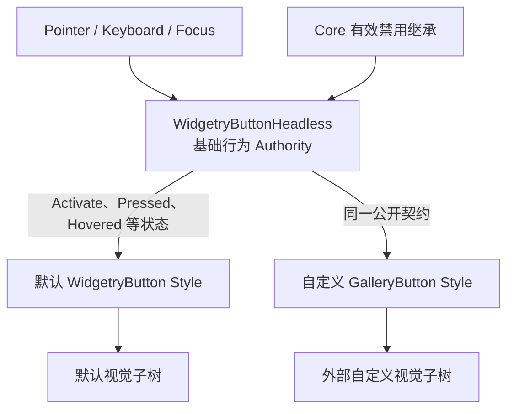

# 公开可组合的 Button 最小 Headless

## 设计目标

让外部项目可以只依赖公开 API，在 BSN 中构造一个具有 Button 基础行为、但**完全没有默认外观或 Loading 能力**的 UI 根实体。这个独立可验收的增量是 `WidgetryButtonHeadless`：它既是最小可用的行为组合入口，也是默认 `WidgetryButton` 和后续 `GalleryButton` 共享的基础。

Bevy 0.20 已有名为 `bevy::ui_widgets::Button` 的 Headless Component。新入口不是为了复制一套并行的激活系统，而是把 Widgetry 需要的输入约束、焦点、通用禁用行为与公开组合契约统一起来。尤其不能把“简单加一个包装 Marker”误认为交互语义已经符合需求。



Headless 的根实体同时就是交互、焦点、公开状态查询和 `Activate` 的目标，不隐藏另一个 Button Entity，也不要求调用方查找内部子节点。根上允许叠加普通 Component、可选能力和消费者自有状态，使用 Rust / ECS 的组合，不模拟类继承或方法自动继承。

## 最小行为契约

`WidgetryButtonHeadless` 负责构成 Button 所必需、不能随意拆断的基础交互：

- 鼠标**主键**完成有效点击时触发一次官方 `Activate { entity }`；按下、释放、取消及拖出过程遵守 Button 的正常激活边界。按下状态属于可消费的交互状态，而不是默认 Style 的私有状态。
- 右键不触发普通 `Activate`，也不把普通按钮置入主键 Pressed 状态；右键事件可以由外部消费者添加自己的行为。这条语义直接服务于后续 GalleryButton 的左右键分工。
- 对获得焦点的 Button，Enter / Space 激活遵循其键盘输入语义，重复按键不得导致意外重复激活。保留 Bevy 的输入焦点与 TabIndex 模型，焦点可达性由有效配置决定；不假设 `TabIndex(-1)` 会自动参与 Tab 遍历。
- 焦点和无障碍角色属于可用 Button 行为的一部分；如果无法直接复用原生 Button 的实现，替代输入实现同样要维护这两项能力。
- 显式本地禁用、祖先禁用及内部能力施加的禁用都通过 Core 的现有效禁用机制汇总。真实用户输入被禁用时不触发 Activate；外部直接编程触发 `Activate` 仍属于调用者行为，不因为这里的输入 Guard 自动被拒绝。
- Hover / Pressed 由 Bevy 的 `Hovered` / `Pressed` 提供，禁用结果由 Core 的 `WidgetryEffectiveDisabled` 提供；Headless 组合并遵守这些能力，不复制成另一套私有状态。Style 读取它们来决定表现，Headless 不为其决定颜色、边框、布局、动画或 Spinner。

### Bevy 原生输入处理的实际冲突

Bevy 0.20 原生 `Button` 的 `PointerPress` 和 `PointerClick` 处理没有检查 `PointerButton`。因此，**原样挂载该原生 Component 再添加右键 Observer，不能保证右键只执行自定义操作**：原生处理器也可能置入 Pressed 并发出 Activate。

这个问题必须在 Headless 的输入行为中正面解决。可以尽量复用原生 Button 的焦点、无障碍和事件语义，但对主键和副键的区分必须在可靠的输入分派边界完成。不得依赖同一 Entity 上两个 Observer 的执行先后顺序来“抢先取消”右键事件，也不能让未过滤的原生激活处理器与另一套主键处理器同时工作，产生双重激活。如果需要由 Widgetry 自己承担部分 Pointer / Keyboard 处理，也只对必要行为负责，不把其他 Widget 的输入一起改掉。

## BSN 公开组合入口

预期外部可使用下面的形式构造根实体；这是目标调用形态，具体 `SceneComponent` 的派生和 `@` 用法以实际编译通过的 BSN API 为准。

```rust
// 目标调用示意：这里没有 Loading，也没有默认外观。
bsn! {
    @WidgetryButtonHeadless
    Node { width: px(160), height: px(40) }
    Name("PlainHeadlessButton")
    on(on_activate)
}
```

`WidgetryButtonHeadless` 应可从 Button crate 的公开 API 与 Facade 的 `button` 模块取得，配套 Plugin 应使其必要的行为系统和 Core UI 能力得到正确安装。是否单设一个独立 Headless Plugin 属于内部组织选择，不是要求外部先注册默认 Style 或必须使用 `WidgetryButton` 的理由。Gallery 不允许从 Button 的 `internal`、`pub(crate)` 模块获取这些能力。

纯 Headless 自身不自动创建默认内容包装层、默认 Spinner、背景、边框、图标或颜色状态，也**不得通过 `#[require]` 或 Scene 展开暗中装上 Loading**。实际交互依赖 UI Picking 和布局，根实体需要有效 `Node` / `ComputedNode`；这只保证它能够参与 UI 和有效禁用投影，不等于 Headless 自带视觉设计。外观实现决定大小、可点击范围和视觉子树。

## 默认 Button 如何继续使用同一基础能力

默认 `WidgetryButton` 使用同一个 Headless 交互能力，再组合默认视觉结构，继续承担外部调用方可见的 Button 标识。默认 Style 的 Hover / Pressed / Disabled 配色、内容构造与 Theme 响应继续属于默认 Style；其可选 Loading 的迁移在下一份方案中处理，**本增量不为了“先拆完 Headless”而临时弄坏现有默认 Loading 演示**。

现有 `WidgetryStyleOwner<WidgetryButton>` 在 MessageBox 的按钮视觉托管中被使用；该关系属于直接受影响的组合点，必须随实际内部实现同步调整，保证 MessageBox 按钮的样式所有权及激活行为仍正常。LinkButton 虽和普通 Button 同处一个 crate、共用插件安装路径，但不是本次自定义样式实验的目标；其 URL/激活功能不能被新的主键输入实现意外改写。

只要求保留这些实际功能，不要求保留旧的关联方法签名、内部状态结构或历史 API 兼容层。新的对外说明应写入 `docs/crates/button.md`；若模块职责发生事实变化，再同步 `docs/architecture.md`。Gallery 展示行为以 `gallery/` 中的实际代码为准，不建立额外的集中式 Gallery 文档。

## 验证与完成条件

- 在 Button crate 的**外部视角集成测试**中，仅通过公开入口构建 Headless 根；它可正常命中、焦点激活、接收 `Activate`，同时不具备默认外观节点与 Loading Component。必要时维护对应的 `tests/COVERAGE.md`。
- 确认主键有效点击只激活一次；右键完整点击不激活且不留下 Pressed；按下后取消、离开目标或拖动不应凭空产生有效激活；键盘 Enter / Space 在获得焦点后按约定激活。
- 显式与祖先禁用时真实输入不激活，恢复后重新可用。有效 UI 根能够从 `WidgetryEffectiveDisabled` 读取与 Core 一致的结果，无须新增 Button 专属禁用组件。
- 默认 `WidgetryButton` 使用相同基础行为且显示原有正常 / Hover / Pressed / Disabled 外观；MessageBox 的 StyleOwner 管理及 LinkButton 的独立功能没有意外退化。
- 需要通过真实 Gallery 输入检查的 Pointer、Focus 和视觉行为执行针对性 BRP 验证；不把单元测试或应用启动替代这项检查。

## 边界与错误条件

外部可在根实体组合其他组件，但不保证任意删除行为所需的基础 UI 组件后仍可正常工作。输入处理中出现的真实内部错误遵循 Widgetry 的现有诊断与 ECS Error Handler 约定，不以 panic 或静默忽略处理。此增量不引入 Style Trait、运行时 Style 替换机制、通用功能插件框架，也不改造其他控件的 Headless。