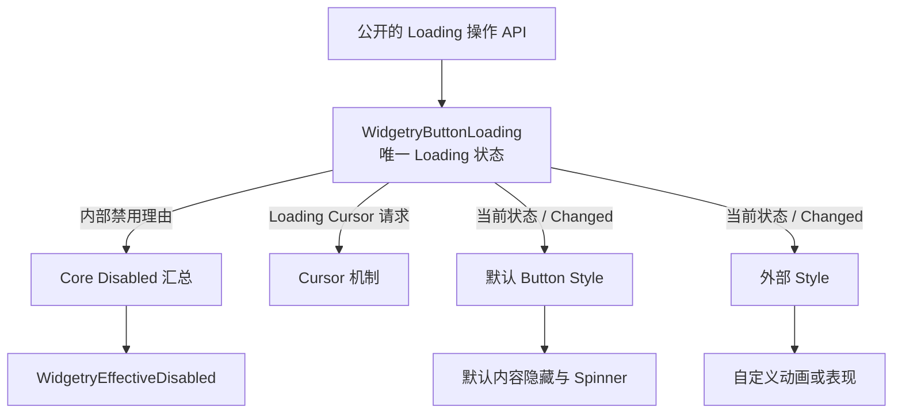

# 将 Button Loading 拆成独立可选能力

## 设计目标

把当前混在 `WidgetryButton` 方法、内部 `LoadingState`、`ButtonContent` 与 `Spinner` 之间的职责拆开，使 `WidgetryButtonLoading` 成为**外部可选、可查询、可受控操作**的行为 Component。Headless 单独存在时不具有 Loading；加入该组件后，Loading 的交互限制与状态管理生效，但仍不产生默认 Spinner。

这个增量与最小 Button Headless 不同：第一份方案使基础激活可以脱离外观使用；本方案使一项原本依赖默认视觉子树的功能，也能单独附加到任何使用该基础行为的 Button 上。默认 `WidgetryButton` 仍组合 Loading 与默认 Style，保留它原有的加载表现。



Headless 维护事实和行为；两套 Style 只消费事实并控制自身视觉。Style 不得因为自己的 Spinner 或内容节点缺失而阻止 Loading 状态提交。

## 状态归属与公开 API

预期由公开 Component `WidgetryButtonLoading` 保存唯一的运行期状态，默认 `false`，内部字段不允许外部任意写入。外部可以用 `Query<&WidgetryButtonLoading>` 获取状态并通过 `is_active()` 等只读方法查询。`WidgetryButtonHeadless` 不自动要求或构造它；默认 `WidgetryButton` 可以在自身 Scene 组合中显式纳入它。

```rust
// 目标公开接口示意；名称与具体返回类型按仓库诊断规范落地。
#[derive(Component, Default)]
pub struct WidgetryButtonLoading {
    active: bool,
}

impl WidgetryButtonLoading {
    pub fn is_active(&self) -> bool { self.active }
    pub fn set_in_world(
        world: &mut World,
        entity: Entity,
        active: bool,
    ) -> Result<bool, ButtonFailure> { /* ... */ }
    pub fn set(commands: &mut Commands, entity: Entity, active: bool) { /* ... */ }
}
```

同步入口完成提交后返回状态是否变化：合法同值为 `Ok(false)`、实际改变为 `Ok(true)`、目标错误或缺失必需能力则为 `Err`。延迟的 `Commands` 入口只在 Command 实际执行时进行校验、提交与通知；入队时不应宣称状态已经改变。所有错误仍沿用 Widgetry 的领域诊断、真实原因链与宿主 Error Handler，不新造孤立的错误系统。

设置 Loading 是**一次完整的行为转换**，不是单纯布尔赋值：预先验证操作前置条件，提交 Loading 状态，并同步更新其独立的内部禁用理由及 Loading 光标请求。清除 Loading 时只撤销 Loading 自己的禁用理由，不能顺带解除本地显式、祖先或其他内部原因。若存在 Loading 变化通知，只在状态真正提交之后发出；初始化、合法同值和失败请求不额外发送变化通知。Style 不以该事件为唯一入口，保证晚创建的 Style 仍可读取当前状态。

失败前置条件不能导致状态已经变、禁用没变的半提交结果；相关依赖在写入前完成必要校验。功能切换不应自行改变现有 Focus 或 TabIndex，不自动开始、取消或完成外部业务任务。业务层负责任务结束时恢复 Loading。

## Loading 与有效禁用的联动

`WidgetryEffectiveDisabled` 已由 Core 根据本地、祖先和内部理由维护。本方案继续复用这一状态，不定义 `ButtonEffectiveDisabled`。Loading API 通过现有内部理由机制将 `active = true` 纳入汇总，并在结束时撤销该理由。

例如，按钮先由祖先禁用，再进入 Loading；即使随后结束 Loading，只要祖先仍禁用，按钮就不能激活。反过来，在普通状态下进入 Loading，应立即阻断有效的鼠标主键和键盘激活。Loading 光标请求与禁用光标的优先级遵守既有 Cursor 能力的规则；它们都是状态相关的交互反馈，不应绑在默认 Spinner 上。

对 `GalleryButton` 的右键扩展而言，禁用判断直接查询根 Entity 的 `WidgetryEffectiveDisabled`，而不是复制一套 `explicit || loading || ancestor` 条件。状态投影需要根实体属于有效 UI 节点，且执行时机应与 Core 的禁用协调机制一致。合法的 `Commands` 调用尚未执行前，不提前假设禁用已生效。

## Style 只负责 Loading 的视觉结果

默认 `WidgetryButton` 的完整视觉由其 Style 维护：正常内容包装层、Loading 时隐藏内容、默认 Spinner 的生成/显示和动画、Theme 配色、边框与前景色，以及状态恢复后的视觉一致性。过去 Loading API 直接查找 `ButtonContent` 与 `Spinner` 的做法应移出行为边界；这些节点、素材资源和布局现在只由默认 Style 负责。

默认风格仍表现为内容隐藏、居中的两层圆环，以及随 Theme / ColorOverrides 变化的前景色；现有旋转效果约为 300° 弧、1.2 秒一圈，非 Loading 时停止旋转。为避免显式 Visible 子元素穿透隐藏包装层，默认 Style 可沿用自身的 Visibility 与 UiTransform 处理并在退出 Loading 时恢复原样，不能让 Headless 持有或恢复这些视觉快照。Loading 的默认颜色优先级与 Hover、Pressed、Disabled、Normal 的关系由默认 Style 自己解析，不强加给外部样式。

外部 Style 可以完全不用默认内容包装层、默认 Spinner 或圆环素材。例如 GalleryButton 可以显示独立设计的文字切换或进度动画，只需读取公开的 Loading Component。Style 初始化时读取当前状态，之后监听 `Changed<WidgetryButtonLoading>` 或等效 ECS 信号，处理新增、改变和状态解除的表现，不依赖“刚好收到了那一次事件”。

默认 Button 的颜色覆盖 API 及 `WidgetryStyleOwner<WidgetryButton>` 仍属于默认视觉实现，不能被错误塞进 Headless 或可选 Loading 的必要组成。默认 Theme、内容和配色的行为需要在重组之后持续成立。

## 公开组合与直接受影响接口

```rust
// 目标调用形式，仅说明组合关系。
bsn! {
    @WidgetryButtonHeadless
    WidgetryButtonLoading::default()
    Node { width: px(160), height: px(40) }
}

// 外部不需要寻找内部 Content / Spinner Entity。
WidgetryButtonLoading::set(&mut commands, button_entity, true);
```

`WidgetryButtonLoading`、状态读取与转换 API 应通过 Button crate 和 Facade `button` 模块公开。外部只要提供正常的 Widgetry Button 行为环境即可，不依赖 `internal` 路径。无 Loading 的 Headless 仍是独立合法构造；默认 `WidgetryButton` 则继续自带 Loading 与默认 Style。LinkButton 不因这项抽离自动获得 Loading 能力。

此处不规定所有 Widgetry 控件都采用同名 API，也不增加统一状态 Setter 框架；这是 Button 自有状态的具体契约。公共 Loading API 与行为契约的调整须同步 `docs/crates/button.md`，不能只修改运行时代码。

## 验证与完成条件

- 在 Button crate 外部视角的测试里分别创建“Headless 无 Loading”和“Headless + Loading 无默认 Style”，证明前者没有 Loading API 目标，后者可正常读状态、设置状态并阻断输入，而不要求存在默认 Spinner 或 Content。
- 覆盖同步和 Commands 两种设置入口、合法同值、失效根、缺失能力组件、状态提交与通知先后、失败不修改既有状态及原因链诊断。相关集成测试的覆盖模型同步更新。
- 覆盖 Loading 与显式禁用、祖先禁用的叠加及分别解除，确认不会错误恢复可交互状态；核对有效禁用投影与 Loading 光标请求的生效/恢复。
- 在默认 `WidgetryButton` 上检验 Loading 进入和退出：内容正确隐藏和还原、正常业务 Children 与原 Layout 不丢失、Spinner 只在 Loading 时可见并旋转、颜色跟随 Theme/Override、Hover/Pressed/Disabled 状态没有错误投影。
- 通过定向 BRP 操作和 Screenshot/ECS 状态确认关键中间帧与最终结果，尤其检查 Loading 切换的瞬间视觉、禁用和光标一致性；保留原有 Gallery 加载演示功能。

## 边界与失败情况

不支持运行期更换整套 Style，也不为可选 Loading 创建新的 Visual Slot 框架。任意删除必须的 Headless 或 Loading Component 不属于合法状态转换；公开 API 应明确返回错误而不继续破坏其他状态。默认视觉子树损坏是默认 Style 的问题，不允许把这种视觉细节错误升级为所有 Headless + Loading 组合的共同前置条件。