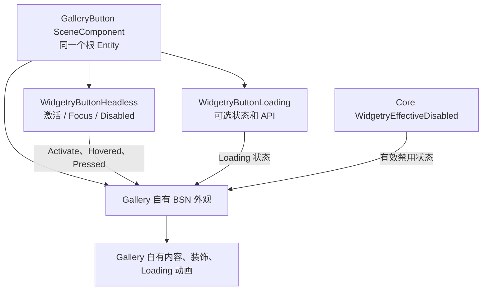

# 用 GalleryButton 验证完整自定义外观

## 设计目标

在现有 Gallery 的 Button 页面实现独立的 `GalleryButton`，证明普通外部项目无需继承 `WidgetryButton`、无需复用默认视觉节点，就能组合公开的 Button Headless、可选 Loading，并通过 BSN 实现完整的按钮外观。它应当是 Gallery 自己的控件，而不是默认 `WidgetryButton` 改几项颜色或尺寸后的变体。

这一增量只负责自定义**外观与现有行为复用**。右键标记属于下一个独立增量；没有它，GalleryButton 也应能完成独立构造、正常交互和 Loading 表现。



## 外部控件在 BSN 中的组织

`GalleryButton` 是 Gallery 代码定义的独立 `SceneComponent`，因为它需要持久身份，供状态查询、专属样式更新和后续右键功能识别。单个按钮只保留**一个根 Entity**，其上共同持有 `GalleryButton`、`WidgetryButtonHeadless`、`WidgetryButtonLoading` 及所需的 Bevy UI Component。交互事件、焦点、查询和 Loading API 都直接使用这个根实体。

示意结构如下，重点是责任与组合关系，不要求照搬具体 BSN 宏语法：

```rust
// Gallery 内部的独立 SceneComponent，语义示例。
#[derive(SceneComponent, Default, Clone)]
struct GalleryButton;

impl GalleryButton {
    fn scene() -> impl Scene {
        bsn! {
            WidgetryButtonHeadless
            WidgetryButtonLoading::default()
            Node { /* Gallery 自己决定大小、布局和圆角 */ }
            Children [
                // Gallery 内容与装饰层
                // Gallery 自己的 Loading 表现节点
            ]
        }
    }
}
```

外部使用 `bevy_widgetry::button` 中正式公开的 Headless / Loading 入口与操作 API，使用 `bevy_widgetry::disabled::WidgetryEffectiveDisabled` 读取有效禁用；普通 Bevy UI、BSN、Picking 和 ECS 接口照常使用。不得借助 Button 的 `internal` 导出、`pub(crate)` 类型、私有视觉 Marker 或默认 Spinner 子节点“完成”实验。若接口仍不能由 Gallery 从 Facade 合法构造或操作，说明前两项公开契约尚未达标。

Scene Props 只用于初始结构和必要配置；真正的运行期状态存放在持久 Component 中，不保留会与 Component 持续同步的 Props 副本。UI Tree 按现有 BSN Composition 规则建立，不引入另一套构造器或 OOP 风格的继承。

## 自有 Style 的表现范围

GalleryButton 自己决定根布局、背景、边框、前景色、圆角、间距、装饰层、内容的摆放与加载视觉。可以采取与默认 Button 明显不同的形状、层次与动画，以证明“完整接管视觉”，而不只是主题颜色覆盖。GalleryButton 不附加默认 `WidgetryButton` 样式 Marker，也不让默认 Style 系统意外管理它的颜色。

视觉更新从公开状态读入：

- **Normal / Hovered / Pressed**：由有效的交互状态驱动，不需要重新实现点击或键盘激活。
- **Disabled**：依据根 Entity 的 `WidgetryEffectiveDisabled` 展现真正不可交互的效果，而不是仅检查本地 `InteractionDisabled`。
- **Loading**：读取 `WidgetryButtonLoading::is_active()`，显示自己的加载内容或动画；具体视觉形态独立于默认 Spinner。Headless 不管理显示节点，反过来视觉系统不负责设置 Loading 的禁用理由。

创建时先按照当前状态正确呈现，后续使用 `Added`、`Changed` 或合理的相应 ECS 更新机制驱动视觉。不要仅靠“正好收到了某次 Loading 事件”恢复状态。Style 在创建时确定，**不要求运行时整套替换**；但颜色、动画与状态响应是运行期持续发生的。

GalleryButton 的视觉子实体是展示内容，不应意外抢占根的 Pointer 命中。纯装饰和内容层按需要声明 `Pickable::IGNORE`，使实际点击目标与状态拥有者一致。根 Entity 必须参与真实 UI 布局与 Picking，使 Core 的 `WidgetryEffectiveDisabled` 在这里可查询。加载效果不能以新增交互子按钮的形式绕过根的 Disabled。

## 在现有 Gallery Button 页面呈现

只扩展现有 Button 页面，不新建顶层导航页，也不另开 Demo crate。页面中保留默认 `WidgetryButton` 与现有 Loading、Toggle、HoldButton、LinkButton、RadioGroup 等展示，再增加与默认 Button 对照的 `GalleryButton` 区域。

该区域需要让使用者实际操作并观察自定义外观：正常点击计数或结果、Hover / Pressed 状态、显式及祖先 Disabled、Loading 的启动/结束，以及加载时操作被阻止。Loading 通过公开 `WidgetryButtonLoading` API 设置，不操作视觉节点或 Widgetry 内部组件。可在页面中给演示根一个稳定 `Name`，便于 BRP 目标发现与 ECS 检查。

遵守 Gallery 现有的页面生命周期：进入时创建控件与演示状态，离开时销毁本页内容，重新进入恢复初始状态；避免全局常驻的样式状态或输入监听泄漏。页面新标签、说明和状态文字跟随现有中英文 i18n 机制，能够在切换语言时更新。整体样式可以使用自定颜色与布局，不要求接入额外的全局 Style 注册表；如果引用现有 Theme，也不能使它变成使用默认 Button Style 的前提。当前 Light、Pink Dream、Kamuri Violet 主题及 Kamuri Cursor 已改由 Cargo Feature 按需启用；Gallery 自身已显式启用相关 Feature，外部样式只需复用现有配置，不为这次实验增加新的 Feature 或假设这些资源在所有宿主里默认可用。

Gallery 的展示行为以 `gallery/` 中的实际实现为准，不另外恢复集中式 Gallery 功能文档；库的公共接口变更由对应 crate 文档承载。

## 验证与完成条件

- `GalleryButton` 完全位于 Gallery 代码中，可以通过 Button Facade 和 Bevy 官方接口编译，既不依赖私有路径，也没有复制库里的输入/Loading 实现。没有隐含的子 Button 作为交互目标；根 Entity 同时承载身份、Headless 与可选 Loading。
- 默认 Button 与 GalleryButton 同屏，两者确实有不同的视觉结构；改变 GalleryButton 的视觉树不影响官方 `Activate`、焦点和公开 Loading API。
- 主键点击和聚焦后的 Enter / Space 正常产生原有激活，禁用或 Loading 时真实输入不会激活；右键不误触发普通 Activate。正常、Hover、Pressed、Disabled、Loading 的可见状态各自正确，状态解除后恢复正常呈现。
- Loading 在根上通过公开 API 进入/退出，用户内容保持且自定义动画展示/停止正确，不创建默认 Spinner，不破坏布局、焦点或外部内容。
- 显式 Disabled、祖先 Disabled、Loading 叠加后实际交互与 `WidgetryEffectiveDisabled` 一致；重复进出 Button 页面不残留动画、状态或监听器。新增文字在中英文下有效。
- Gallery 无需单独增加 Rust Unit / Integration Test 才算符合自身工程规则，但必须编译；视觉和真实交互要使用 BRP 操作、Screenshot 与 ECS 查询做针对性验证，包括 Loading 进入/退出的关键中间帧及稳定帧。BRP 受限时记录实际未能覆盖的行为，不把 UI 成功出现当作交互验证。

## 范围边界

本方案不新增右键标记、自定义双击、业务任务框架、样式切换 Trait 或全局默认 Style 替换机制。GalleryButton 可以做成供 Gallery 内多处调用的 SceneComponent，但本次不要求把它上升为 Widgetry 的新公共控件。它的额外视觉节点和动画完全归 Gallery，库内默认 Button Style 不应感知它们。