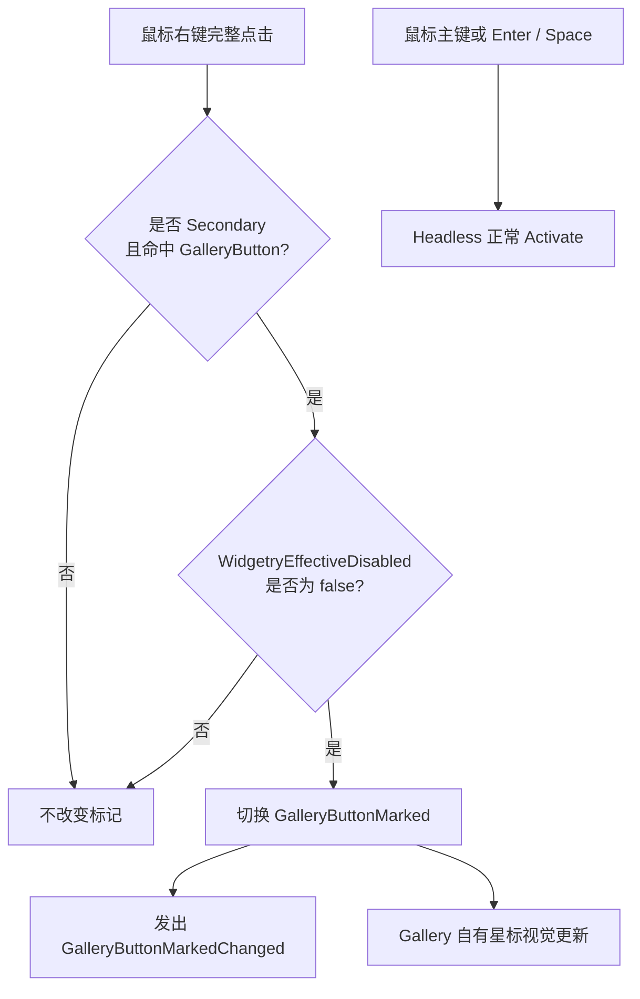

# 为 GalleryButton 扩展右键标记行为

## 设计目标

在已经能独立复用 Headless、Loading 和自定义 BSN 外观的 `GalleryButton` 上，添加一个**完全由 Gallery 实现的右键标记功能**，证明消费者能够在 Widgetry 基础行为之外自由组合新的 Component、输入 Observer、状态通知和视觉反馈，而不必修改库的内部业务语义。

这一功能没有理由进入通用 Button Headless。Headless 继续拥有主键 / 键盘激活、焦点及有效禁用；Gallery 拥有右键标记的全部逻辑，二者通过同一根 Entity 和公开状态进行协作。



## Gallery 自有状态与通知

`GalleryButtonMarked` 是 Gallery 定义的持久 Component，记录是否被标记；初始为 `false`。与 Widgetry 自有的 Loading 状态不同，这个状态的 Authority 只属于 Gallery，本次不要求把它包装成 Widgetry 公共 Setter。可以由 Gallery 的系统或 Observer 直接修改自己的 Component。

`GalleryButtonMarkedChanged { entity, marked }` 是 Gallery 自有的状态变化事件，只有标记状态成功切换时才发送。先提交新状态，再发通知；重复处理无效输入、Disabled 拦截、页面初始化或离开页面不生成虚假的变化通知。因为行为定义为“切换”，每个合法完整右键点击都使 `false → true` 或 `true → false`，通知中携带提交后的值与根 Entity。

```rust
// 表达 Gallery 自己拥有状态与事件，类型名为设计约定。
#[derive(Component, Default)]
struct GalleryButtonMarked(bool);

#[derive(EntityEvent)]
struct GalleryButtonMarkedChanged {
    entity: Entity,
    marked: bool,
}
```

Style 从持久状态读取标记，而不只响应一次性事件：已标记时在按钮**右上角显示小星标**，取消标记后隐藏。星标和相关装饰属于 GalleryButton 自有视觉子树，使用适当的非 Picking 设置，不允许它们抢占右键目标；按钮外观与 Headless 事件仍位于同一个根 Entity 上。

## 左键与右键的职责隔离

Gallery 通过 Bevy 0.20 的 `PointerClick`（或语义等价的完整 Click 输入）判断 `PointerButton::Secondary`，只在一次真正完成的右键点击后切换状态。单纯 Press、Release、拖拽中止、指针取消以及点击未完成，都不能切换。指针事件目标应对应 GalleryButton 根；如视觉子节点能够被命中，必须通过可靠的 Picking / 传播设计把事件归属到正确的根，而不把内部子节点当成另一颗按钮。

`GalleryButton` 的键盘 Enter / Space 和鼠标主键仍走 Headless 的正常 `Activate`，不借用 `GalleryButtonMarkedChanged` 来表达激活。右键只切换标记，不应触发官方 `Activate`，也不能导致主键 Pressed 视觉闪烁或持续残留。此项要求依赖第一份方案已经解决的 Bevy 原生 Button 对副键未过滤的问题：如果尚有未经过滤的原生 Button Pointer 处理器留在同一根上，Gallery 的右键 Observer 不能可靠保证这些语义，因此不能视为完成。

外部的右键 Handler 不去修改 `WidgetryButtonLoading`、`InteractionDisabled`、Headless 内部状态或默认 Style；它只维护自己的标记状态，并把新的状态交给 Gallery Style 展示。

## 有效禁用与 Loading 的交互规则

右键标记也属于用户输入，应和主键激活遵循同一份最终禁用结果。Gallery 查询根 Entity 的 `WidgetryEffectiveDisabled::is_disabled()`，而不是自己判断本地禁用标志、祖先或 Loading 字段的并集。

- 正常可用时，右键每完成一次点击便切换一次标记。
- 本地 `InteractionDisabled` 生效、祖先禁用或 Loading 的独立禁用理由生效时，右键不修改标记，也不发变化通知。
- 多个禁用原因叠加时，只清除其中一个原因不应错误允许右键；全部限制解除后才可以继续切换。
- 标记状态不因为进入或退出 Loading、Disabled 自动清零；只在用户成功右键切换或 Gallery 页面生命周期结束时改变其存在状态。

有效禁用属于 Core 已有只读 Component；GalleryButton 的根需要正常参与 UI Node / ComputedNode 与 Core Disabled 同步。任何尚未 Apply 的 Commands 都不能被当作已经生效的状态，测试应在明确的状态同步时机检查交互，不制造依赖某个 Observer 恰好先执行的时序。

## Gallery 页面与验证展示

在第三份方案的 GalleryButton 对照区域加入右键操作说明、当前已标记 / 未标记状态、可观察的标记变化信息，以及右上角星标。新增文案通过现有中文、英文语言系统提供。演示的业务事件处理可以展示变化次数或最新状态，让用户既能看到视觉，也能确认事件确实是在状态提交后发送的。

Gallery 页面仍使用原有 Button 页进入/退出机制。离页时销毁标记 Component、状态展示与相关观察者持有的页面资源；重新进入时标记应回到 `false`。无需修改默认 `WidgetryButton` 或给其他页面按钮附加右键标记。功能只存在于 Gallery 自己定义的 `GalleryButton` 上。

## 验证与完成条件

- 正常状态下，一次真实 Secondary Click 触发一次 `GalleryButtonMarkedChanged`，标记 `false → true`；再次触发 `true → false`，星标与状态显示逐次一致。左键点击和 Enter / Space 只走普通 Activate，不切换标记。
- 右键从按下到松开的完整输入过程不应产生官方 Activate，不应出现主键 Pressed 残留。Press 后取消、拖动离开目标以及无效右键输入不修改状态、不发送通知。
- 禁用本地、禁用祖先、进入 Loading，以及这些条件的组合均阻止右键切换；解除条件后恢复可用，既有标记不被错误清除。每次读取的有效禁用状态与 Core 一致。
- GalleryButton 的自定义 Loading 动画与星标显示可以共存或按 Gallery 自己的视觉规则呈现，但标记状态本身不被 Loading 改写。退出/重新进入页面时状态与通知计数恢复初值，不泄漏 Observer 或输入处理。
- Gallery 本身须编译；通过 BRP 对鼠标主键、支持时的副键、Focus、Disabled、Loading 与页面生命周期做真实 UI 输入，用 Screenshot、ECS 状态及事件结果核验。若当前 BRP 工具无法发出等价的 Secondary Click，应明确记录未验证的 GUI 行为和工具限制，并针对已知输入语义补充可确定性运行的测试；不能把主键模拟或直接写状态冒充右键 GUI 验证。
- 更新相关 i18n 文案，并在 Gallery Button 页的代码中保留可直接使用和观察的示例；不新增或恢复独立的 Gallery 功能文档。若实施中改变了库对外的 Button 契约，只同步相应的 `docs/crates/button.md` 或 `docs/architecture.md`。此项验证属于本功能增量，不独立拆成一个“最终验收”方案。

## 边界与防御性要求

不新增右键菜单系统、双击功能或通用 Button 行为扩展注册表。Gallery 的独立状态可以直接写入，但 Widgetry 自有 Loading State 必须继续通过已约定的受控 API 修改。无效、已销毁或不满足组件契约的目标不能因右键事件引发 panic 或半更新；正常的非目标和禁用输入属于静默过滤，不能被当成业务错误。