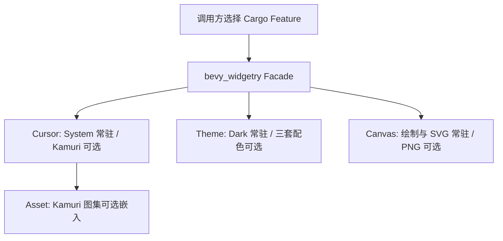

# 控件库内部功能与资源的按需编译

现有 Facade 已经通过独立的控件 Feature、optional dependency 和条件导出，让调用方选择需要的控件 crate。本组改进继续向单个 crate 内部推进，但只处理边界清晰、可以实际排除代码或嵌入资源的能力，不重做 Facade 的控件划分，也不拆 Bevy 的统一底层配置。

默认使用环境仍保留 System Cursor、Dark 配色与 Canvas 的绘制和 SVG 导出。专用的 Kamuri 动画光标、另外三套预定义配色，以及 Canvas 的异步 PNG 导出改为显式选择。三个开关相互独立：**Kamuri Cursor** 与 **Kamuri Violet Theme** 只是名称相近，不能互相启用；是否启用 Canvas PNG 导出也不应影响 Cursor 或 Theme。

图中箭头表示直接相关的 Feature 选择或传递关系，不代表所有节点之间都存在新的运行时依赖。Facade 本来就通过 Core 间接使用 Cursor、Theme 和 Asset；选择 Canvas 的方式仍沿用已有可选控件入口。Cargo Feature 具有**跨同一依赖图累加**的语义：任何依赖启用了某个功能，就不能再由另一处的 `default-features = false` 强行关闭。所以验证精简构建时，应使用不被 Gallery 或其他 Workspace 包启用功能的独立调用方，检查真实依赖图。

这三个目标按下列唯一顺序分别实施和验收。顺序只是收官工作的组织顺序，不表示 Theme 依赖 Kamuri，或 Canvas 依赖 Theme 的可选配色。

1. [01 将 Kamuri Cursor 变为默认关闭的可选编译能力](01-将-Kamuri-Cursor-变为默认关闭的可选编译能力.md)
2. [02 仅默认编译 Dark 配色并按需启用其他主题](02-仅默认编译-Dark-配色并按需启用其他主题.md)
3. [03 将 Canvas PNG 导出变为默认关闭的可选能力](03-将-Canvas-PNG-导出变为默认关闭的可选能力.md)

Waveform、Table 的内部功能与编译配置，以及内建字体的提供方式，均不在本组改动范围内。Theme 需要为各控件（包含 Waveform 和 Table）的可选主题颜色常量增加条件编译，但这不等于调整 Waveform 或 Table crate 的业务功能。Canvas 的基础模型和 SVG 导出目前也使用 `JobFailure`，因此 PNG 关闭时仍应保留共享 Job 诊断依赖；PNG 的取消/失败结果由 `CanvasPngStop` 单独表达。只做这些增量自身需要的测试与文档同步；更广泛的 Cargo Feature 组合与独立使用验收仍由收官大纲中专门的验证事项承接。
