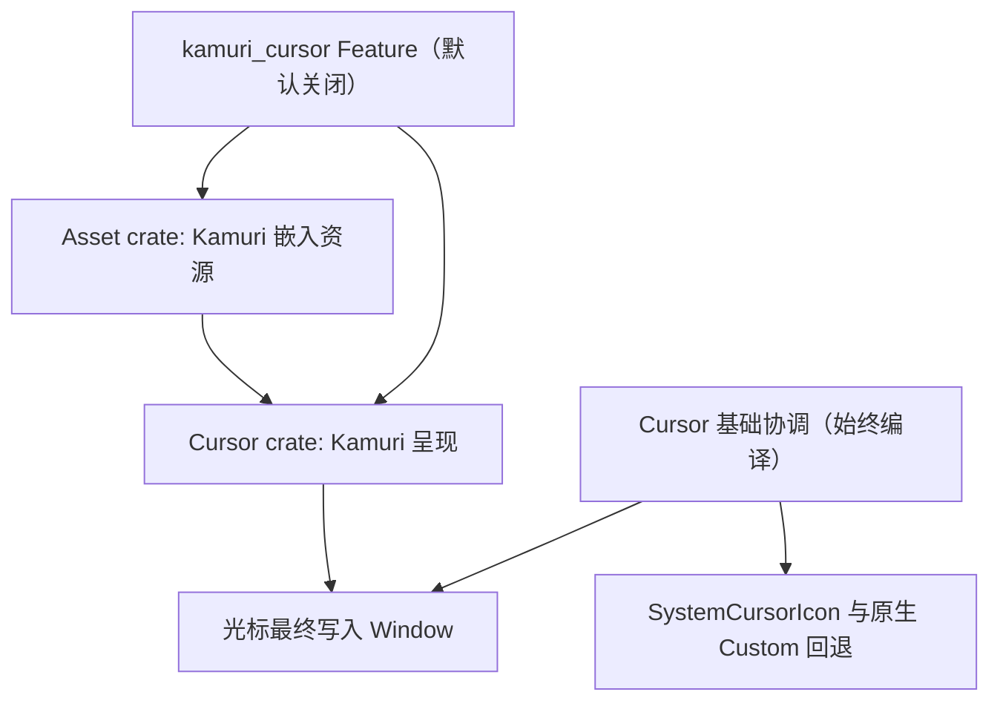

# 将 Kamuri Cursor 变为默认关闭的可选编译能力

Cursor 的必要职责是按照窗口、鼠标命中、拖拽 Lease、Disabled 与 Loading 优先级协调实际 OS 鼠标光标。System Cursor 已能完成这些职责。Kamuri 则在同一协调结果上增加自定义动态图集、播放时间、资源加载、回退与额外重绘；其 45 种动画和一张静态后备图集当前通过 Asset crate 的 `include_bytes!` 被无条件嵌入。这些资源不会因为运行时使用 System 主题而在编译阶段自动消失。

因此，保留 Cursor 的协调能力为基础功能，将 Kamuri 的呈现实现及嵌入资源绑定在**默认关闭的 `kamuri_cursor` Feature** 下；启用后仍可在运行时选择 System 或 Kamuri，不启用时仅有 System。

## 编译边界与公开语义

在 `bevy_widgetry_cursor` 定义 `kamuri_cursor` Feature，默认关闭，并通过该 Feature 显式开启 `bevy_widgetry_asset` 的对应资源 Feature；顶层 Facade 再提供同名转发入口。这样已有各控件对 Cursor、Core 的普通依赖不会自动把 Kamuri 重新带回来，而仅依赖 Facade 的调用方不必直接配置底层 crate。**Facade 默认 Feature 集合也不包含 Kamuri**，否则底层默认关闭没有实际意义。

`WidgetryCursorTheme` 默认值仍为 `System`；`Kamuri` 变体仅在 `kamuri_cursor` 打开时出现，未启用的应用不能构造 `WidgetryCursorTheme::Kamuri`。这是编译期的 API 边界，不采用“变体仍存在、运行时静默退回 System”的假开关。`WidgetryCursorHint` 的十一种业务语义、`system_fallback()`、官方 `EntityCursor::System` / `EntityCursor::Custom`、`CursorLease`、Loading 的 Wait 优先级和每窗口的所有权协调，均持续可用。System Theme 的行为不因删除 Kamuri 分支而改变，调用方原生 Custom 图像也不应被视为 Kamuri 专用能力。

`presentation.rs` 当前同时包含 `AssetServer`、`Assets<Image>`、`TextureAtlasLayout`、`Time<Real>`、`RequestRedraw`、播放状态和双层回退。关闭 Feature 时应真正移除 Kamuri 的状态与系统参数使用、资源加载、帧计算、额外动画唤醒、加载/失败诊断，而不是留下全部实现仅用运行时条件跳过。保留 System 映射的最小呈现路径，使 `coordination.rs` 的光标解析与最终写入继续工作。启用时沿用每窗口独立播放、真实时间、懒加载、静态后备图集及 System 回退的现有行为。

## Asset 中的资源编译与注册

Asset 目前在 `constants.rs` 内嵌 `KAMURI_STATIC_ATLAS`，在 `cursor_animation.rs` 内定义 45 种动画及 `KAMURI_ANIMATIONS`，并在 `WidgetryAssetPlugin::build()` 里始终注册静态图集和动画图集。需要在**常量定义、`include_bytes!`、类型/模块、公开导出、注册循环**这些位置形成一致的条件编译。只给注册循环加 `cfg` 不足以达到不嵌入素材的目标。

启用 `bevy_widgetry_cursor/kamuri_cursor` 时要传递到 Asset 的同名资源 Feature。仅使用普通 Widgetry Asset（内建图标、字体、Shader）的应用，不应顺带启用光标资源。保持 `WidgetryAssetPlugin` 对其它内建资源的既有注册职责，不改变内建字体或无关图标、Shader 的提供方式。Cursor 在 System-only 配置下也不需要为 Kamuri 额外安装动画图集相关的专用注册逻辑；但其它调用方本来需要的 Bevy Asset/Image 基础能力不能随意移除。

## Gallery、测试与独立调用方

Gallery 目前有启动光标逻辑直接设置 `WidgetryCursorTheme::Kamuri`，并提供动画光标展示，因此在 Gallery 的 Facade 依赖里**显式启用 `kamuri_cursor`**，保留其演示、切换和预览能力。Cursor / Asset 自身的 Kamuri 专用测试与 Benchmark 依实际使用设置条件编译或 `required-features`；System 的协调、Lease、原生 Custom、Disabled、Loading 以及重复 Cursor writer 冲突等基础回归，在无 Kamuri 时仍应运行。

验收分开检查：

- Cursor、Asset、Facade 的默认构建及 System-only 调用方可编译；`WidgetryCursorTheme::Kamuri` 在 Feature 关闭时不可用，`System` 和全部 Hint 正常可用。
- 显式启用后，45 种动画、后备图集、热点、播放与资源失败回退仍与现有行为一致；Gallery 的 Kamuri 演示仍可运行。
- 对精简调用方核对 Cargo Feature 图和编译输入：Kamuri 的 `include_bytes!` 不再参与，专用播放代码也不参与；比较可重复的增量构建与产物体积数据，但不预设节省幅度。
- 使用 Windows x64、Bevy 0.20 与项目约定的渲染环境检查真实 OS Cursor 行为，不以 Headless 的模拟光标事件替代窗口验证。

## 约束与边界

不拆除 Cursor 共享协调器，不重做 Picking 或 Window Cursor 所有权。Cargo Feature 只能按整个依赖图累加；若另一个调用方显式开启 Kamuri，不能承诺整个进程仍是 System-only。不要把 `kamuri_violet` 主题配色与本功能挂钩，它属于独立的 Theme Feature。
