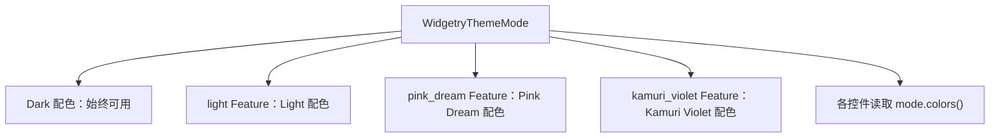

# 仅默认编译 Dark 配色并按需启用其他主题

`bevy_widgetry_theme` 当前提供 Dark、Light、Pink Dream、Kamuri Violet 四套完整的固定配色。Dark 已是 `WidgetryThemeMode` 的运行时默认值，但四套颜色定义与模式枚举当前始终编译。这里将**运行时默认 Dark**扩展成**编译时也仅保留 Dark**：需要其他配色的应用显式选择对应 Feature。

配色主要是 Rust 常量而非大量二进制素材，因此这项改动侧重清晰的 API 边界和少处理未使用代码，不声称它会像裁去 Kamuri 图集那样显著减少可执行文件体积。

## 主题模式与配色常量

Theme crate 定义三个默认关闭的 Feature：`light`、`pink_dream`、`kamuri_violet`；Dark 不需要单独开关。Facade 提供同名转发 Feature，但不把三者放进默认列表。用户仍通过 `WidgetryThemeMode` 和 `colors()` 使用已编译的主题；`WidgetryThemePlugin` 仍初始化 Dark，World/Commands setter 仍先提交模式再发送 `WidgetryThemeChanged`，合法同值不通知，缺失模式时沿用现有 `ThemeFailure` 错误语义。

在 `WidgetryThemeMode` 上分别对 `Light`、`PinkDream`、`KamuriViolet` 变体标记对应 `#[cfg(feature = "...")]`；`colors()` 的 match 分支也使用一致的条件编译。`WIDGETRY_LIGHT_THEME`、`WIDGETRY_PINK_DREAM_THEME`、`WIDGETRY_KAMURI_VIOLET_THEME` 及 `lib.rs` 的公开重导出同步条件编译。未开启某主题 Feature 时，对应枚举变体与公开主题常量应**在类型层面不存在**，直接引用会产生编译错误，不在运行时偷偷映射到 Dark。

`WidgetryTheme` 的完整颜色字段结构保持稳定，仍为各个控件定义所需的 Color Type；只裁去额外主题的颜色**值**。当前 `theme.rs` 通过每个控件的 `LIGHT`、`DARK`、`PINK_DREAM`、`KAMURI_VIOLET` 常量组合整套主题，`common.rs` 提供相应公共色值；需在这些定义、相关 import 和必要的测试引用上统一 `cfg`，避免仅屏蔽最外层常量但仍编译全部子配色。Dark 必须在全部配置下完整、无条件可用。

## Facade 与 Gallery 的使用方式

通过 Facade 转发 Theme Feature，可让普通调用方只依赖 `bevy_widgetry`，不必直接指定 `bevy_widgetry_theme`。三个可选主题可以任意独立选择，也可以全部启用；它们与 `kamuri_cursor` 没有自动启用关系。

Gallery 当前存储主题配置，并为四种模式提供选择与展示。Gallery 显式开启 `light`、`pink_dream`、`kamuri_violet`，使已有配置反序列化、运行时切换、全部主题展示及颜色演示保持原有功能。**不能因为 Gallery 需要四套主题，就把它们放回 Facade 默认集合。**

`test_utils/src/theme.rs` 的测试直接引用 Light 与 Pink Dream，Theme 自身的模式切换、对比度与常量测试也假定四种模式同时存在。测试应分成不依赖额外主题的基础契约验证，以及只有相关 Feature 打开才运行的主题扩展验证；组合测试按实际启用的模式构造，不使关闭单个主题时发生无条件引用。按需检查其他测试对已关闭枚举变体的静态引用。`test_utils` 的公共 `switch_theme(app, mode)` 接口本身不需要因为主题减少而改变。

## 验证与完成条件

- 直接构建 Theme crate 和无默认控件的 Facade：只存在 Dark 模式与完整 Dark 配色，基础插件、查询、同步/Commands setter、通知顺序和错误处理仍正常。
- 分别启用 `light`、`pink_dream`、`kamuri_violet`，验证对应模式、公开常量、各控件颜色字段与切换行为；再验证多 Feature 组合。没有启用的枚举变体和常量无法被外部代码直接引用。
- Gallery 显式启用全部主题后，已有序列化配置、四套配色切换及可视化仍保持完整；不要求修改 Gallery 原有的主题选择业务行为。
- 以独立调用方核对真实 Feature 图。Workspace 其他包（尤其是 Gallery）可能把各主题 Feature 累加起来，不能凭 Workspace 全量编译证明 Dark-only 路径生效。

## 范围限制

不改变颜色覆盖、Disabled / Focus 状态解析、各控件响应 Theme 变化的规则。不改 Waveform 或 Table crate 内部功能与 Feature；Theme crate 中它们对应的非 Dark 色值仍需条件编译。内建字体和 Cursor 图集不属于 Theme 颜色开关的控制对象。
