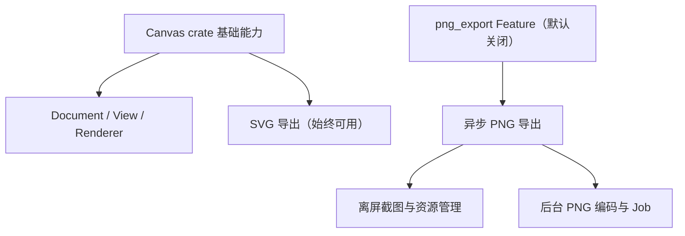

# 将 Canvas PNG 导出变为默认关闭的可选能力

Canvas 现在把图形 Document、可交互 View、SVG 矢量导出和异步 PNG 导出放在同一个 crate。即使调用方只绘制 Canvas 或导出 SVG，`export/png.rs` 的离屏截图、GPU 资源准备、分块读取、后台编码和 Job 生命周期代码仍会参与编译，`image`、`png`、`event-listener` 等依赖也被无条件声明。当前普通 Canvas 模型与 SVG 导出已统一通过 `JobFailure` 传播诊断；它并不是 PNG 专有类型，不能和 PNG 导出代码一起裁掉。

这次保留 Canvas 的基础绘制、Document 操作与 `CanvasDocument::export_svg`，将 **PNG 导出**作为默认关闭的 `png_export` Feature。导出功能被启用时沿用当前异步语义和失败传播约定，不改数据模型、渲染几何或输出格式；关闭时对应导出 API 与专用实现不参与编译。

## 编译边界与依赖

在 `bevy_widgetry_canvas` 声明默认关闭的 `png_export` Feature。`export.rs` 中的共享快照、几何序列化和 `CanvasDocument::export_svg` 继续可用；`export/png.rs`、对应安装入口、`CanvasDocument::export_png`、`CanvasPngOptions`、`CanvasPngExport`、`CanvasPngExportFinished`、`CanvasPngStop` 等仅在功能开启时编译和导出。`crates/canvas/src/lib.rs` 和 `export.rs` 的公开重导出也要同步调整，确保关闭 Feature 时这些符号确实不存在，而不是只能在运行时禁用导出系统。

当前 `CanvasDocument::export_svg` 返回 `Result<(), JobFailure>`，`CanvasDocument::export_png` 的请求入口返回 `Result<Entity, JobFailure>`。PNG 完成事件的 `result` 则是 `Result<UVec2, CanvasPngStop>`，其中 `CanvasPngStop::Canceled` 是正常取消结果，`CanvasPngStop::Failed(JobFailure)` 表示真正失败。**这些接口和语义保持原样**。不能沿用旧版设计中把 `CanvasExportError` 直接当作这两个接口的最终错误结果的假设，也不能重新把取消当作普通错误处理。

`CanvasExportError` 仍是共享导出过程中使用的错误分类，不整体隐藏。`EmptyDocument`、`InvalidDocument`、`Model(JobFailure)`、`InvalidRegion`、`UnsupportedColor`、`Io` 等 SVG 路径仍需要的分类及共享快照校验继续存在；仅用于 PNG 的 `InvalidScale`、`InvalidResolution`、`RendererUnavailable`、`Render(CanvasRenderIssue)`、`Offscreen`、`Cleanup`、`Scene`、`Encoding(image::ImageError)`、`Job`、`Background` 等变体应与对应实现一起形成一致的编译边界。当前公开的 `CanvasRenderIssue` 表达 PNG 渲染和读回的结构性失败，也应随 `png_export` 条件编译；`CanvasPngStop` 已由 PNG 模块导出。`CanvasExportError::into_failure` 的匹配分支、PNG 专用的 `with_cleanup` 等辅助实现必须同步调整，保持 SVG 错误来源链和上下文不变，避免只隐藏最外层 API 但仍保留全部 PNG 类型依赖。

`CanvasPlugin` 当前会调用 `crate::export::install(app)`，应确保 PNG 功能关闭时不会安装 PNG 导出系统，也不会由于无条件引用而编译失败。已有绘制初始化、Mesh/Material、Offscreen Target 和 SVG 导出不得因此受影响。特别是 `crate::alpha::StraightAlpha` 与 `CanvasStraightAlpha` Shader 还用于**正常 Canvas 绘制**，不能误认为它们都是 PNG 专用资源而删去。

检查 Cargo 依赖实际引用：`image`、`png`、`event-listener` 的直接使用集中于 `export/png.rs`，可考虑设为 optional，由 `png_export` 激活；若当前其余目标仍需其中某项，则保留必要依赖。**`bevy_widgetry_job` 不应变为 optional**：`canvas/src/error.rs` 的 `CanvasFailure` / `CanvasFault` 转换和 `CanvasExportError::Model(JobFailure)`、SVG 导出及共享快照本身都依赖它。这与以前把 Job 视为 PNG 专属依赖的设想不同。

判断编译收益时应观察真实 Cargo 依赖图：Workspace 的 Bevy 配置本身启用了 `png`，其它控件也可能间接依赖图像或事件相关 crate；关闭 Canvas 的直接依赖边与 PNG 模块，能够减少 Canvas 自身的编译范围，但不能据此断言整个应用完全不编译 `image` 或 `png`。

Facade 继续以已有 `canvas` Feature 控制是否编译 Canvas crate，另提供清楚表达用途的 `canvas_png_export` 转发入口，关联 Canvas 的 `png_export`；不将 PNG 导出加入 Facade 的默认功能。选择该转发入口时应确保 Canvas 自身也可用，不能产生“PNG Feature 开了但 Canvas 模块没导出”的组合。Canvas crate 的直接用户也可以单独启用其 `png_export`。

## Gallery 与测试目标

Gallery 的 Canvas 页面既调用 `CanvasDocument::export_svg`，也调用 `CanvasDocument::export_png` 并接收 `CanvasPngExportFinished`，还在演示和测试中处理 `CanvasPngStop::{Canceled, Failed}`、`JobFailure` 以及模拟完成事件。因此 Gallery 显式启用 Facade 的 `canvas_png_export`，保持当前导出按钮、后台任务回收、实际失败的 `record_handled` 与完成通知行为，不因为库默认关闭 PNG 而删除演示功能。Gallery 当前还使用独立的 Asset 和 Waveform File crate；这部分现有依赖不作为 PNG Feature 的连带修改对象。

Canvas 的 `png_export` Benchmark 只在 `png_export` Feature 开启时才有意义，需通过 `required-features = ["png_export"]` 或等价方式保护其构建目标。`export/png.rs` 中已有大量 PNG 专用单测，随模块自然条件编译；Gallery 中模拟 `CanvasPngExportFinished` 和 `CanvasPngStop` 的测试也应由 Gallery 显式开启该 Feature 来保留。基础 Canvas 绘制、模型操作、SVG 导出与其它 Benchmark 在不启用 PNG 时仍正常构建。

功能开启时，保留 PNG 请求先返回 `JobFailure` 的校验与错误上下文、共享 JobManager、单 Job 的分块读回与流式编码、取消与资源回收、`CanvasPngStop::Failed(JobFailure)` 的原始诊断，以及完成事件的单次通知等既有契约。与 GPU / RenderApp / DX12 有关的真实导出验证不能仅由 Headless 测试替代。

## 验证与完成条件

- `bevy_widgetry_canvas` 默认关闭 `png_export` 时，Canvas View/Document 与 `export_svg` 可编译、可运行；PNG API 和导出专用系统不在构建中，无默认 Feature 的库测试与 `--all-targets` 不被 PNG Benchmark 无条件引用阻断。
- 单独启用 `png_export` 后，PNG 导出公开 API、`CanvasPngStop` 的取消/失败区分、`CanvasRenderIssue` 错误分类、导出完成事件、分块编码、取消与资源清理契约保持原样；Gallery 导出 PNG 和 SVG 均可完成。
- 核对精简调用方的 Cargo Feature 图和编译输入，确认 PNG 专用模块和可以排除的直接依赖已移出基础路径，同时 `bevy_widgetry_job` 与 SVG 的 `JobFailure` 诊断仍可用；记录具有可比构建条件的编译和产物体积差异，不预设幅度。
- 通过 Windows x64、Bevy 0.20 和项目的 DX12 环境验证涉及 GPU 截图、RenderApp 与文件落盘的真实导出路径；Headless 测试不替代真实图形导出验证。

## 范围限制

不顺带拆分 Canvas 的绘制工具、形状、SVG 导出、公共错误体系或 Shader；不重新设计 PNG 流水线、统一的 `JobFailure` 诊断、后台 Job 与失败清理契约。`crate::alpha::StraightAlpha` 以及对应 Shader 仍是正常绘制路径的一部分，不能随着 PNG 导出一起删除。不对 Waveform、Table 或内建字体建立额外 Feature，也不改它们的内部实现。Cargo Feature 在整个依赖图中累加，因此需要使用独立消费方验证 PNG-off 构建，避免 Gallery 显式开启 PNG 后掩盖基础配置。
