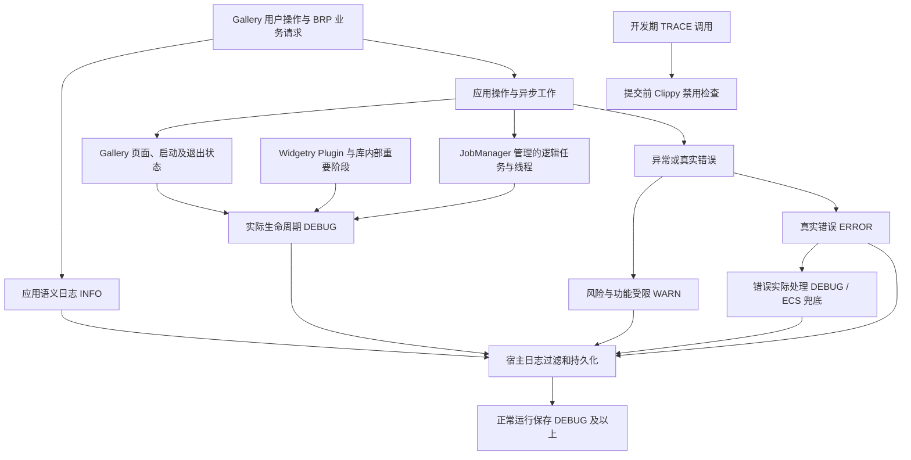

# 运行日志规范落地的整体设计

现有 `rules/logging.md` 已定义统一的五级日志语义，以及 Widgetry 库和 Gallery／业务应用各自负责的记录边界。真正需要改动的是具体日志入口、宿主过滤条件以及已有业务处理路径中的记录时机，而不是重新发明一套日志规范。

这里把日志视为两类正常事实与一类异常诊断：应用层知道用户或远程请求想做什么，用 INFO 描述语义操作和最终业务结果；负责运行状态的模块知道程序实际做到了哪一步，用 DEBUG 描述生命周期、状态转换、任务启动和终结。异常风险用 WARN，真实失败首次发生用 ERROR，并保持 `rules/code.md` 的错误 ID、传播和处理约定。临时高频诊断才使用 TRACE，最终实现代码不保留调用。

正常日志不能取代 Event、Message、Profiler 或程序自己的操作状态。日志应写在真正掌握事件含义的处理点，不引入额外轮询、逐帧输入监听或业务状态；一条用户操作 INFO 可以和多个实际执行阶段 DEBUG 关联，但不能把“已请求”写成“已完成”。

## 目标之间的真实关系

宏和 Lint 负责限定合法日志入口；宿主日志配置决定这些事件是否能被真实保存。Widgetry Plugin 与 JobManager 可以独立产生自己的 DEBUG，Gallery 则在页面导航、设置、应用生命周期及各个业务示例中使用这些约定。JobManager 的 `JobId` 是 Gallery Job、Waveform 后台打开以及异步文件操作能够共享的执行身份，但 Gallery 不应由 JobManager 推测用户业务动作。

Gallery 页面操作彼此属于独立业务流程，因此按增量分别交付。导航与设置、退出与托盘、Slider、ScrollArea、Job、Waveform、普通 Canvas 导出、BRP Canvas 阶段导出、BRP 会话与绘图批次可以分别验证；它们遵循同一日志语义，但不存在必须修改对方业务逻辑的依赖。序号是唯一的实施顺序，不把这种顺序误写成架构依赖。

测试直接归入每个实际增量：宏与 Clippy 检查独立验证、文件层过滤做真实读盘验证、JobManager 检查终态和取消先后、Gallery 使用业务事件／BRP 与必要的真实窗口操作确认行为。原有错误诊断机制及日志写入可靠性不在此次重构范围。

## 实施方案（唯一顺序）

1. [增加 TRACE 临时诊断宏与 Clippy 禁用约束](01-增加TRACE临时诊断宏与Clippy禁用约束.md)
2. [让宿主完整保存正常运行 DEBUG](02-让宿主完整保存正常运行DEBUG.md)
3. [统一 Widgetry Plugin 注册日志等级](03-统一WidgetryPlugin注册日志等级.md)
4. [为 JobManager 的业务任务生命周期补齐 DEBUG](04-为JobManager业务任务生命周期补齐DEBUG.md)
5. [记录 Gallery 启动就绪与结束阶段](05-记录Gallery启动就绪与结束阶段.md)
6. [分离 Gallery 导航意图与页面实际切换](06-分离Gallery导航意图与页面实际切换.md)
7. [完善 Gallery 设置操作的意图与结果记录](07-完善Gallery设置操作的意图与结果记录.md)
8. [完善 Gallery 托盘与退出流程的分层日志](08-完善Gallery托盘与退出流程的分层日志.md)
9. [补齐 Slider 拖动操作的语义结果日志](09-补齐Slider拖动操作的语义结果日志.md)
10. [补齐 ScrollArea 按钮的业务操作日志](10-补齐ScrollArea按钮的业务操作日志.md)
11. [完善 Gallery Job 演示操作与终态日志](11-完善GalleryJob演示操作与终态日志.md)
12. [关联 Waveform 录制文件重载与后台打开结果](12-关联Waveform录制文件重载与后台打开结果.md)
13. [完善 Gallery Canvas 文件导出的分阶段日志](13-完善GalleryCanvas文件导出的分阶段日志.md)
14. [完善 BRP Canvas 阶段导出的操作及结果日志](14-完善BRPCanvas阶段导出的操作及结果日志.md)
15. [补齐 BRP Canvas 会话与显式保存日志](15-补齐BRPCanvas会话与显式保存日志.md)
16. [区分 BRP Canvas 绘图批次结果与异常](16-区分BRPCanvas绘图批次结果与异常.md)
