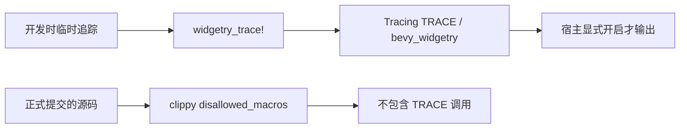

# 增加 TRACE 临时诊断宏与 Clippy 禁用约束

## 目标与设计思路

使 Widgetry 库在开发过程中能够通过统一入口发出 TRACE，同时保证正式提交的实现代码不会遗留 TRACE 调用。这是一个可以独立交付的日志入口与静态约束增量，不改变运行期错误记录，也不要求在生产路径实际添加 TRACE。

已有 `internal_log` 提供 `widgetry_debug!`、`widgetry_info!`、`widgetry_warn!`、`widgetry_error!`，都通过 Tracing 发出 `target: "bevy_widgetry"` 的事件；而 `rules/logging.md` 已经正式列出 `widgetry_trace!`。缺口是宏实现、Clippy 配置和对应文档尚未对齐。

## 日志宏与约束

在 `crates/internal_log/src/lib.rs` 按现有四个宏的形式增加 `#[macro_export]` 的 `widgetry_trace!`。它仅向 `$crate::__log::trace!` 转发 Token Tree，保持 `target: "bevy_widgetry"`，允许消息和 Tracing 的结构化字段，保留调用处的原生元数据。现有四个宏和 `__log` 的职责不变；无需建立新 Subscriber、Feature 开关、全局日志状态或包装类型。

宏定义可以永久保留，**宏调用不能永久保留**。开发期间可以临时在高频诊断处使用 `widgetry_trace!` 或 Bevy/Tracing `trace!`；任务正式提交前必须删去这些调用，而不是使用 `#[cfg(debug_assertions)]`、运行期过滤或大量 `#[allow]` 将其掩盖。普通 Pointer、Hover、逐帧更新等默认仍不产生日志；即使开发期间使用 TRACE，也必须有明确诊断目的。

在根目录 `clippy.toml` 已存在的 `disallowed-macros` 中加入内部 TRACE 与代码可能使用的 Tracing／Bevy TRACE 宏路径。根目录 `Cargo.toml` 已经把 `clippy::disallowed_macros` 设为 `deny`，直接复用，不开发新 Lint、Dylint 或自定义扫描工具。明确排除**宏定义**本身，不误伤普通文字或注释。配置路径应根据当前实际可解析的宏导出路径确定，遇到某个 crate 不依赖该宏时按 Clippy 支持的 `allow-invalid` 语义精确处理，而不是让整个检查失效。

Clippy 已有测试模块为断言而局部允许 `disallowed_macros`，这些例外不得被扩大成生产实现的 TRACE 豁免。需要通过实际的正反例验证：宏定义存在时通过检查；在普通生产函数中放入任一被禁止的 TRACE 调用时 Clippy 必须失败；从源码移除后恢复通过。临时验证代码在此增量验收完成前清理。

## 文档与完成条件

同步 `docs/crates/internal_log.md`：补齐第五个宏，改掉“DEBUG 只用于错误实际处理”的旧描述，明确 DEBUG 可用于有意义的内部生命周期、TRACE 仅临时调试且提交前删除。`rules/logging.md` 已经规定了这些语义，不再复制或重写规范。

完成时应能确认五个宏在允许的使用阶段共享正确 Target 和结构化字段能力；Clippy 禁止正式 TRACE 调用但不会阻止宏定义；现有 DEBUG／INFO／WARN／ERROR 的消息行为不变。使用 Workspace 现有 Clippy 命令并在需要时进行专门的拒绝样例验证，不引入新的构建基础设施。
