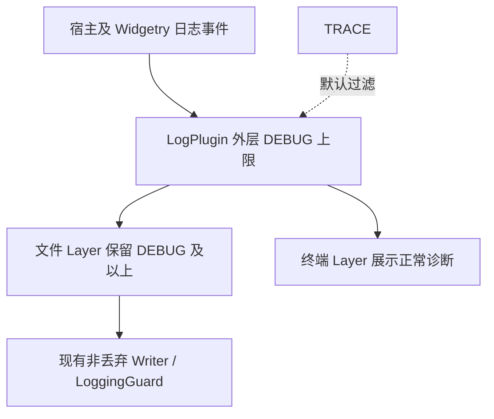

# 让宿主完整保存正常运行 DEBUG

## 目标与设计思路

使 `app_logging` 这一可选宿主配置在正常运行时保存 DEBUG、INFO、WARN、ERROR，TRACE 默认不输出。这是日志语义变更的前置能力：否则后续补充的 Plugin、JobManager、页面及退出 DEBUG 即使正确发出，也无法在日志文件中看到。

目前 `crates/app_logging/src/logging.rs` 的 `log_plugin()` 外层 Level 已设为 DEBUG，但文件层实际只保留 INFO 及以上，外加同时带 `error_id` 和 `phase` 字段的 DEBUG。普通生命周期 DEBUG 被明确滤掉。终端层也只保留 INFO 及以上。因此要调整的是过滤语义，**不是**日志 Writer、Flush、队列或 Error Handler 的机制。

## 过滤行为

`file_layer` 不能再根据 `error_id`、`phase` 判断 DEBUG 是否值得保存。已确认的正常运行 DEBUG（如 `"应用启动完成"` 或 `"任务已取消"`）和实际错误处理 DEBUG 必须拥有同等保存资格。文件层默认接受 ERROR、WARN、INFO、DEBUG；TRACE 保持默认关闭，只有宿主明确开启开发诊断时才允许输出。

终端层当前只接受 INFO 及以上，这种与文件层不同的策略可由宿主决定；本增量优先保证**文件完整保存**。若应用采用“常规日志不按等级过滤、只关闭 TRACE”的默认展示策略，可以同步允许 DEBUG 出现在终端，但不得以终端是否打印来代替文件验收。第三方框架输出量应通过对应 Target 的独立过滤配置管理，不得为减少第三方噪声重新过滤掉所有应用自身 DEBUG，也不应把 `app_logging` 硬编码为只支持 Gallery Target。

保留 Bevy 官方 LogPlugin 的安装方式、外层 Subscriber 装配、`RUST_LOG` 等宿主显式覆盖能力。`AppLogging::new`、`install`、`LoggingGuard::finish`、有界 non-lossy Writer、错误时独立 stderr 和原有 Backtrace 机制不变。避免因为加入正常 DEBUG 使日志可靠性退化，尤其不能改为缓冲区满时静默丢失必要错误记录。

## 验证与文档

修改 `crates/app_logging/tests/app_logging.rs` 的真实读盘测试：当前测试故意发出普通 `debug!(target: "ordinary_module", "普通模块DEBUG过滤验证")`，并断言文件**不包含**它；要改为断言包含。同时保留带 `error_id`、`phase` 的处理 DEBUG、INFO、ERROR、带 Backtrace 的最终 ERROR，并增加 TRACE 默认不入文件的验证。分别覆盖 `bevy_widgetry` Target 和宿主自身非错误模块 Target，不能只检查错误诊断通道。测试继续验证时间格式、源文件位置、ANSI 处理和关闭刷盘；不因过滤改动重做非丢弃 Writer 设计。

同步 `docs/crates/app_logging.md` 和 `docs/gallery.md` 中“仅保存错误诊断 DEBUG”的旧说明，准确描述新的默认保留等级与宿主配置权。验证由真正的 `log_plugin()` + `file_layer` + 文件读取完成，不能只单独调用过滤表达式；异常写入和 Flush 的现有测试应维持通过。
