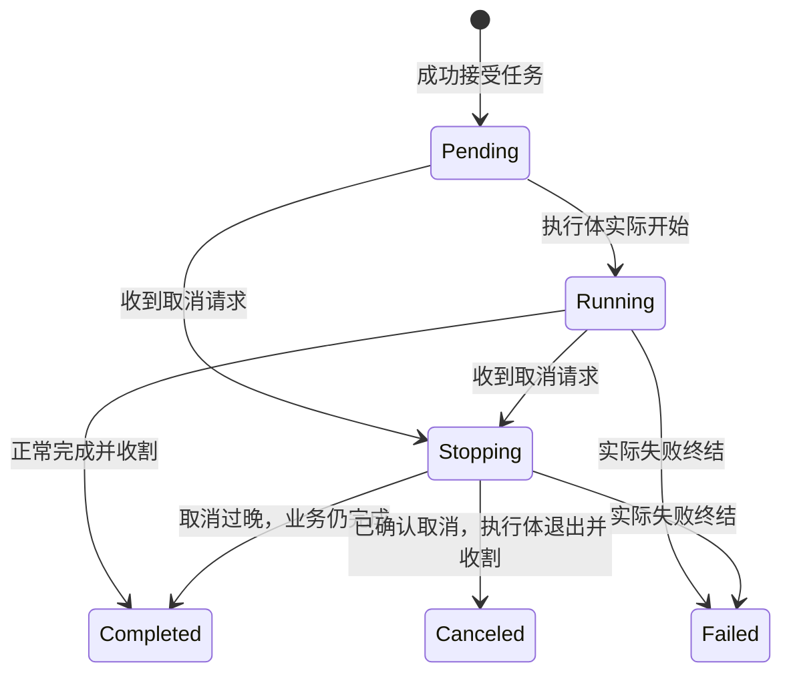

# 为 JobManager 业务任务生命周期补齐 DEBUG

## 目标与设计思路

JobManager 是当前项目对明确提交的逻辑后台工作的统一管理入口。它已经拥有 `JobId`、`JobKind`、可选 `JobOptions::label`、可协作取消的生命周期，以及线程真实 Join 后才能公布终态的机制，但目前主要依赖状态查询和 Tracing Span，没有完整的 DEBUG 事件轨迹。该增量只在状态**真实发生变化**的关键点增加 DEBUG，不改变管理器状态机，也不把内部轮询日志化。

这张图强调：`Stopping` 只是取消申请成立，不等于 `Canceled`；任务返回与注册表公布终态也有时间差。特别是 `Thread`，必须等待操作系统确认真正退出并完成 Join，不能在工作闭包返回时提前输出“线程已回收”。

## 状态记录位置

在 `crates/job/src/manager.rs` 及已有生命周期边界中，以实际状态转换为依据发出一次性 DEBUG：

- **成功接受任务**：已分配 `JobId` 并完成注册时，记录任务种类、可选 Label 和 ID。提交失败保留现有 ERROR／错误传播，不能写成启动成功。
- **实际开始执行**：在 `Lifecycle::start()` 确实由 Pending 转为 Running 时记录；已被取消而跳过业务闭包的任务不得虚构 Running。
- **取消请求成立**：仅 `CancelResult::CancelRequested` 记录“请求取消”；重复请求返回 `AlreadyStopping`、终态返回 `AlreadyFinished` 不重复写成新取消。由 `begin_shutdown` 批量取消的任务遵守同一语义。
- **工作体退出**：专属线程工作体结束与真正 Join 是两种事实。必要时分别记录“工作体退出”和“线程已回收”；不能以执行闭包返回代替 Join 结果。
- **实际终态**：在任务真正被收割并通过 `Lifecycle::finish` 确立不可逆状态后记录一次 `Completed`、`Canceled` 或 `Failed`。取消后仍 Completed、失败后 Failed 都按实际结果记录。失败 DEBUG 只记录执行阶段及 ID／结果，不重复首次错误的原因或完整 Backtrace。
- **关闭协作**：`begin_shutdown` 首次接受关闭请求时记录协调开始与活跃任务数；真正全部结束时记录完成。重复查询、定时推进、再次 `begin_shutdown` 不重复打印。超时若构成运行风险应由掌握异常语义的模块按 WARN 处理，而不是把每轮检查写成 WARN。

在已有 `tracing::info_span!(target: "bevy_widgetry", "job", job_id=...)` 上可以继续保留结构化上下文，但 Span 本身不能替代事件。新增事件使用 Widgetry 内部 `widgetry_debug!`，保留 `target: "bevy_widgetry"`，附上 `job_id`、`kind`、可用 `label`、`state`／`outcome`。不要为了日志向公开 `JobContext` 增加操作 ID 或修改 `JobId` 分配机制；上层关联用户操作时直接使用已经存在的 JobId。

## 并发、取消与错误边界

- `JobManager` 可能被多个线程调用。每个阶段的“一次”以既有状态转换及同步边界为依据，避免在 `Record::reap` 多次被查询时重复输出；不要为了日志新增全局去重器。
- `Io`／`Cpu` Future 通过任务池执行，普通轮询、结果 Item、广播背压和 Winit WakeUp 不记日志；`Thread` 记录专属线程的实际执行和回收，不记录线程池自己的 Worker 生命周期。
- `acknowledge_cancel()` 只表明执行体承诺协作取消，不是最终 Canceled；已提交的业务副作用不因取消请求自动回滚。
- `JobOutcome::Failed` 的真实失败仍由现有 `JobFailure` 创建源头 ERROR、传播上下文、在实际处理时记录处理 DEBUG。新增生命周期 DEBUG 不得触发第二份同源 ERROR，不得吞掉原诊断。
- `crates/job/src/wake.rs` 在先前的主循环唤醒回调失败、之后重新投递成功时，目前通过 `widgetry_info!` 记录“Job 主循环唤醒已恢复”；这一持续异常的实际恢复也应改为 `widgetry_debug!`，并且仅在从故障状态转换为正常状态时记录。`collect_thread_with_wait` 发现退出查询曾失败但最终成功 Join 时，目前通过 `widgetry_info!` 记录“Job 线程退出查询已恢复并完成回收”。这是程序内部恢复，不是用户操作，改为 `widgetry_debug!`；继续保留原有失败的源头 ERROR、`error_id`、实际 `record_handled` DEBUG 和最终 `JobOutcome::Failed`，不能因为成功 Join 就掩盖之前发生的真实错误。

新增日志正文统一中文，动态上下文使用英文结构化字段；只记录必要的对象身份、状态和结果摘要，不打印完整用户输入、敏感内容或大体量业务数据，也不手动重复 Tracing 已提供的 `file`、`line`、`module_path`、`crate_name` 等元数据。

## 验证

优先利用 `crates/job/tests/execution.rs`、`cancellation.rs`、`threads.rs`、`shutdown.rs` 的现有可控时序场景，以及 `bevy_widgetry_test_utils::LogCapture`：验证接受／Running／终态有正确 `job_id` 且顺序可信；重复 `status`／`reap` 不重复终态；Pending 取消不出现伪造 Running；取消请求后仍正常 Completed 的场景不记录 Canceled；真正确认并收割后的取消才记录 Canceled；线程日志不会在 Join 之前宣称完成；关闭的重复申请和超时后的完成不导致日志风暴。保留现有失败 ID、Error Severity、ShutdownHandle 消息及线程收割测试。

同步 `docs/crates/job.md` 中新增的实际可观察生命周期日志行为。工程验证在支持的 Windows 64 位环境完成，不改变任务 API、取消协议、调度时机、超时定义、WakeUp 行为或公开状态枚举。
